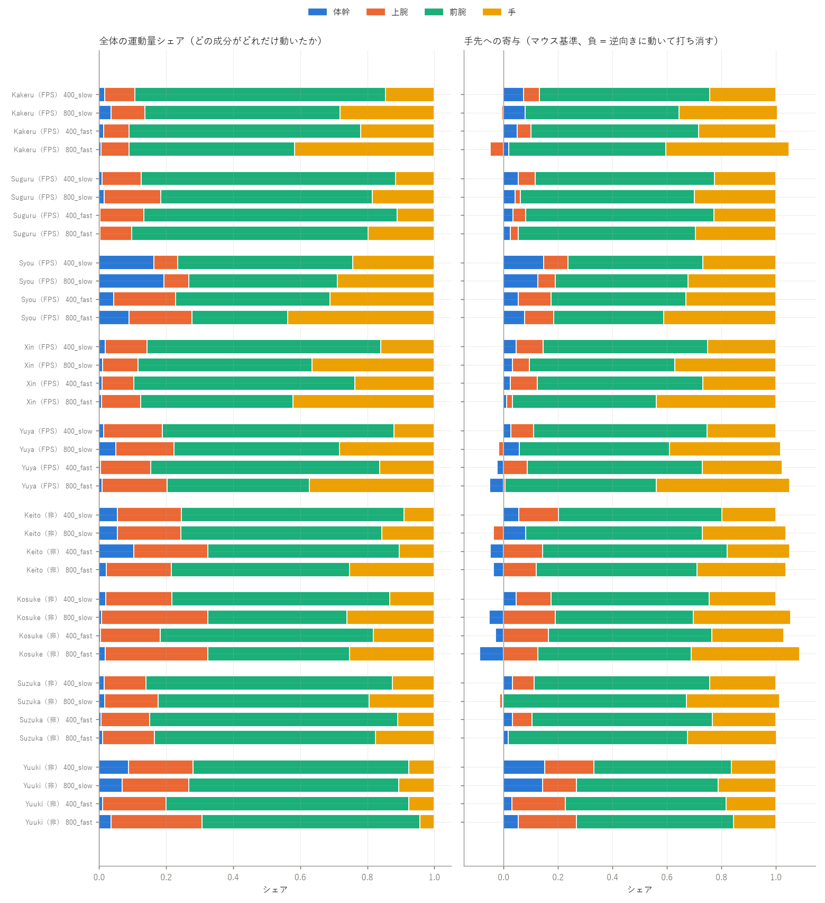
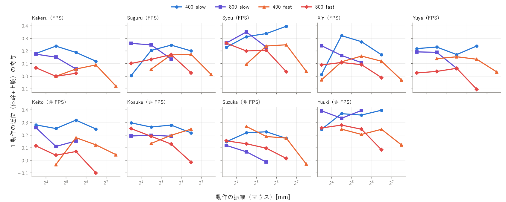
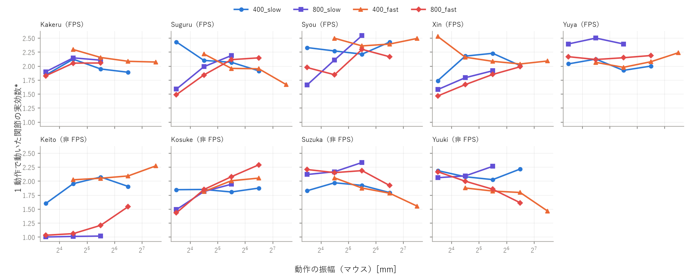
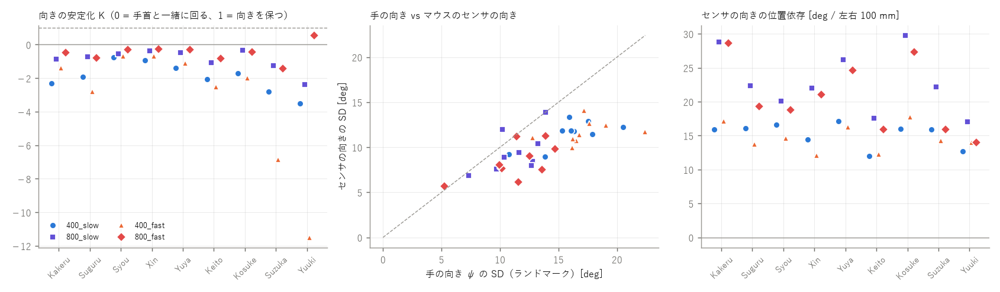
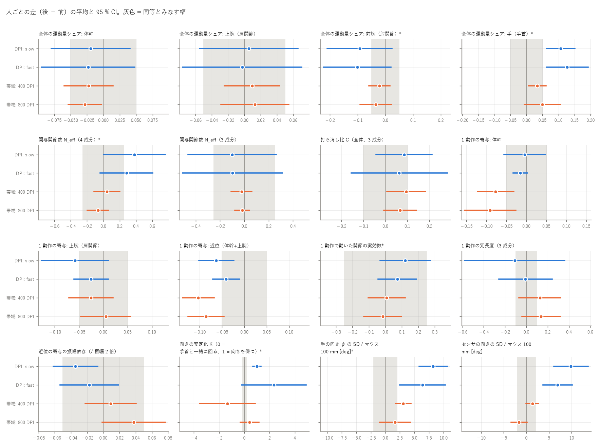
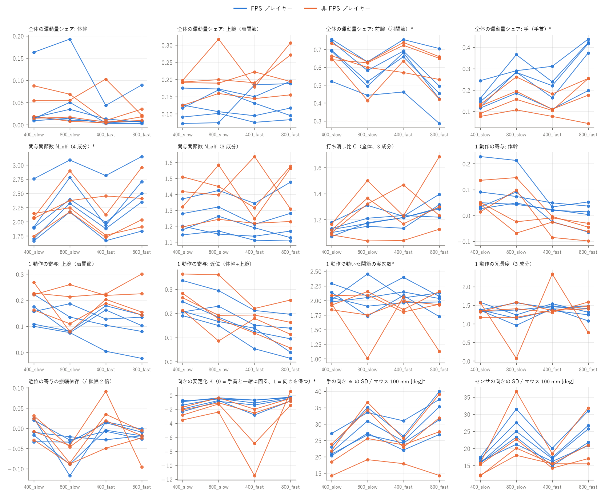
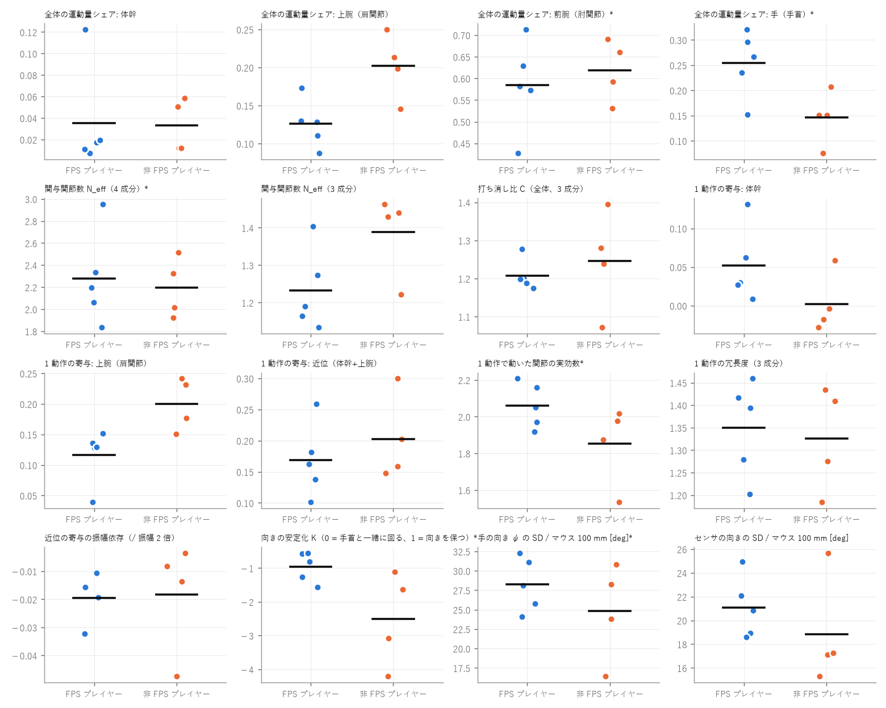

# 上肢の関節協調の解析（coord_eval）

- 参加者 9 人（FPS プレイヤー: Kakeru, Suguru, Syou, Xin, Yuya、非 FPS プレイヤー: Keito, Kosuke, Suzuka, Yuuki）
- 本番試行 108 本、1 動作 8325 個（有効）/ 8453 個
- 条件: 400_slow, 800_slow, 400_fast, 800_fast（DPI_帯域）。各条件 seed 3 本の平均を人の値とする
- 偏りの補正: あり（擬似データ 2 回）
- 【参考】= 手首・MCP3（MediaPipe Hand）を使う指標。MoCap でまだ照合できていないので主結論には使わない
- 方法の詳細と旧プログラムとの対応は `coord_eval/README.md`

## 0. データの点検

印の付いた試行 6 本（除外はしていない。除外するときは config.EXCLUDE）:

| 参加者 | DPI | 試行 | 印 | ゲイン | 手首の有効率 % | 左右の取り違え % |
|---|---|---|---|---|---|---|
| Kakeru | 800 | trial_04_fast_s1 | gain | 0.49 | 100 | 0.0 |
| Kakeru | 800 | trial_05_fast_s2 | gain | 0.47 | 100 | 0.0 |
| Kakeru | 800 | trial_06_fast_s3 | gain | 0.48 | 100 | 0.0 |
| Syou | 800 | trial_06_fast_s3 | gain | 0.50 | 100 | 0.0 |
| Yuya | 800 | trial_04_fast_s1 | gain | 0.49 | 100 | 0.0 |
| Yuya | 800 | trial_05_fast_s2 | gain | 0.44 | 100 | 0.0 |

机の座標系（セッションごと）とノイズ床:

| 参加者 | DPI | ゲイン x | ゲイン y | 軸のなす角 | 残差 mm | ノイズ 上腕 mm | ノイズ 手先 mm | ノイズ ψ deg |
|---|---|---|---|---|---|---|---|---|
| Kakeru | 400 | 0.64 | 0.97 | 88 | 44.0 | 2.3 | 1.3 | 0.4 |
| Kakeru | 800 | 0.52 | 0.95 | 93 | 19.1 | 2.1 | 1.4 | 0.6 |
| Keito | 400 | 0.74 | 0.99 | 86 | 31.4 | 8.3 | 1.3 | 0.5 |
| Keito | 800 | 0.62 | 0.93 | 85 | 14.6 | 38.7 | 1.4 | 0.5 |
| Kosuke | 400 | 0.69 | 0.98 | 85 | 37.6 | 5.5 | 1.1 | 0.4 |
| Kosuke | 800 | 0.55 | 0.85 | 99 | 11.5 | 7.1 | 1.7 | 0.6 |
| Suguru | 400 | 0.74 | 1.01 | 84 | 44.5 | 2.4 | 1.0 | 0.3 |
| Suguru | 800 | 0.66 | 1.03 | 87 | 24.5 | 4.1 | 1.8 | 0.3 |
| Suzuka | 400 | 0.73 | 1.01 | 90 | 26.2 | 2.4 | 1.7 | 0.5 |
| Suzuka | 800 | 0.67 | 1.00 | 91 | 9.6 | 2.4 | 1.3 | 0.4 |
| Syou | 400 | 0.60 | 1.02 | 85 | 37.9 | 3.5 | 1.7 | 0.6 |
| Syou | 800 | 0.58 | 1.09 | 87 | 10.9 | 7.4 | 1.7 | 0.9 |
| Xin | 400 | 0.66 | 0.97 | 76 | 39.9 | 4.2 | 0.9 | 0.4 |
| Xin | 800 | 0.59 | 1.00 | 75 | 16.9 | 5.2 | 1.1 | 0.3 |
| Yuuki | 400 | 0.77 | 1.00 | 93 | 23.4 | 2.5 | 0.8 | 0.2 |
| Yuuki | 800 | 0.74 | 1.05 | 89 | 7.9 | 2.4 | 0.9 | 0.2 |
| Yuya | 400 | 0.67 | 0.93 | 94 | 44.5 | 2.2 | 1.4 | 0.3 |
| Yuya | 800 | 0.53 | 0.93 | 87 | 18.0 | 2.6 | 0.9 | 0.3 |
| test | 800 | – | – | – | – | – | – | – |

ゲイン = マウス 1 mm あたりカメラの palm が何 mm 動いたか（1 に近いほどよい。軸のなす角は 90° が理想）。

## 1. H1a 全体を通した関節の寄与

**運動量シェア** = 各成分（体幹・上腕・前腕・手）の変位のうち課題の入力周波数に乗ったパワーの割合（近傍の周波数のノイズを引く。和 = 1）。「全体の関節移動に対してその関節がどれだけ動いたか」。  
**手先への寄与** = 各成分の変位をマウスの動きに射影した割合（和 = 1、負 = 手先と逆向きに動いて他の成分を打ち消す）。マウスはカメラと独立に測っているので、カメラのノイズは平均で消える。

| 群 | 条件 | 運動量 体幹 | 運動量 上腕 | 運動量 前腕 | 運動量 手 | 寄与 体幹 | 寄与 上腕 | 寄与 前腕 | 寄与 手 | N_eff | N_eff(3) | C(3) |
|---|---|---|---|---|---|---|---|---|---|---|---|---|
| FPS プレイヤー | 400_slow | 0.04 | 0.12 | 0.68 | 0.16 | 0.07 | 0.08 | 0.60 | 0.25 | 1.99 | 1.23 | 1.12 |
| FPS プレイヤー | 800_slow | 0.06 | 0.12 | 0.53 | 0.28 | 0.07 | 0.02 | 0.56 | 0.35 | 2.55 | 1.27 | 1.20 |
| FPS プレイヤー | 400_fast | 0.01 | 0.13 | 0.65 | 0.21 | 0.03 | 0.08 | 0.61 | 0.28 | 2.06 | 1.20 | 1.20 |
| FPS プレイヤー | 800_fast | 0.02 | 0.14 | 0.47 | 0.37 | 0.02 | 0.02 | 0.54 | 0.42 | 2.51 | 1.23 | 1.30 |
| 非 FPS プレイヤー | 400_slow | 0.04 | 0.18 | 0.67 | 0.11 | 0.07 | 0.13 | 0.58 | 0.21 | 2.01 | 1.36 | 1.12 |
| 非 FPS プレイヤー | 800_slow | 0.04 | 0.22 | 0.57 | 0.18 | 0.04 | 0.07 | 0.59 | 0.30 | 2.42 | 1.42 | 1.31 |
| 非 FPS プレイヤー | 400_fast | 0.03 | 0.18 | 0.67 | 0.12 | -0.00 | 0.14 | 0.63 | 0.23 | 2.02 | 1.35 | 1.23 |
| 非 FPS プレイヤー | 800_fast | 0.02 | 0.23 | 0.57 | 0.18 | -0.01 | 0.11 | 0.60 | 0.30 | 2.33 | 1.42 | 1.34 |
| 全員 | 400_slow | 0.04 | 0.14 | 0.68 | 0.13 | 0.07 | 0.10 | 0.59 | 0.23 | 2.00 | 1.29 | 1.12 |
| 全員 | 800_slow | 0.05 | 0.17 | 0.55 | 0.24 | 0.06 | 0.04 | 0.57 | 0.33 | 2.49 | 1.33 | 1.25 |
| 全員 | 400_fast | 0.02 | 0.15 | 0.66 | 0.17 | 0.01 | 0.11 | 0.62 | 0.26 | 2.04 | 1.27 | 1.21 |
| 全員 | 800_fast | 0.02 | 0.18 | 0.51 | 0.29 | 0.00 | 0.06 | 0.57 | 0.37 | 2.43 | 1.32 | 1.32 |

前腕・手の列と N_eff（4 成分）は【参考】。N_eff(3) と C(3) は手首の点を使わない 3 成分（体幹・上腕・肘→MCP3）。

人ごと（全条件の平均）:

| 参加者 | 群 | 運動量 体幹 | 運動量 上腕 | 運動量 前腕 | 運動量 手 | 寄与 体幹 | 寄与 上腕 | 寄与 肘→MCP3 | N_eff(3) | C(3) |
|---|---|---|---|---|---|---|---|---|---|---|
| Kakeru | FPS | 0.02 | 0.09 | 0.63 | 0.27 | 0.06 | 0.01 | 0.93 | 1.13 | 1.20 |
| Keito | nonFPS | 0.06 | 0.20 | 0.59 | 0.15 | 0.01 | 0.09 | 0.89 | 1.44 | 1.28 |
| Kosuke | nonFPS | 0.01 | 0.25 | 0.53 | 0.21 | -0.03 | 0.15 | 0.88 | 1.43 | 1.40 |
| Suguru | FPS | 0.01 | 0.13 | 0.71 | 0.15 | 0.04 | 0.04 | 0.92 | 1.19 | 1.20 |
| Suzuka | nonFPS | 0.01 | 0.15 | 0.69 | 0.15 | 0.02 | 0.04 | 0.95 | 1.22 | 1.24 |
| Syou | FPS | 0.12 | 0.13 | 0.43 | 0.32 | 0.10 | 0.10 | 0.80 | 1.40 | 1.19 |
| Xin | FPS | 0.01 | 0.11 | 0.58 | 0.30 | 0.03 | 0.07 | 0.90 | 1.16 | 1.17 |
| Yuuki | nonFPS | 0.05 | 0.21 | 0.66 | 0.08 | 0.09 | 0.18 | 0.73 | 1.46 | 1.07 |
| Yuya | FPS | 0.02 | 0.17 | 0.57 | 0.24 | 0.00 | 0.04 | 0.96 | 1.27 | 1.28 |

## 2. H1b 1 動作（A → B）の中での関節の寄与と協調

課題は連続追従なので、マウスの速さの谷で区切った「ほぼまっすぐな 1 回の移動」を 1 動作とした（0.2–4.0 s、正味 8.0 mm 以上、直線性 0.7 以上）。動作の始点と終点で各成分の変位を測る。

- **1 動作の寄与** = 成分の変位を動作の向きに射影した割合（和 = 1）
- **動いた関節の実効数 N_move** = 成分の変位の大きさ（ノイズ床を引く）から 1/Σq²。1 = 1 つの関節だけで動かした、4 = 全成分が同じだけ動いた
- **冗長度 C_move** = Σ|成分の変位| / |手先の変位|。1 = 全成分が同じ向きに足し合わさった（最小の動き）、> 1 = 手先に出ない動き（互いに打ち消す動き）も使った
- **振幅依存 rslope** = 動作の振幅が 2 倍になると寄与が何ポイント変わるか。0 = どの大きさの動作も同じ組み合わせ、+ = 大きい動作ほど近位を足す（小さい動作は遠位だけで済ませる）

| 群 | 条件 | 動作数/試行 | 振幅 中央値 mm | 近位の寄与 | 手の寄与* | N_move* | C_move(3) | rslope 近位 | rslope N* | 近位→遠位 ms |
|---|---|---|---|---|---|---|---|---|---|---|
| FPS プレイヤー | 400_slow | – | – | 0.24 | 0.23 | 2.09 | 1.40 | -0.003 | -0.036 | -85 |
| FPS プレイヤー | 800_slow | – | – | 0.20 | 0.32 | 2.04 | 1.26 | -0.058 | +0.283 | -58 |
| FPS プレイヤー | 400_fast | – | – | 0.14 | 0.31 | 2.13 | 1.44 | -0.002 | -0.045 | -59 |
| FPS プレイヤー | 800_fast | – | – | 0.10 | 0.44 | 1.99 | 1.30 | -0.015 | +0.205 | -83 |
| 非 FPS プレイヤー | 400_slow | – | – | 0.28 | 0.18 | 1.95 | 1.35 | +0.005 | -0.007 | -22 |
| 非 FPS プレイヤー | 800_slow | – | – | 0.20 | 0.26 | 1.75 | 1.06 | -0.066 | +0.061 | -92 |
| 非 FPS プレイヤー | 400_fast | – | – | 0.18 | 0.21 | 1.92 | 1.59 | +0.024 | -0.030 | -52 |
| 非 FPS プレイヤー | 800_fast | – | – | 0.15 | 0.28 | 1.79 | 1.31 | -0.036 | +0.054 | -81 |
| 全員 | 400_slow | – | – | 0.26 | 0.21 | 2.03 | 1.38 | +0.000 | -0.023 | -57 |
| 全員 | 800_slow | – | – | 0.20 | 0.29 | 1.91 | 1.17 | -0.061 | +0.219 | -75 |
| 全員 | 400_fast | – | – | 0.15 | 0.27 | 2.04 | 1.51 | +0.009 | -0.039 | -56 |
| 全員 | 800_fast | – | – | 0.12 | 0.37 | 1.90 | 1.31 | -0.024 | +0.148 | -82 |

**同じ振幅どうしで比べた DPI の効果**（振幅の区分ごとに 800 − 400 を出して平均。DPI を上げると動作が小さくなるので、全体の平均の差には「振幅の効果」が混ざる。区分をそろえると DPI そのものの効果になる）:

| 指標 | 帯域 | 人数 | 差 | 95% CI | 同等の幅 | p(差) | p(同等) | 判定 |
|---|---|---|---|---|---|---|---|---|
| 1 動作の寄与: 近位（体幹+上腕） | slow | 9 | -0.045 | [-0.097, +0.008] | 0.05 | 0.088 | 0.408 | 判定不能（ばらつき大） |
| 1 動作の寄与: 手（手首）【参考】 | slow | 9 | +0.070 | [+0.035, +0.105] | 0.05 | 0.002 | 0.884 | 変化あり |
| 1 動作で動いた関節の実効数【参考】 | slow | 9 | -0.095 | [-0.383, +0.192] | 0.25 | 0.467 | 0.125 | 判定不能（ばらつき大） |
| 1 動作の冗長度（3 成分） | slow | 9 | -0.281 | [-0.695, +0.133] | 0.10 | 0.156 | 0.828 | 判定不能（ばらつき大） |
| 1 動作の寄与: 近位（体幹+上腕） | fast | 9 | -0.065 | [-0.103, -0.028] | 0.05 | 0.004 | 0.814 | 変化あり |
| 1 動作の寄与: 手（手首）【参考】 | fast | 9 | +0.109 | [+0.061, +0.157] | 0.05 | 0.001 | 0.989 | 変化あり |
| 1 動作で動いた関節の実効数【参考】 | fast | 9 | -0.149 | [-0.394, +0.096] | 0.25 | 0.199 | 0.184 | 判定不能（ばらつき大） |
| 1 動作の冗長度（3 成分） | fast | 9 | -0.285 | [-0.714, +0.144] | 0.10 | 0.164 | 0.825 | 判定不能（ばらつき大） |

## 3. H2 マウスの向き（手首 → MCP3）

机の水平面で、手の向き ψ（手首 → MCP3）、前腕の向き φ（肘 → 手首）、手首の水平回転 θ = ψ − φ を求める。握りが固ければ ψ の変化 ≒ マウスの回転。

- **向きの安定化 K** = 1 − dψ/dθ（入力周波数での回帰）。**K ≈ 0**: 手首を回すとマウスも同じだけ回る（向きが変わる）。**K ≈ 1**: 手首を回しても前腕が逆に回って打ち消し、マウスは同じ向きのまま平行に動く。K < 0: 前腕も同じ向きに回る
- **センサの向き** = マウスのセンサが報告する移動の向きと、カメラで測った手の移動の向きのずれ（1 s の窓ごと）。手のランドマークの取り方に依らない「マウスが実際に何度回ったか」。ψ と一致すれば握りが固い
- **位置依存** = 手を左右に 100 mm 動かしたとき向きが何度変わるか（弧を描く動きなら大きい）

| 参加者 | 群 | K* | K 1 動作* | ψ SD* | θ SD* | φ SD | センサ SD | センサ/100mm | r(センサ, ψ)* | 傾き(センサ/ψ)* |
|---|---|---|---|---|---|---|---|---|---|---|
| Kakeru | FPS | -1.26 | -0.54 | 13.7 | 7.2 | 8.2 | 12.7 | +22.6 | +0.90 | 0.96 |
| Keito | nonFPS | -1.63 | -1.83 | 12.5 | 6.2 | 7.5 | 8.7 | +14.4 | +0.86 | 0.68 |
| Kosuke | nonFPS | -1.12 | -0.58 | 15.4 | 9.6 | 7.8 | 12.4 | +22.7 | +0.89 | 0.79 |
| Suguru | FPS | -1.57 | -0.74 | 13.0 | 5.4 | 9.3 | 9.9 | +17.9 | +0.92 | 0.81 |
| Suzuka | nonFPS | -3.09 | -0.84 | 14.6 | 5.5 | 10.4 | 9.0 | +17.0 | +0.91 | 0.63 |
| Syou | FPS | -0.57 | -0.41 | 17.3 | 11.8 | 6.2 | 9.9 | +17.5 | +0.89 | 0.58 |
| Xin | FPS | -0.56 | -0.33 | 14.3 | 9.6 | 6.4 | 10.4 | +17.4 | +0.85 | 0.70 |
| Yuuki | nonFPS | -4.21 | -0.31 | 9.0 | 3.4 | 7.5 | 8.2 | +14.4 | +0.90 | 0.96 |
| Yuya | FPS | -0.82 | -0.47 | 16.1 | 9.7 | 7.6 | 11.4 | +21.0 | +0.91 | 0.73 |

角度は deg、全条件の平均。* = 手のランドマークを使う【参考】。センサ SD はセンサの向きのノイズ（カメラの速度のノイズ）も含むので、条件どうし・人どうしの比較に使い、絶対値はノイズ床（静止試行）と比べて読む。

## 4. H3 DPI・帯域が変わっても同じ人の協調・寄与は変わらないか

人ごとに差 d（後 − 前、例: 800 DPI − 400 DPI）を出し、**同等性検定（TOST）**で「±幅 の範囲で同じ」と言えるかを調べる（差が有意でないことは「同じ」の証拠にならないため）。幅（SESOI）は config.SESOI。DPI の比較は、400 の試行を半分に縮めて静止試行のノイズを入れ直した擬似 800 で測った**SNR の偏り**を引いた値。

判定: **同等** = p(同等) < 0.05 / **変化あり** = 95 % CI が 0 を含まず |d| ≥ 幅 / **判定不能** = どちらも言えない（人数・ばらつきが足りない）。「MDC 超え」= 自分の seed 間のばらつきから見て変わったと言える人数。ρ = 人の順位の一致。

| 指標 | 比較 | 前 | 後 | d | 偏り | 95% CI | 幅 | p(同等) | q(差) | MDC 超え | ρ | 判定 |
|---|---|---|---|---|---|---|---|---|---|---|---|---|
| 全体の運動量シェア: 体幹 | DPI 800 − 400（slow） | 0.044 | 0.050 | -0.019 | +0.026 | [-0.079, +0.041] | 0.05 | 0.136 | 0.642 | 5/9 | +0.53 | 判定不能（ばらつき大） |
| 全体の運動量シェア: 体幹 | DPI 800 − 400（fast） | 0.022 | 0.022 | -0.023 | +0.024 | [-0.094, +0.048] | 0.05 | 0.204 | 0.642 | 6/9 | +0.57 | 判定不能（ばらつき大） |
| 全体の運動量シェア: 体幹 | 帯域 fast − slow（400 DPI） | 0.044 | 0.022 | -0.022 | – | [-0.060, +0.015] | 0.05 | 0.062 | 0.327 | 5/9 | +0.77 | 判定不能（ばらつき大） |
| 全体の運動量シェア: 体幹 | 帯域 fast − slow（800 DPI） | 0.050 | 0.022 | -0.028 | – | [-0.053, -0.003] | 0.05 | 0.041 | 0.127 | 3/9 | +0.63 | 差はあるが小さい（幅の内） |
| 全体の運動量シェア: 上腕（肩関節） | DPI 800 − 400（slow） | 0.143 | 0.165 | +0.005 | +0.017 | [-0.055, +0.066] | 0.05 | 0.064 | 0.894 | 4/9 | +0.93 | 判定不能（ばらつき大） |
| 全体の運動量シェア: 上腕（肩関節） | DPI 800 − 400（fast） | 0.152 | 0.178 | -0.003 | +0.029 | [-0.076, +0.070] | 0.05 | 0.087 | 0.943 | 2/9 | +0.77 | 判定不能（ばらつき大） |
| 全体の運動量シェア: 上腕（肩関節） | 帯域 fast − slow（400 DPI） | 0.143 | 0.152 | +0.009 | – | [-0.024, +0.043] | 0.05 | 0.012 | 0.642 | 0/9 | +0.50 | 同等（変わらない） |
| 全体の運動量シェア: 上腕（肩関節） | 帯域 fast − slow（800 DPI） | 0.165 | 0.178 | +0.013 | – | [-0.029, +0.054] | 0.05 | 0.036 | 0.642 | 2/9 | +0.77 | 同等（変わらない） |
| 全体の運動量シェア: 前腕（肘関節）【参考】 | DPI 800 − 400（slow） | 0.679 | 0.549 | -0.093 | -0.037 | [-0.209, +0.024] | 0.05 | 0.789 | 0.219 | 7/9 | +0.57 | 判定不能（ばらつき大） |
| 全体の運動量シェア: 前腕（肘関節）【参考】 | DPI 800 − 400（fast） | 0.658 | 0.514 | -0.101 | -0.042 | [-0.223, +0.020] | 0.05 | 0.822 | 0.198 | 6/9 | +0.82 | 判定不能（ばらつき大） |
| 全体の運動量シェア: 前腕（肘関節）【参考】 | 帯域 fast − slow（400 DPI） | 0.679 | 0.658 | -0.021 | – | [-0.059, +0.017] | 0.05 | 0.059 | 0.354 | 1/9 | +0.68 | 判定不能（ばらつき大） |
| 全体の運動量シェア: 前腕（肘関節）【参考】 | 帯域 fast − slow（800 DPI） | 0.549 | 0.514 | -0.035 | – | [-0.091, +0.022] | 0.05 | 0.272 | 0.324 | 3/9 | +0.98 | 判定不能（ばらつき大） |
| 全体の運動量シェア: 手（手首）【参考】 | DPI 800 − 400（slow） | 0.134 | 0.236 | +0.107 | -0.005 | [+0.062, +0.151] | 0.05 | 0.991 | 0.007 | 9/9 | +0.88 | 変化あり |
| 全体の運動量シェア: 手（手首）【参考】 | DPI 800 − 400（fast） | 0.168 | 0.286 | +0.127 | -0.010 | [+0.062, +0.192] | 0.05 | 0.987 | 0.014 | 9/9 | +0.93 | 変化あり |
| 全体の運動量シェア: 手（手首）【参考】 | 帯域 fast − slow（400 DPI） | 0.134 | 0.168 | +0.034 | – | [+0.006, +0.062] | 0.05 | 0.109 | 0.089 | 4/9 | +0.95 | 差あり（同等性は示せず） |
| 全体の運動量シェア: 手（手首）【参考】 | 帯域 fast − slow（800 DPI） | 0.236 | 0.286 | +0.050 | – | [-0.006, +0.106] | 0.05 | 0.497 | 0.188 | 3/9 | +0.90 | 判定不能（ばらつき大） |
| 関与関節数 N_eff（4 成分）【参考】 | DPI 800 − 400（slow） | 1.995 | 2.495 | +0.379 | +0.120 | [+0.001, +0.758] | 0.25 | 0.773 | 0.167 | 6/9 | +0.67 | 変化あり |
| 関与関節数 N_eff（4 成分）【参考】 | DPI 800 − 400（fast） | 2.038 | 2.429 | +0.285 | +0.106 | [-0.038, +0.608] | 0.25 | 0.595 | 0.188 | 5/9 | +0.87 | 判定不能（ばらつき大） |
| 関与関節数 N_eff（4 成分）【参考】 | 帯域 fast − slow（400 DPI） | 1.995 | 2.038 | +0.043 | – | [-0.114, +0.200] | 0.25 | 0.008 | 0.642 | 0/9 | +0.68 | 同等（変わらない） |
| 関与関節数 N_eff（4 成分）【参考】 | 帯域 fast − slow（800 DPI） | 2.495 | 2.429 | -0.066 | – | [-0.197, +0.065] | 0.25 | 0.006 | 0.408 | 1/9 | +0.98 | 同等（変わらない） |
| 関与関節数 N_eff（3 成分） | DPI 800 − 400（slow） | 1.291 | 1.333 | -0.101 | +0.143 | [-0.462, +0.261] | 0.25 | 0.184 | 0.642 | 5/9 | +0.77 | 判定不能（ばらつき大） |
| 関与関節数 N_eff（3 成分） | DPI 800 − 400（fast） | 1.268 | 1.316 | -0.098 | +0.145 | [-0.508, +0.312] | 0.25 | 0.208 | 0.680 | 2/9 | +0.82 | 判定不能（ばらつき大） |
| 関与関節数 N_eff（3 成分） | 帯域 fast − slow（400 DPI） | 1.291 | 1.268 | -0.023 | – | [-0.108, +0.062] | 0.25 | 0.000 | 0.642 | 1/9 | +0.87 | 同等（変わらない） |
| 関与関節数 N_eff（3 成分） | 帯域 fast − slow（800 DPI） | 1.333 | 1.316 | -0.018 | – | [-0.078, +0.042] | 0.25 | 0.000 | 0.642 | 1/9 | +0.90 | 同等（変わらない） |
| 打ち消し比 C（全体、3 成分） | DPI 800 − 400（slow） | 1.119 | 1.249 | +0.085 | +0.045 | [-0.042, +0.212] | 0.10 | 0.395 | 0.304 | 4/9 | +0.48 | 判定不能（ばらつき大） |
| 打ち消し比 C（全体、3 成分） | DPI 800 − 400（fast） | 1.214 | 1.316 | +0.063 | +0.039 | [-0.155, +0.280] | 0.10 | 0.352 | 0.642 | 6/9 | +0.03 | 判定不能（ばらつき大） |
| 打ち消し比 C（全体、3 成分） | 帯域 fast − slow（400 DPI） | 1.119 | 1.214 | +0.095 | – | [+0.007, +0.183] | 0.10 | 0.450 | 0.136 | 3/9 | +0.45 | 差あり（同等性は示せず） |
| 打ち消し比 C（全体、3 成分） | 帯域 fast − slow（800 DPI） | 1.249 | 1.316 | +0.067 | – | [-0.007, +0.141] | 0.10 | 0.169 | 0.185 | 3/9 | +0.50 | 判定不能（ばらつき大） |
| 1 動作の寄与: 体幹 | DPI 800 − 400（slow） | 0.074 | 0.069 | -0.004 | -0.001 | [-0.056, +0.047] | 0.05 | 0.038 | 0.894 | 3/9 | +0.32 | 同等（変わらない） |
| 1 動作の寄与: 体幹 | DPI 800 − 400（fast） | -0.003 | -0.022 | -0.015 | -0.004 | [-0.033, +0.003] | 0.05 | 0.001 | 0.198 | 5/9 | +0.93 | 同等（変わらない） |
| 1 動作の寄与: 体幹 | 帯域 fast − slow（400 DPI） | 0.074 | -0.003 | -0.077 | – | [-0.122, -0.032] | 0.05 | 0.897 | 0.028 | 6/9 | +0.65 | 変化あり |
| 1 動作の寄与: 体幹 | 帯域 fast − slow（800 DPI） | 0.069 | -0.022 | -0.090 | – | [-0.154, -0.026] | 0.05 | 0.908 | 0.057 | 6/9 | +0.10 | 変化あり |
| 1 動作の寄与: 上腕（肩関節） | DPI 800 − 400（slow） | 0.182 | 0.135 | -0.058 | +0.011 | [-0.127, +0.011] | 0.05 | 0.603 | 0.198 | 3/9 | +0.30 | 判定不能（ばらつき大） |
| 1 動作の寄与: 上腕（肩関節） | DPI 800 − 400（fast） | 0.157 | 0.140 | -0.025 | +0.009 | [-0.061, +0.010] | 0.05 | 0.073 | 0.268 | 0/9 | +0.97 | 判定不能（ばらつき大） |
| 1 動作の寄与: 上腕（肩関節） | 帯域 fast − slow（400 DPI） | 0.182 | 0.157 | -0.026 | – | [-0.071, +0.020] | 0.05 | 0.125 | 0.354 | 2/9 | +0.60 | 判定不能（ばらつき大） |
| 1 動作の寄与: 上腕（肩関節） | 帯域 fast − slow（800 DPI） | 0.135 | 0.140 | +0.005 | – | [-0.046, +0.056] | 0.05 | 0.038 | 0.894 | 2/9 | +0.57 | 同等（変わらない） |
| 1 動作の寄与: 近位（体幹+上腕） | DPI 800 − 400（slow） | 0.257 | 0.204 | -0.062 | +0.010 | [-0.102, -0.023] | 0.05 | 0.756 | 0.034 | 3/9 | +0.63 | 変化あり |
| 1 動作の寄与: 近位（体幹+上腕） | DPI 800 − 400（fast） | 0.154 | 0.119 | -0.041 | +0.005 | [-0.071, -0.010] | 0.05 | 0.245 | 0.066 | 0/9 | +0.93 | 差あり（同等性は示せず） |
| 1 動作の寄与: 近位（体幹+上腕） | 帯域 fast − slow（400 DPI） | 0.257 | 0.154 | -0.103 | – | [-0.138, -0.068] | 0.05 | 0.996 | 0.003 | 5/9 | +0.63 | 変化あり |
| 1 動作の寄与: 近位（体幹+上腕） | 帯域 fast − slow（800 DPI） | 0.204 | 0.119 | -0.085 | – | [-0.126, -0.045] | 0.05 | 0.961 | 0.010 | 6/9 | +0.82 | 変化あり |
| 1 動作で動いた関節の実効数【参考】 | DPI 800 − 400（slow） | 2.028 | 1.912 | +0.121 | -0.236 | [-0.032, +0.274] | 0.25 | 0.044 | 0.219 | 4/9 | +0.08 | 同等（変わらない） |
| 1 動作で動いた関節の実効数【参考】 | DPI 800 − 400（fast） | 2.035 | 1.896 | +0.073 | -0.212 | [-0.044, +0.189] | 0.25 | 0.004 | 0.324 | 4/9 | -0.08 | 同等（変わらない） |
| 1 動作で動いた関節の実効数【参考】 | 帯域 fast − slow（400 DPI） | 2.028 | 2.035 | +0.008 | – | [-0.105, +0.120] | 0.25 | 0.001 | 0.907 | 3/9 | +0.33 | 同等（変わらない） |
| 1 動作で動いた関節の実効数【参考】 | 帯域 fast − slow（800 DPI） | 1.912 | 1.896 | -0.016 | – | [-0.130, +0.099] | 0.25 | 0.001 | 0.837 | 4/9 | +0.88 | 同等（変わらない） |
| 1 動作の冗長度（3 成分） | DPI 800 − 400（slow） | 1.380 | 1.167 | -0.110 | -0.103 | [-0.580, +0.361] | 0.10 | 0.518 | 0.680 | 4/9 | -0.33 | 判定不能（ばらつき大） |
| 1 動作の冗長度（3 成分） | DPI 800 − 400（fast） | 1.506 | 1.305 | -0.008 | -0.193 | [-0.257, +0.241] | 0.10 | 0.209 | 0.943 | 4/9 | -0.53 | 判定不能（ばらつき大） |
| 1 動作の冗長度（3 成分） | 帯域 fast − slow（400 DPI） | 1.380 | 1.506 | +0.126 | – | [-0.069, +0.321] | 0.10 | 0.617 | 0.319 | 3/9 | +0.72 | 判定不能（ばらつき大） |
| 1 動作の冗長度（3 成分） | 帯域 fast − slow（800 DPI） | 1.167 | 1.305 | +0.138 | – | [-0.043, +0.319] | 0.10 | 0.681 | 0.233 | 3/9 | +0.92 | 判定不能（ばらつき大） |
| 近位の寄与の振幅依存（/ 振幅 2 倍） | DPI 800 − 400（slow） | 0.000 | -0.061 | -0.034 | -0.027 | [-0.062, -0.007] | 0.05 | 0.113 | 0.086 | 1/9 | -0.18 | 差あり（同等性は示せず） |
| 近位の寄与の振幅依存（/ 振幅 2 倍） | DPI 800 − 400（fast） | 0.009 | -0.024 | -0.017 | -0.016 | [-0.053, +0.019] | 0.05 | 0.035 | 0.430 | 1/9 | +0.23 | 同等（変わらない） |
| 近位の寄与の振幅依存（/ 振幅 2 倍） | 帯域 fast − slow（400 DPI） | 0.000 | 0.009 | +0.009 | – | [-0.022, +0.040] | 0.05 | 0.008 | 0.642 | 0/9 | +0.53 | 同等（変わらない） |
| 近位の寄与の振幅依存（/ 振幅 2 倍） | 帯域 fast − slow（800 DPI） | -0.061 | -0.024 | +0.037 | – | [-0.002, +0.076] | 0.05 | 0.238 | 0.177 | 1/9 | -0.35 | 判定不能（ばらつき大） |
| 向きの安定化 K（0 = 手首と一緒に回る、1 = 向きを保つ）【参考】 | DPI 800 − 400（slow） | -1.938 | -0.891 | +0.996 | +0.051 | [+0.681, +1.311] | 0.15 | 1.000 | 0.003 | 8/9 | +0.83 | 変化あり |
| 向きの安定化 K（0 = 手首と一緒に回る、1 = 向きを保つ）【参考】 | DPI 800 − 400（fast） | -3.283 | -0.477 | +2.339 | +0.467 | [-0.221, +4.899] | 0.15 | 0.958 | 0.185 | 8/9 | +0.32 | 判定不能（ばらつき大） |
| 向きの安定化 K（0 = 手首と一緒に回る、1 = 向きを保つ）【参考】 | 帯域 fast − slow（400 DPI） | -1.938 | -3.283 | -1.345 | – | [-3.551, +0.861] | 0.15 | 0.877 | 0.324 | 2/9 | +0.88 | 判定不能（ばらつき大） |
| 向きの安定化 K（0 = 手首と一緒に回る、1 = 向きを保つ）【参考】 | 帯域 fast − slow（800 DPI） | -0.891 | -0.477 | +0.415 | – | [-0.328, +1.157] | 0.15 | 0.783 | 0.354 | 3/9 | +0.28 | 判定不能（ばらつき大） |
| 手の向き ψ の SD / マウス 100 mm [deg]【参考】 | DPI 800 − 400（slow） | 21.222 | 29.889 | +8.197 | +0.470 | [+5.785, +10.610] | 2.00 | 1.000 | 0.003 | 9/9 | +0.82 | 変化あり |
| 手の向き ψ の SD / マウス 100 mm [deg]【参考】 | DPI 800 − 400（fast） | 24.269 | 31.544 | +6.390 | +0.885 | [+2.494, +10.287] | 2.00 | 0.984 | 0.031 | 9/9 | +0.90 | 変化あり |
| 手の向き ψ の SD / マウス 100 mm [deg]【参考】 | 帯域 fast − slow（400 DPI） | 21.222 | 24.269 | +3.047 | – | [+1.700, +4.393] | 2.00 | 0.945 | 0.009 | 5/9 | +0.72 | 変化あり |
| 手の向き ψ の SD / マウス 100 mm [deg]【参考】 | 帯域 fast − slow（800 DPI） | 29.889 | 31.544 | +1.655 | – | [-1.003, +4.313] | 2.00 | 0.386 | 0.324 | 5/9 | +0.88 | 判定不能（ばらつき大） |
| センサの向きの SD / マウス 100 mm [deg] | DPI 800 − 400（slow） | 15.232 | 25.082 | +9.850 | – | [+6.059, +13.640] | 2.00 | 0.999 | 0.005 | 9/9 | +0.73 | 変化あり |
| センサの向きの SD / マウス 100 mm [deg] | DPI 800 − 400（fast） | 16.547 | 23.446 | +6.899 | – | [+3.685, +10.112] | 2.00 | 0.996 | 0.010 | 8/9 | +0.83 | 変化あり |
| センサの向きの SD / マウス 100 mm [deg] | 帯域 fast − slow（400 DPI） | 15.232 | 16.547 | +1.315 | – | [-0.044, +2.674] | 2.00 | 0.139 | 0.177 | 2/9 | +0.77 | 判定不能（ばらつき大） |
| センサの向きの SD / マウス 100 mm [deg] | 帯域 fast − slow（800 DPI） | 25.082 | 23.446 | -1.636 | – | [-3.402, +0.131] | 2.00 | 0.324 | 0.185 | 3/9 | +0.93 | 判定不能（ばらつき大） |

偏り = 振幅が縮むことだけで生じる見かけの変化（擬似データ）。d は偏りを引いた後の値。

**人ごとの判定**（その人の seed 間のばらつきから。= 同等、↑ / ↓ 変化（幅を超える）、+ / − 差はあるが幅の内、? 判定不能）:

*DPI（slow）*

| 参加者 | 群 | 全体の運動量シェア: 体幹 | 全体の運動量シェア: 上腕（肩関節） | 全体の運動量シェア: 前腕（肘関節） | 全体の運動量シェア: 手（手首） | 関与関節数 N_eff（4 成分） | 関与関節数 N_eff（3 成分） | 打ち消し比 C（全体、3 成分） | 1 動作の寄与: 体幹 | 1 動作の寄与: 上腕（肩関節） | 1 動作の寄与: 近位（体幹+上腕） | 1 動作で動いた関節の実効数 | 1 動作の冗長度（3 成分） | 近位の寄与の振幅依存（/ 振幅 2  | 向きの安定化 K（0 = 手首と一緒 | 手の向き ψ の SD / マウス  | センサの向きの SD / マウス 1 |
|---|---|---|---|---|---|---|---|---|---|---|---|---|---|---|---|---|---|
| Kakeru | FPS プレイヤー | = | ? | ↓ | ↑ | ↑ | = | ? | ? | ? | ? | ? | ? | ? | ↑ | ↑ | ↑ |
| Keito | 非 FPS プレイヤー | ↓ | ? | ? | ↑ | ? | ↓ | ? | ? | ↓ | ↓ | − | ↓ | ? | ↑ | ↑ | ↑ |
| Kosuke | 非 FPS プレイヤー | = | ↑ | ↓ | ↑ | ↑ | ↑ | ↑ | ↓ | ? | ? | ? | ? | ? | ↑ | ↑ | ↑ |
| Suguru | FPS プレイヤー | = | ? | ↓ | ↑ | ↑ | = | ? | = | ? | = | = | − | ↓ | ↑ | ↑ | ↑ |
| Suzuka | 非 FPS プレイヤー | = | + | ↓ | ↑ | ↑ | = | ↑ | ↓ | ? | ↓ | ↑ | ↑ | ? | ? | ↑ | ↑ |
| Syou | FPS プレイヤー | ? | ? | ↓ | ? | ? | = | ? | ? | ? | ↓ | ? | ? | ? | ? | ↑ | ↑ |
| Xin | FPS プレイヤー | − | ? | ↓ | ↑ | ↑ | − | ? | = | ↓ | ↓ | = | ↓ | ? | ↑ | ↑ | ↑ |
| Yuuki | 非 FPS プレイヤー | ? | ? | ? | + | ? | ? | ? | ? | ? | ? | = | ? | ↓ | ? | ↑ | ↑ |
| Yuya | FPS プレイヤー | + | ? | ↓ | ↑ | ↑ | = | ↑ | ? | ↓ | − | ↑ | ↑ | ? | ↑ | ↑ | ↑ |
| 同等の人数 | | 4 | 0 | 0 | 0 | 0 | 5 | 0 | 2 | 0 | 1 | 3 | 0 | 0 | 0 | 0 | 0 |

*DPI（fast）*

| 参加者 | 群 | 全体の運動量シェア: 体幹 | 全体の運動量シェア: 上腕（肩関節） | 全体の運動量シェア: 前腕（肘関節） | 全体の運動量シェア: 手（手首） | 関与関節数 N_eff（4 成分） | 関与関節数 N_eff（3 成分） | 打ち消し比 C（全体、3 成分） | 1 動作の寄与: 体幹 | 1 動作の寄与: 上腕（肩関節） | 1 動作の寄与: 近位（体幹+上腕） | 1 動作で動いた関節の実効数 | 1 動作の冗長度（3 成分） | 近位の寄与の振幅依存（/ 振幅 2  | 向きの安定化 K（0 = 手首と一緒 | 手の向き ψ の SD / マウス  | センサの向きの SD / マウス 1 |
|---|---|---|---|---|---|---|---|---|---|---|---|---|---|---|---|---|---|
| Kakeru | FPS プレイヤー | = | ? | ↓ | ↑ | ↑ | = | ? | = | ? | ? | = | ? | ? | ↑ | ↑ | ↑ |
| Keito | 非 FPS プレイヤー | ↓ | ? | ? | ↑ | ? | ↓ | ↓ | ? | ? | ? | ? | ? | ? | ↑ | ? | ↑ |
| Kosuke | 非 FPS プレイヤー | + | ↑ | ↓ | ? | ↑ | ↑ | ↑ | ? | ? | ? | = | ? | ↓ | ↑ | ↑ | ↑ |
| Suguru | FPS プレイヤー | = | ? | ? | ↑ | ? | = | = | = | ? | = | ? | = | = | ↑ | ↑ | ↑ |
| Suzuka | 非 FPS プレイヤー | = | = | ↓ | ↑ | ↑ | = | ↑ | = | ? | ↓ | ↑ | ↑ | ? | ? | ↑ | ? |
| Syou | FPS プレイヤー | ? | ? | ↓ | ↑ | ? | = | ? | ? | ? | = | ? | ? | ? | ↑ | ↑ | ↑ |
| Xin | FPS プレイヤー | = | ? | ↓ | ↑ | ↑ | = | ↑ | = | ? | ? | = | ? | ? | ↑ | ↑ | ↑ |
| Yuuki | 非 FPS プレイヤー | ? | ? | ? | − | ? | ? | ? | ? | ? | ? | ? | ↑ | − | ↑ | ↓ | = |
| Yuya | FPS プレイヤー | = | ? | ↓ | ↑ | ↑ | = | ↑ | ? | ↓ | ↓ | ? | ? | ? | ↑ | ↑ | ↑ |
| 同等の人数 | | 5 | 1 | 0 | 0 | 0 | 6 | 1 | 4 | 0 | 2 | 3 | 1 | 1 | 0 | 0 | 1 |

*帯域（400 DPI）*

| 参加者 | 群 | 全体の運動量シェア: 体幹 | 全体の運動量シェア: 上腕（肩関節） | 全体の運動量シェア: 前腕（肘関節） | 全体の運動量シェア: 手（手首） | 関与関節数 N_eff（4 成分） | 関与関節数 N_eff（3 成分） | 打ち消し比 C（全体、3 成分） | 1 動作の寄与: 体幹 | 1 動作の寄与: 上腕（肩関節） | 1 動作の寄与: 近位（体幹+上腕） | 1 動作で動いた関節の実効数 | 1 動作の冗長度（3 成分） | 近位の寄与の振幅依存（/ 振幅 2  | 向きの安定化 K（0 = 手首と一緒 | 手の向き ψ の SD / マウス  | センサの向きの SD / マウス 1 |
|---|---|---|---|---|---|---|---|---|---|---|---|---|---|---|---|---|---|
| Kakeru | FPS プレイヤー | = | ? | ? | ↑ | ? | = | ? | ? | ? | ↓ | ? | ? | ? | ↑ | ? | ? |
| Keito | 非 FPS プレイヤー | ? | ? | ? | ? | ? | ? | ? | ? | ? | ↓ | ? | ? | ? | ? | ↑ | ? |
| Kosuke | 非 FPS プレイヤー | − | ? | ? | ? | ? | = | ? | ↓ | ? | ? | ? | ↑ | ? | ? | ↑ | ? |
| Suguru | FPS プレイヤー | = | ? | ? | = | = | = | ? | − | ? | ? | = | = | ? | ? | ? | ? |
| Suzuka | 非 FPS プレイヤー | = | ? | ? | ? | = | = | ? | ↓ | ? | ? | = | = | ? | ? | ? | ? |
| Syou | FPS プレイヤー | ↓ | ↑ | ? | ? | ? | = | ↑ | ↓ | ? | ↓ | = | ? | ? | ? | ↑ | ? |
| Xin | FPS プレイヤー | = | ? | ? | ? | ? | = | ? | = | ↓ | ↓ | = | ? | ? | ? | ↑ | ? |
| Yuuki | 非 FPS プレイヤー | ↓ | ? | ? | = | ? | ? | ? | ↓ | ? | ↓ | ↓ | ? | ? | ↓ | ↑ | ↑ |
| Yuya | FPS プレイヤー | = | ? | ? | ? | ? | = | ? | ↓ | ? | ? | = | ? | ? | ? | ? | ? |
| 同等の人数 | | 5 | 0 | 0 | 2 | 2 | 7 | 0 | 1 | 0 | 0 | 5 | 2 | 0 | 0 | 0 | 0 |

*帯域（800 DPI）*

| 参加者 | 群 | 全体の運動量シェア: 体幹 | 全体の運動量シェア: 上腕（肩関節） | 全体の運動量シェア: 前腕（肘関節） | 全体の運動量シェア: 手（手首） | 関与関節数 N_eff（4 成分） | 関与関節数 N_eff（3 成分） | 打ち消し比 C（全体、3 成分） | 1 動作の寄与: 体幹 | 1 動作の寄与: 上腕（肩関節） | 1 動作の寄与: 近位（体幹+上腕） | 1 動作で動いた関節の実効数 | 1 動作の冗長度（3 成分） | 近位の寄与の振幅依存（/ 振幅 2  | 向きの安定化 K（0 = 手首と一緒 | 手の向き ψ の SD / マウス  | センサの向きの SD / マウス 1 |
|---|---|---|---|---|---|---|---|---|---|---|---|---|---|---|---|---|---|
| Kakeru | FPS プレイヤー | − | ? | ↓ | ↑ | ? | = | ? | ? | ↓ | ↓ | = | ? | ? | ? | ↑ | ? |
| Keito | 非 FPS プレイヤー | ? | ? | ? | ↑ | ? | ? | ? | ↓ | ? | ↓ | ? | ? | ? | ? | ? | ? |
| Kosuke | 非 FPS プレイヤー | = | ? | ? | ? | ? | = | ? | ? | ? | ? | + | ↑ | ? | ? | ↑ | ↓ |
| Suguru | FPS プレイヤー | − | ↓ | ↑ | = | ↓ | − | = | − | ? | ? | = | ? | ↑ | ? | ? | ? |
| Suzuka | 非 FPS プレイヤー | = | ? | ? | ? | ? | = | ? | = | ? | ? | = | ↓ | ? | ? | ? | ↓ |
| Syou | FPS プレイヤー | ↓ | ↑ | ↓ | ↑ | ? | = | ? | ↓ | ? | ? | = | ? | ? | ↑ | ↑ | ? |
| Xin | FPS プレイヤー | = | ? | ? | ? | ? | = | ↑ | ? | ? | ↓ | = | ? | ? | ? | ↑ | ? |
| Yuuki | 非 FPS プレイヤー | ? | ? | ? | ↓ | ? | ? | + | ↓ | ? | ↓ | − | ? | ? | ? | ↓ | ↓ |
| Yuya | FPS プレイヤー | − | ? | ? | ? | ? | = | ? | ↓ | ? | ↓ | ↓ | ? | ? | ? | ? | ? |
| 同等の人数 | | 3 | 0 | 0 | 1 | 0 | 6 | 1 | 1 | 0 | 0 | 5 | 0 | 0 | 0 | 0 | 0 |

**個人差の構造は条件をまたいで保たれるか**（分散成分）:

| 指標 | 人 % | 条件 % | 人×条件 % | 試行 % | 人×条件 / 試行 | ICC(3,1) 条件をまたぐ | ICC(1,1) 条件内 |
|---|---|---|---|---|---|---|---|
| 全体の運動量シェア: 体幹 | 45 | 8 | 16 | 30 | 2.59 | 0.63 | 0.68 |
| 全体の運動量シェア: 上腕（肩関節） | 39 | 4 | 4 | 54 | 1.21 | 0.64 | 0.46 |
| 全体の運動量シェア: 前腕（肘関節）【参考】 | 35 | 33 | 7 | 25 | 1.84 | 0.70 | 0.63 |
| 全体の運動量シェア: 手（手首）【参考】 | 42 | 33 | 14 | 12 | 4.46 | 0.71 | 0.82 |
| 関与関節数 N_eff（4 成分）【参考】 | 42 | 26 | 4 | 28 | 1.37 | 0.76 | 0.61 |
| 関与関節数 N_eff（3 成分） | 39 | 2 | 2 | 57 | 1.08 | 0.66 | 0.44 |
| 打ち消し比 C（全体、3 成分） | 21 | 24 | 20 | 34 | 2.79 | 0.40 | 0.45 |
| 1 動作の寄与: 体幹 | 26 | 33 | 22 | 18 | 4.66 | 0.48 | 0.70 |
| 1 動作の寄与: 上腕（肩関節） | 38 | 6 | 12 | 45 | 1.79 | 0.59 | 0.54 |
| 1 動作の寄与: 近位（体幹+上腕） | 34 | 35 | 4 | 27 | 1.41 | 0.73 | 0.57 |
| 1 動作で動いた関節の実効数【参考】 | 27 | 6 | 58 | 9 | 20.66 | 0.31 | 0.85 |
| 1 動作の冗長度（3 成分） | 0 | 12 | 61 | 26 | 8.01 | -0.18 | 0.58 |
| 近位の寄与の振幅依存（/ 振幅 2 倍） | 0 | 21 | 0 | 79 | 0.93 | -0.10 | -0.07 |
| 向きの安定化 K（0 = 手首と一緒に回る、1 = 向きを保つ）【参考】 | 13 | 25 | 37 | 25 | 5.45 | 0.22 | 0.47 |
| 手の向き ψ の SD / マウス 100 mm [deg]【参考】 | 39 | 41 | 12 | 7 | 6.22 | 0.73 | 0.84 |
| センサの向きの SD / マウス 100 mm [deg] | 23 | 52 | 13 | 13 | 4.01 | 0.58 | 0.62 |

「人×条件 / 試行」が 1 前後 = 条件に対する反応の個人差は試行のばらつき以上には無い。ICC(3,1) が高い = 条件が変わっても人の順序と間隔が保たれる（DPI の主効果は除く）。

**多変量の照合**（条件 A の各人の指標ベクトルに最も近い条件 B の人が本人か）:

| 条件 A | 条件 B | 当たり | 偶然の期待値 | p（並べ替え） |
|---|---|---|---|---|
| 400_fast | 400_slow | 5/9 | 1 | 0.0008 |
| 400_fast | 800_fast | 4/9 | 1 | 0.0038 |
| 400_fast | 800_slow | 4/9 | 1 | 0.0030 |
| 400_slow | 800_fast | 3/9 | 1 | 0.0544 |
| 400_slow | 800_slow | 4/9 | 1 | 0.0112 |
| 800_fast | 800_slow | 5/9 | 1 | 0.0004 |

使った指標: gshare_trunk,gshare_upperarm,eshare3_distal,N_eff3,C_glob3,mshare_prox,C_move3,rslope_prox,psis_sd_per100

## 5. FPS プレイヤー vs 非 FPS プレイヤー

人の平均（全条件）で比較。並べ替え検定（FPS プレイヤー 5 人・非 FPS プレイヤー 4 人、全組み合わせ）、Hedges g、主要指標の中で BH 補正した q。少人数なので **探索的**。

| 指標 | FPS プレイヤー | 非 FPS プレイヤー | 差 | g | p | q |
|---|---|---|---|---|---|---|
| 全体の運動量シェア: 体幹 | 0.035 | 0.033 | +0.002 | +0.05 | 0.937 | 0.937 |
| 全体の運動量シェア: 上腕（肩関節） | 0.126 | 0.202 | -0.076 | -1.84 | 0.024 | 0.159 |
| 全体の運動量シェア: 前腕（肘関節）【参考】 | 0.585 | 0.619 | -0.034 | -0.33 | 0.627 | 0.836 |
| 全体の運動量シェア: 手（手首）【参考】 | 0.254 | 0.146 | +0.108 | +1.58 | 0.032 | 0.159 |
| 関与関節数 N_eff（4 成分）【参考】 | 2.276 | 2.194 | +0.082 | +0.20 | 0.770 | 0.880 |
| 関与関節数 N_eff（3 成分） | 1.233 | 1.388 | -0.156 | -1.25 | 0.079 | 0.254 |
| 打ち消し比 C（全体、3 成分） | 1.207 | 1.246 | -0.039 | -0.37 | 0.556 | 0.808 |
| 1 動作の寄与: 体幹 | 0.052 | 0.002 | +0.050 | +0.99 | 0.135 | 0.308 |
| 1 動作の寄与: 上腕（肩関節） | 0.117 | 0.200 | -0.083 | -1.69 | 0.016 | 0.159 |
| 1 動作の寄与: 近位（体幹+上腕） | 0.168 | 0.202 | -0.034 | -0.47 | 0.437 | 0.698 |
| 1 動作で動いた関節の実効数【参考】 | 2.061 | 1.851 | +0.210 | +1.09 | 0.103 | 0.275 |
| 1 動作の冗長度（3 成分） | 1.350 | 1.326 | +0.024 | +0.19 | 0.730 | 0.880 |
| 近位の寄与の振幅依存（/ 振幅 2 倍） | -0.020 | -0.018 | -0.001 | -0.08 | 0.905 | 0.937 |
| 向きの安定化 K（0 = 手首と一緒に回る、1 = 向きを保つ）【参考】 | -0.957 | -2.511 | +1.554 | +1.41 | 0.040 | 0.159 |
| 手の向き ψ の SD / マウス 100 mm [deg]【参考】 | 28.260 | 24.820 | +3.440 | +0.63 | 0.341 | 0.635 |
| センサの向きの SD / マウス 100 mm [deg] | 21.074 | 18.830 | +2.244 | +0.55 | 0.357 | 0.635 |

**DPI を変えたときの変化量（800 − 400）は群で違うか**（不変性の度合いが群で違うか）:

| 指標 | 層 | FPS プレイヤー | 非 FPS プレイヤー | g | p |
|---|---|---|---|---|---|
| 全体の運動量シェア: 体幹 | DPI の変化（slow） | +0.016 | -0.007 | +1.36 | 0.063 |
| 全体の運動量シェア: 体幹 | DPI の変化（fast） | +0.008 | -0.010 | +0.45 | 0.603 |
| 全体の運動量シェア: 上腕（肩関節） | DPI の変化（slow） | +0.009 | +0.040 | -0.66 | 0.349 |
| 全体の運動量シェア: 上腕（肩関節） | DPI の変化（fast） | +0.009 | +0.048 | -0.69 | 0.294 |
| 全体の運動量シェア: 前腕（肘関節）【参考】 | DPI の変化（slow） | -0.149 | -0.107 | -0.53 | 0.397 |
| 全体の運動量シェア: 前腕（肘関節）【参考】 | DPI の変化（fast） | -0.177 | -0.102 | -0.87 | 0.183 |
| 全体の運動量シェア: 手（手首）【参考】 | DPI の変化（slow） | +0.124 | +0.073 | +0.80 | 0.206 |
| 全体の運動量シェア: 手（手首）【参考】 | DPI の変化（fast） | +0.160 | +0.063 | +1.38 | 0.056 |
| 関与関節数 N_eff（4 成分）【参考】 | DPI の変化（slow） | +0.567 | +0.416 | +0.54 | 0.373 |
| 関与関節数 N_eff（4 成分）【参考】 | DPI の変化（fast） | +0.452 | +0.314 | +0.41 | 0.492 |
| 関与関節数 N_eff（3 成分） | DPI の変化（slow） | +0.031 | +0.057 | -0.23 | 0.786 |
| 関与関節数 N_eff（3 成分） | DPI の変化（fast） | +0.034 | +0.065 | -0.14 | 0.873 |
| 打ち消し比 C（全体、3 成分） | DPI の変化（slow） | +0.082 | +0.189 | -0.86 | 0.198 |
| 打ち消し比 C（全体、3 成分） | DPI の変化（fast） | +0.096 | +0.110 | -0.06 | 0.913 |
| 1 動作の寄与: 体幹 | DPI の変化（slow） | +0.008 | -0.023 | +0.45 | 0.484 |
| 1 動作の寄与: 体幹 | DPI の変化（fast） | -0.012 | -0.028 | +0.81 | 0.198 |
| 1 動作の寄与: 上腕（肩関節） | DPI の変化（slow） | -0.041 | -0.054 | +0.15 | 0.817 |
| 1 動作の寄与: 上腕（肩関節） | DPI の変化（fast） | -0.028 | -0.003 | -0.53 | 0.460 |
| 1 動作の寄与: 近位（体幹+上腕） | DPI の変化（slow） | -0.033 | -0.077 | +0.90 | 0.167 |
| 1 動作の寄与: 近位（体幹+上腕） | DPI の変化（fast） | -0.040 | -0.031 | -0.19 | 0.746 |
| 1 動作で動いた関節の実効数【参考】 | DPI の変化（slow） | -0.051 | -0.196 | +0.31 | 0.643 |
| 1 動作で動いた関節の実効数【参考】 | DPI の変化（fast） | -0.140 | -0.138 | -0.00 | 1.000 |
| 1 動作の冗長度（3 成分） | DPI の変化（slow） | -0.146 | -0.296 | +0.24 | 0.865 |
| 1 動作の冗長度（3 成分） | DPI の変化（fast） | -0.135 | -0.283 | +0.23 | 0.937 |
| 近位の寄与の振幅依存（/ 振幅 2 倍） | DPI の変化（slow） | -0.055 | -0.070 | +0.28 | 0.635 |
| 近位の寄与の振幅依存（/ 振幅 2 倍） | DPI の変化（fast） | -0.013 | -0.059 | +0.70 | 0.302 |
| 向きの安定化 K（0 = 手首と一緒に回る、1 = 向きを保つ）【参考】 | DPI の変化（slow） | +0.874 | +1.263 | -0.84 | 0.214 |
| 向きの安定化 K（0 = 手首と一緒に回る、1 = 向きを保つ）【参考】 | DPI の変化（fast） | +0.903 | +5.186 | -1.17 | 0.024 |
| 手の向き ψ の SD / マウス 100 mm [deg]【参考】 | DPI の変化（slow） | +8.138 | +9.328 | -0.31 | 0.627 |
| 手の向き ψ の SD / マウス 100 mm [deg]【参考】 | DPI の変化（fast） | +8.518 | +5.723 | +0.45 | 0.484 |
| センサの向きの SD / マウス 100 mm [deg] | DPI の変化（slow） | +9.301 | +10.535 | -0.21 | 0.786 |
| センサの向きの SD / マウス 100 mm [deg] | DPI の変化（fast） | +8.096 | +5.402 | +0.57 | 0.389 |

## 6. 補助の解析（詳細は CSV）

旧プログラムとの連続性のための指標。すべて `data/person_condition.csv` に条件ごとの値、`data/invariance.csv` と `data/group_tests.csv` に全指標の検定がある。

| 条件 | 速度シェア 前腕* | 速度シェア 手* | 上腕 低周波 | 上腕 高周波 | 近位→遠位 位相 deg | 肩・回旋* | 肩・方位 | 肘・屈曲* | 追従誤差 mm | 追従の遅れ ms |
|---|---|---|---|---|---|---|---|---|---|---|
| 400_slow | 0.60 | 0.12 | 0.13 | 0.18 | -18 | 0.36 | 0.32 | 0.24 | 3.2 | 57 |
| 800_slow | 0.51 | 0.21 | 0.16 | 0.18 | -18 | 0.40 | 0.27 | 0.19 | 3.0 | 39 |
| 400_fast | 0.57 | 0.15 | 0.13 | 0.22 | -28 | 0.34 | 0.34 | 0.19 | 9.4 | 103 |
| 800_fast | 0.47 | 0.26 | 0.17 | 0.21 | -28 | 0.33 | 0.32 | 0.19 | 8.1 | 75 |

## 7. 読むときの注意

- 手首・MCP3 は MediaPipe Hand の点で、MoCap での照合は肘・肩より弱い（手首の角度は r = 0.14〜0.54 だった。`analysis_out/20261022/report.md` §4）。手・前腕の成分、N_eff（4 成分）、手の向き ψ・θ は【参考】。手首を使わない 3 成分（体幹・上腕・肘→MCP3）と、マウスのセンサの向きを主に読む
- 「前腕の回転」は肘→手首ベクトルの動きで、肘の屈伸だけでなく肩の回旋で前腕を振る動きも含む（6 自由度の内訳は補助の表）
- 1 動作の切り出しは連続追従の中の区切りなので、ポイントからポイントへの到達運動そのものではない。折り返し（速さの谷）から次の折り返しまでの 1 ストローク
- 同等性の幅（SESOI）は結果を見る前に決めておく値。幅を変えると判定が変わるので、幅は報告に必ず書く
- 群の比較は 5 人 vs 4 人。p の下限は 2/126 ≈ 0.016。効果量 g と人ごとの点を併せて読む

## 出力ファイル

- `data/trials.csv`
- `data/movements.csv`
- `data/person_condition.csv`
- `data/person_means.csv`
- `data/invariance.csv`
- `data/invariance_person.csv`
- `data/individuality.csv`
- `data/signature_match.csv`
- `data/group_tests.csv`
- `data/amp_profile.csv`
- `data/matched_amp_dpi.csv`
- `data/bias_pseudo.csv`
- `data/desk_frames.csv`
- `data/noise_floor.csv`
