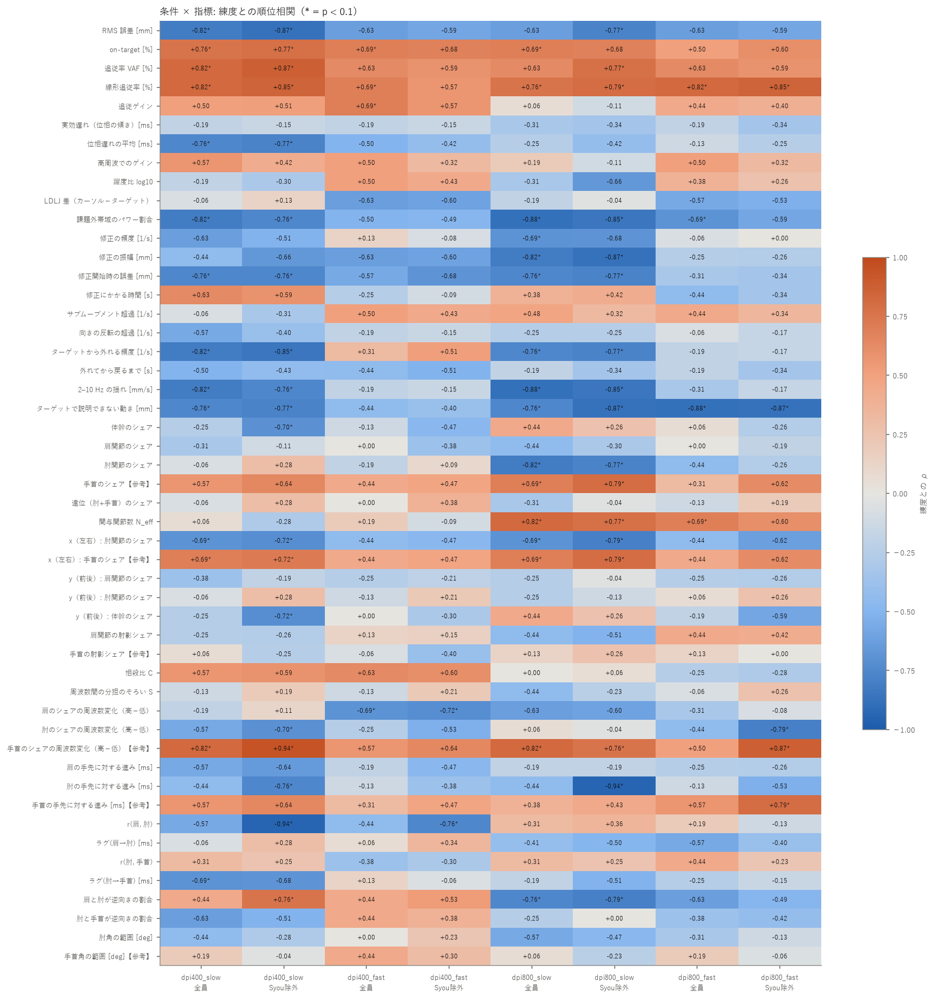

# 条件間の比較（解析済み: dpi400_slow, dpi400_fast, dpi800_slow, dpi800_fast）

「練度差あり」= 全員でも Syou 除外でも p < 0.1（探索的な目安）。各条件は独立に解析した結果を並べただけです。

**考察（手書き）: [discussion.md](discussion.md)**（この表は再実行で作り直されますが、考察は上書きされません）

## どの条件でも練度差あり

- なし

## 特定の条件でだけ練度差あり

- RMS 誤差 [mm]: dpi400_slow
- on-target [%]: dpi400_slow
- 追従率 VAF [%]: dpi400_slow
- 線形追従率 [%]: dpi400_slow、dpi800_slow、dpi800_fast
- 位相遅れの平均 [ms]: dpi400_slow
- 課題外帯域のパワー割合: dpi400_slow、dpi800_slow
- 修正の振幅 [mm]: dpi800_slow
- 修正開始時の誤差 [mm]: dpi400_slow、dpi800_slow
- ターゲットから外れる頻度 [1/s]: dpi400_slow、dpi800_slow
- 2–10 Hz の揺れ [mm/s]: dpi400_slow、dpi800_slow
- ターゲットで説明できない動き [mm]: dpi400_slow、dpi800_slow、dpi800_fast
- 肘関節のシェア: dpi800_slow
- 手首のシェア【参考】: dpi800_slow
- 関与関節数 N_eff: dpi800_slow
- x（左右）: 肘関節のシェア: dpi400_slow、dpi800_slow
- x（左右）: 手首のシェア【参考】: dpi400_slow、dpi800_slow
- 肩のシェアの周波数変化（高−低）: dpi400_fast
- 手首のシェアの周波数変化（高−低）【参考】: dpi400_slow、dpi800_slow
- 肩と肘が逆向きの割合: dpi800_slow

## どの条件でも同じ向き（全条件・全員 / Syou 除外とも |ρ| ≥ 0.4 で同符号）

- RMS 誤差 [mm]: 高練度ほど小さい（ρ -0.87〜-0.59）
- on-target [%]: 高練度ほど大きい（ρ +0.50〜+0.77）
- 追従率 VAF [%]: 高練度ほど大きい（ρ +0.59〜+0.87）
- 線形追従率 [%]: 高練度ほど大きい（ρ +0.57〜+0.85）
- 課題外帯域のパワー割合: 高練度ほど小さい（ρ -0.88〜-0.49）
- x（左右）: 肘関節のシェア: 高練度ほど小さい（ρ -0.79〜-0.44）
- x（左右）: 手首のシェア【参考】: 高練度ほど大きい（ρ +0.44〜+0.79）
- 手首のシェアの周波数変化（高−低）【参考】: 高練度ほど大きい（ρ +0.50〜+0.94）

## 条件によって向きが逆になる（ある条件で ρ ≥ +0.5、別の条件で ≤ −0.5）

- 躍度比 log10: dpi400_slow -0.19、dpi400_fast +0.50、dpi800_slow -0.31、dpi800_fast +0.38
- ターゲットから外れる頻度 [1/s]: dpi400_slow -0.82、dpi400_fast +0.31、dpi800_slow -0.76、dpi800_fast -0.19
- 肩と肘が逆向きの割合: dpi400_slow +0.44、dpi400_fast +0.44、dpi800_slow -0.76、dpi800_fast -0.63

## ρ の一覧

| 指標 | dpi400_slow 全員 | dpi400_slow 除外 | dpi400_fast 全員 | dpi400_fast 除外 | dpi800_slow 全員 | dpi800_slow 除外 | dpi800_fast 全員 | dpi800_fast 除外 |
|---|---|---|---|---|---|---|---|---|
| RMS 誤差 [mm] | -0.82* | -0.87* | -0.63 | -0.59 | -0.63 | -0.77* | -0.63 | -0.59 |
| on-target [%] | +0.76* | +0.77* | +0.69* | +0.68 | +0.69* | +0.68 | +0.50 | +0.60 |
| 追従率 VAF [%] | +0.82* | +0.87* | +0.63 | +0.59 | +0.63 | +0.77* | +0.63 | +0.59 |
| 線形追従率 [%] | +0.82* | +0.85* | +0.69* | +0.57 | +0.76* | +0.79* | +0.82* | +0.85* |
| 追従ゲイン | +0.50 | +0.51 | +0.69* | +0.57 | +0.06 | -0.11 | +0.44 | +0.40 |
| 実効遅れ（位相の傾き）[ms] | -0.19 | -0.15 | -0.19 | -0.15 | -0.31 | -0.34 | -0.19 | -0.34 |
| 位相遅れの平均 [ms] | -0.76* | -0.77* | -0.50 | -0.42 | -0.25 | -0.42 | -0.13 | -0.25 |
| 高周波でのゲイン | +0.57 | +0.42 | +0.50 | +0.32 | +0.19 | -0.11 | +0.50 | +0.32 |
| 躍度比 log10 | -0.19 | -0.30 | +0.50 | +0.43 | -0.31 | -0.66 | +0.38 | +0.26 |
| LDLJ 差（カーソル−ターゲット） | -0.06 | +0.13 | -0.63 | -0.60 | -0.19 | -0.04 | -0.57 | -0.53 |
| 課題外帯域のパワー割合 | -0.82* | -0.76* | -0.50 | -0.49 | -0.88* | -0.85* | -0.69* | -0.59 |
| 修正の頻度 [1/s] | -0.63 | -0.51 | +0.13 | -0.08 | -0.69* | -0.68 | -0.06 | +0.00 |
| 修正の振幅 [mm] | -0.44 | -0.66 | -0.63 | -0.60 | -0.82* | -0.87* | -0.25 | -0.26 |
| 修正開始時の誤差 [mm] | -0.76* | -0.76* | -0.57 | -0.68 | -0.76* | -0.77* | -0.31 | -0.34 |
| 修正にかかる時間 [s] | +0.63 | +0.59 | -0.25 | -0.09 | +0.38 | +0.42 | -0.44 | -0.34 |
| サブムーブメント超過 [1/s] | -0.06 | -0.31 | +0.50 | +0.43 | +0.48 | +0.32 | +0.44 | +0.34 |
| 向きの反転の超過 [1/s] | -0.57 | -0.40 | -0.19 | -0.15 | -0.25 | -0.25 | -0.06 | -0.17 |
| ターゲットから外れる頻度 [1/s] | -0.82* | -0.85* | +0.31 | +0.51 | -0.76* | -0.77* | -0.19 | -0.17 |
| 外れてから戻るまで [s] | -0.50 | -0.43 | -0.44 | -0.51 | -0.19 | -0.34 | -0.19 | -0.34 |
| 2–10 Hz の揺れ [mm/s] | -0.82* | -0.76* | -0.19 | -0.15 | -0.88* | -0.85* | -0.31 | -0.17 |
| ターゲットで説明できない動き [mm] | -0.76* | -0.77* | -0.44 | -0.40 | -0.76* | -0.87* | -0.88* | -0.87* |
| 体幹のシェア | -0.25 | -0.70* | -0.13 | -0.47 | +0.44 | +0.26 | +0.06 | -0.26 |
| 肩関節のシェア | -0.31 | -0.11 | +0.00 | -0.38 | -0.44 | -0.30 | +0.00 | -0.19 |
| 肘関節のシェア | -0.06 | +0.28 | -0.19 | +0.09 | -0.82* | -0.77* | -0.44 | -0.26 |
| 手首のシェア【参考】 | +0.57 | +0.64 | +0.44 | +0.47 | +0.69* | +0.79* | +0.31 | +0.62 |
| 遠位（肘+手首）のシェア | -0.06 | +0.28 | +0.00 | +0.38 | -0.31 | -0.04 | -0.13 | +0.19 |
| 関与関節数 N_eff | +0.06 | -0.28 | +0.19 | -0.09 | +0.82* | +0.77* | +0.69* | +0.60 |
| x（左右）: 肘関節のシェア | -0.69* | -0.72* | -0.44 | -0.47 | -0.69* | -0.79* | -0.44 | -0.62 |
| x（左右）: 手首のシェア【参考】 | +0.69* | +0.72* | +0.44 | +0.47 | +0.69* | +0.79* | +0.44 | +0.62 |
| y（前後）: 肩関節のシェア | -0.38 | -0.19 | -0.25 | -0.21 | -0.25 | -0.04 | -0.25 | -0.26 |
| y（前後）: 肘関節のシェア | -0.06 | +0.28 | -0.13 | +0.21 | -0.25 | -0.13 | +0.06 | +0.26 |
| y（前後）: 体幹のシェア | -0.25 | -0.72* | +0.00 | -0.30 | +0.44 | +0.26 | -0.19 | -0.59 |
| 肩関節の射影シェア | -0.25 | -0.26 | +0.13 | +0.15 | -0.44 | -0.51 | +0.44 | +0.42 |
| 手首の射影シェア【参考】 | +0.06 | -0.25 | -0.06 | -0.40 | +0.13 | +0.26 | +0.13 | +0.00 |
| 相殺比 C | +0.57 | +0.59 | +0.63 | +0.60 | +0.00 | +0.06 | -0.25 | -0.28 |
| 周波数間の分担のそろい S | -0.13 | +0.19 | -0.13 | +0.21 | -0.44 | -0.23 | -0.06 | +0.26 |
| 肩のシェアの周波数変化（高−低） | -0.19 | +0.11 | -0.69* | -0.72* | -0.63 | -0.60 | -0.31 | -0.08 |
| 肘のシェアの周波数変化（高−低） | -0.57 | -0.70* | -0.25 | -0.53 | +0.06 | -0.04 | -0.44 | -0.79* |
| 手首のシェアの周波数変化（高−低）【参考】 | +0.82* | +0.94* | +0.57 | +0.64 | +0.82* | +0.76* | +0.50 | +0.87* |
| 肩の手先に対する進み [ms] | -0.57 | -0.64 | -0.19 | -0.47 | -0.19 | -0.19 | -0.25 | -0.26 |
| 肘の手先に対する進み [ms] | -0.44 | -0.76* | -0.13 | -0.38 | -0.44 | -0.94* | -0.13 | -0.53 |
| 手首の手先に対する進み [ms]【参考】 | +0.57 | +0.64 | +0.31 | +0.47 | +0.38 | +0.43 | +0.57 | +0.79* |
| r(肩, 肘) | -0.57 | -0.94* | -0.44 | -0.76* | +0.31 | +0.36 | +0.19 | -0.13 |
| ラグ(肩→肘) [ms] | -0.06 | +0.28 | +0.06 | +0.34 | -0.41 | -0.50 | -0.57 | -0.40 |
| r(肘, 手首) | +0.31 | +0.25 | -0.38 | -0.30 | +0.31 | +0.25 | +0.44 | +0.23 |
| ラグ(肘→手首) [ms] | -0.69* | -0.68 | +0.13 | -0.06 | -0.19 | -0.51 | -0.25 | -0.15 |
| 肩と肘が逆向きの割合 | +0.44 | +0.76* | +0.44 | +0.53 | -0.76* | -0.79* | -0.63 | -0.49 |
| 肘と手首が逆向きの割合 | -0.63 | -0.51 | +0.44 | +0.38 | -0.25 | +0.00 | -0.38 | -0.42 |
| 肘角の範囲 [deg] | -0.44 | -0.28 | +0.00 | +0.23 | -0.57 | -0.47 | -0.31 | -0.13 |
| 手首角の範囲 [deg]【参考】 | +0.19 | -0.04 | +0.44 | +0.30 | +0.06 | -0.23 | +0.19 | -0.06 |

