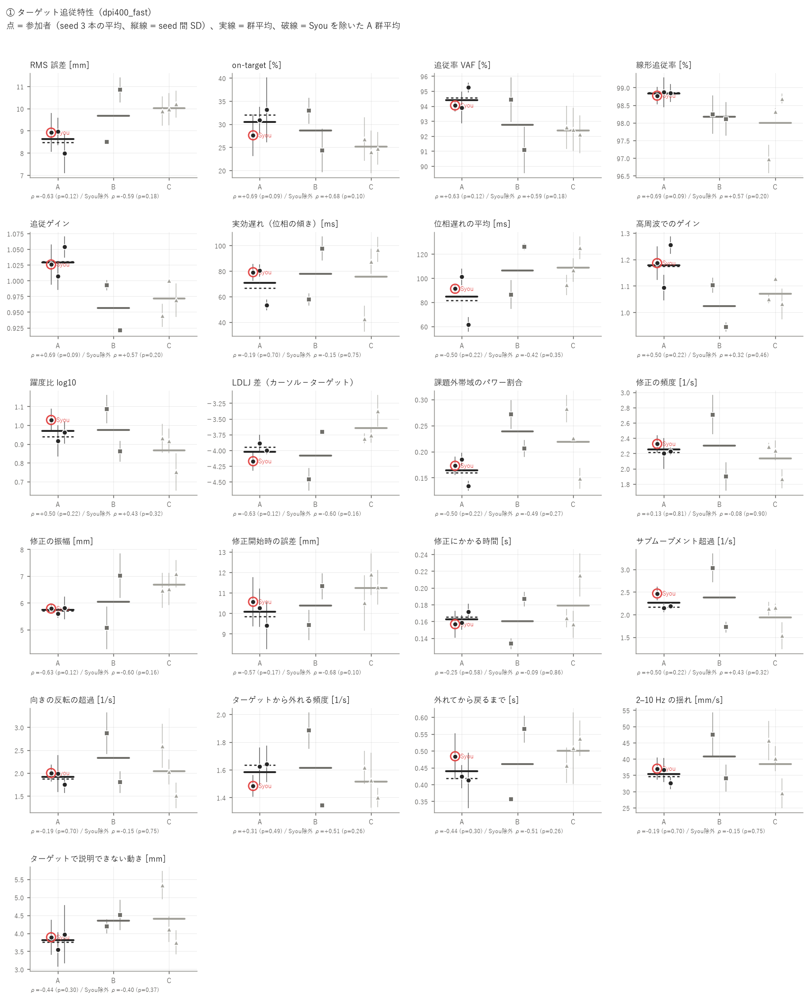
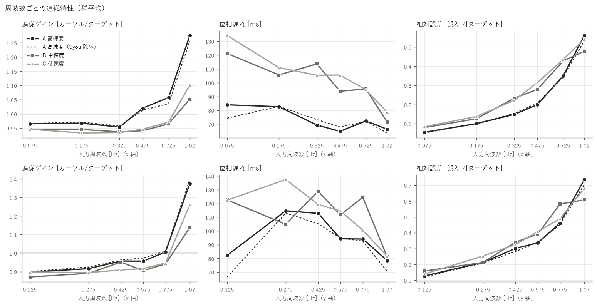
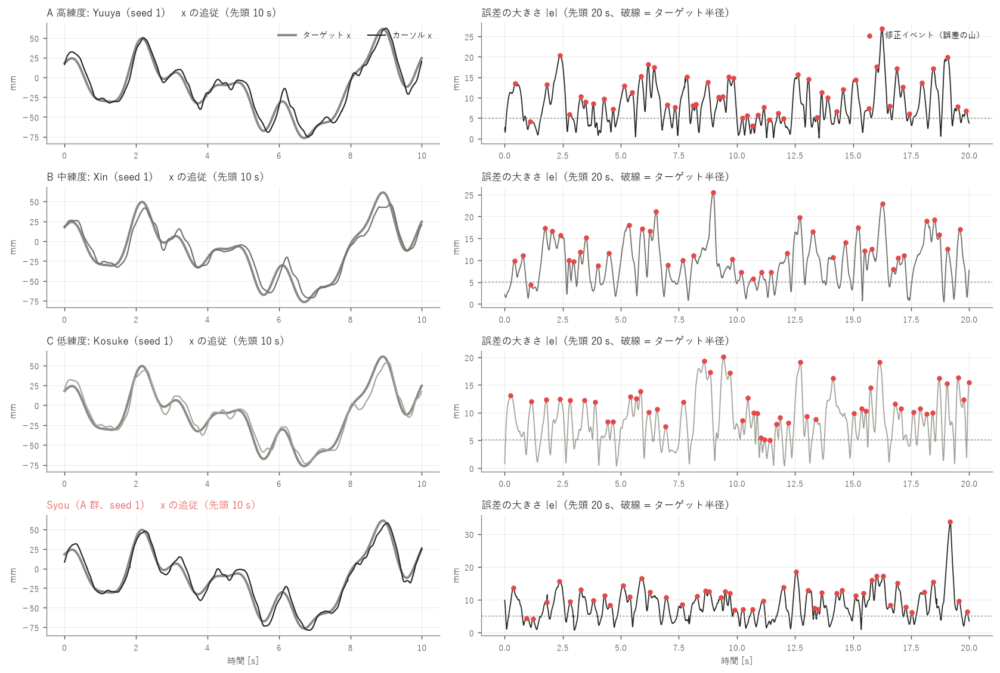
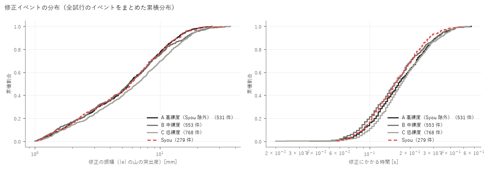
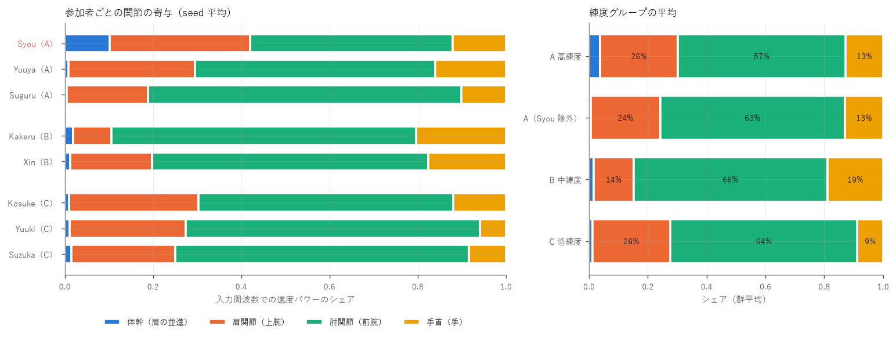
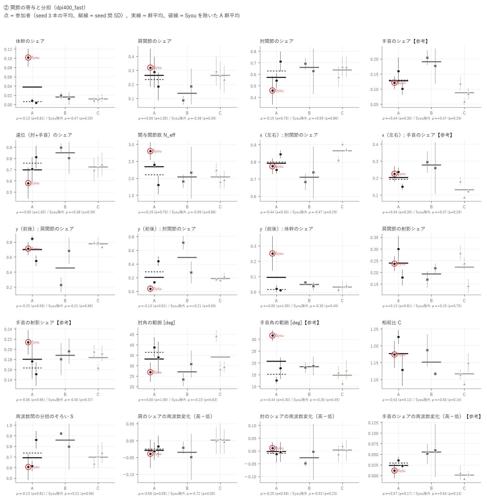
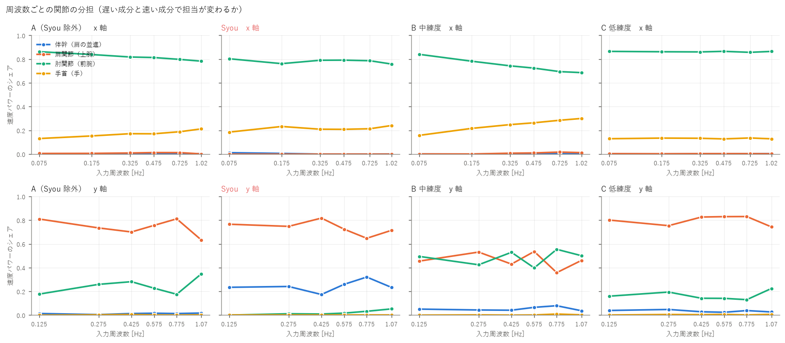
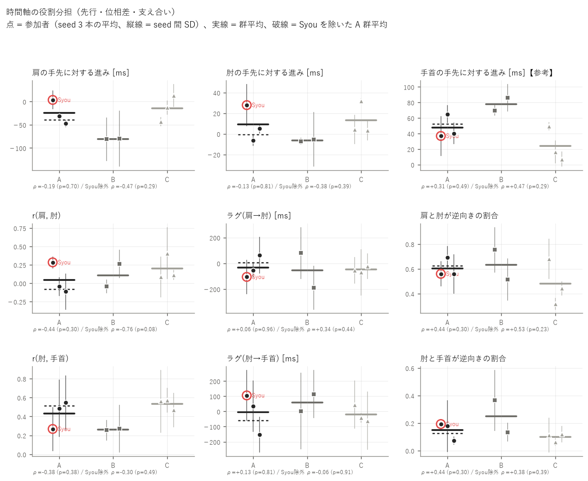
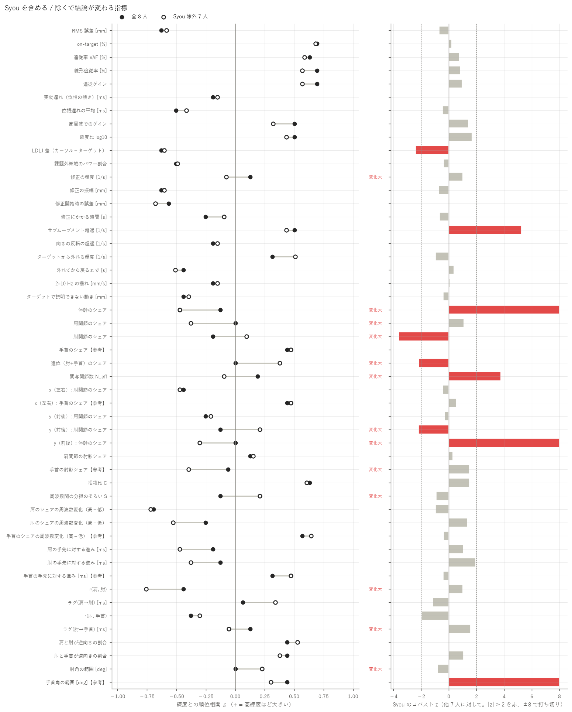

# 練度別の追従特性・上肢協調の解析 — 400 DPI / FAST

生成: 2026-10-23 03:21　条件名: `dpi400_fast`　スクリプト: `skill_analysis/run_skill.py`

この条件だけを独立に解析した結果です（他条件のデータは混ぜていません）。条件どうしの比較は `results/_compare/` を見てください。

**考察（手書き）: [discussion.md](discussion.md)**（このレポートは再実行で作り直されますが、考察は上書きされません）

## 0. 対象と読み方

- **A 高練度**: Syou, Yuuya, Suguru（解析できた人: 3）
- **B 中練度**: Kakeru, Xin（解析できた人: 2）
- **C 低練度**: Kosuke, Yuuki, Suzuka（解析できた人: 3）
- 試行: 本番の fast 試行 seed 1〜3（各参加者 3 本、計 24 本）。参加者ごとに 3 本を平均してから群を比べる
- 統計: 練度の順位（A=3 / B=2 / C=1）と参加者平均の Spearman ρ。p はラベルの全並べ替えによる正確な p（8 人 560 通り / Syou 除外 7 人 210 通り）、q は族（追従精度・滑らかさ・軌道修正・関節の寄与・時間の役割分担）ごとの BH 補正。g(A−C) は Hedges の g。判別比 D = 参加者間 SD / seed 間 SD（1 付近なら人の違いは試行のばらつきと同程度）
- **人数が 3 / 2 / 3 人と少ないため、p は探索的な目安です。** 1 人の違いで順位が入れ替わるので、必ず「Syou 除外」の列と個人の点（図）を併せて読んでください
- 関節は RealSense + MediaPipe の推定値。既存の検証（aim_eval/README）より、手首（hand）・MCP3 を使う成分（手首のシェアなど）は MoCap で未照合のため【参考】。肘は振幅を 6〜7 % 小さく捉える癖がある

## 1. 要約（p < 0.10 の指標を自動抽出）

### ① ターゲット追従特性

- **on-target [%]**: 高練度ほど大きい（良い向き）。ρ = +0.69（p = 0.09）/ Syou 除外 ρ = +0.68（p = 0.10）、全員でのみ p < 0.1。判別比 D = 0.9
- **線形追従率 [%]**: 高練度ほど大きい（良い向き）。ρ = +0.69（p = 0.09）/ Syou 除外 ρ = +0.57（p = 0.20）、全員でのみ p < 0.1。判別比 D = 2.0
- **追従ゲイン**: 高練度ほど大きい。ρ = +0.69（p = 0.09）/ Syou 除外 ρ = +0.57（p = 0.20）、全員でのみ p < 0.1。判別比 D = 2.8

### ② 上肢関節の協調・分担

- **肩のシェアの周波数変化（高−低）**: 高練度ほど小さい。ρ = -0.69（p = 0.09）/ Syou 除外 ρ = -0.72（p = 0.09）、全員でも Syou 除外でも p < 0.1。判別比 D = 0.5
- **r(肩, 肘)**: 高練度ほど小さい。ρ = -0.44（p = 0.30）/ Syou 除外 ρ = -0.76（p = 0.08）、Syou 除外でのみ p < 0.1。判別比 D = 1.1

### Syou の影響

- Syou を除くと ρ の符号が変わる、または |Δρ| ≥ 0.3 の指標: 修正の頻度 [1/s]（+0.13 → -0.08）、体幹のシェア（-0.13 → -0.47）、肩関節のシェア（+0.00 → -0.38）、肘関節のシェア（-0.19 → +0.09）、遠位（肘+手首）のシェア（+0.00 → +0.38）、関与関節数 N_eff（+0.19 → -0.09）、y（前後）: 肘関節のシェア（-0.13 → +0.21）、y（前後）: 体幹のシェア（+0.00 → -0.30）、手首の射影シェア【参考】（-0.06 → -0.40）、周波数間の分担のそろい S（-0.13 → +0.21）、r(肩, 肘)（-0.44 → -0.76）、ラグ(肘→手首) [ms]（+0.13 → -0.06）、肘角の範囲 [deg]（+0.00 → +0.23）
- Syou が他 7 人から外れている指標（|ロバスト z| ≥ 2）: LDLJ 差（カーソル−ターゲット）（z = -2.4）、サブムーブメント超過 [1/s]（z = +5.3）、体幹のシェア（z = +19.5）、肘関節のシェア（z = -3.6）、遠位（肘+手首）のシェア（z = -2.2）、関与関節数 N_eff（z = +3.7）、y（前後）: 肘関節のシェア（z = -2.2）、y（前後）: 体幹のシェア（z = +10.1）、手首角の範囲 [deg]【参考】（z = +9.1）

## 2. ① ターゲット追従特性

指標の定義: 追従率 VAF = 1 − Σ|誤差|²/Σ|ターゲットの変動|²、線形追従率 = カーソルのパワーのうち入力周波数に乗った割合、躍度比 = log10(RMS 躍度 カーソル / ターゲット)（0 = ターゲットと同じ滑らかさ）、修正イベント = 誤差の大きさ |e| の山（ずれが最大になり戻り始めた点。突出度 ≥ 1.0 mm）。すべて画面上の mm。

### 群ごとの値（参加者平均の平均 ± SD）

| 指標 | A 高練度 | A（Syou 除外） | B 中練度 | C 低練度 | Syou（個人） |
|---|---|---|---|---|---|
| RMS 誤差 [mm] | 8.62 ± 0.56 | 8.47 ± 0.70 | 9.67 ± 1.65 | 10.02 ± 0.16 | 8.91 |
| on-target [%] | 30.5 ± 2.8 | 32.0 ± 1.6 | 28.6 ± 6.1 | 25.2 ± 1.4 | 27.6 |
| 追従率 VAF [%] | 94.4 ± 0.7 | 94.6 ± 0.9 | 92.8 ± 2.4 | 92.4 ± 0.2 | 94.0 |
| 線形追従率 [%] | 98.8 ± 0.1 | 98.9 ± 0.0 | 98.2 ± 0.1 | 98.0 ± 0.9 | 98.8 |
| 追従ゲイン | 1.029 ± 0.023 | 1.030 ± 0.033 | 0.957 ± 0.051 | 0.971 ± 0.028 | 1.026 |
| 実効遅れ（位相の傾き）[ms] | 70.9 ± 15.2 | 66.8 ± 19.1 | 77.7 ± 28.2 | 75.7 ± 29.0 | 79.1 |
| 位相遅れの平均 [ms] | 84.6 ± 20.6 | 81.4 ± 27.9 | 106.2 ± 28.1 | 108.8 ± 15.6 | 91.2 |
| 高周波でのゲイン | 1.179 ± 0.081 | 1.175 ± 0.114 | 1.024 ± 0.112 | 1.070 ± 0.050 | 1.186 |
| 躍度比 log10 | 0.968 ± 0.056 | 0.939 ± 0.032 | 0.973 ± 0.158 | 0.866 ± 0.099 | 1.028 |
| LDLJ 差（カーソル−ターゲット） | -4.021 ± 0.143 | -3.944 ± 0.078 | -4.084 ± 0.533 | -3.648 ± 0.241 | -4.173 |
| 課題外帯域のパワー割合 | 0.164 ± 0.026 | 0.160 ± 0.036 | 0.238 ± 0.046 | 0.219 ± 0.067 | 0.173 |
| 修正の頻度 [1/s] | 2.250 ± 0.066 | 2.213 ± 0.018 | 2.304 ± 0.572 | 2.133 ± 0.232 | 2.325 |
| 修正の振幅 [mm] | 5.73 ± 0.12 | 5.71 ± 0.15 | 6.04 ± 1.38 | 6.69 ± 0.35 | 5.79 |
| 修正開始時の誤差 [mm] | 10.08 ± 0.60 | 9.84 ± 0.61 | 10.37 ± 1.34 | 11.23 ± 0.70 | 10.56 |
| 修正にかかる時間 [s] | 0.162 ± 0.008 | 0.165 ± 0.009 | 0.160 ± 0.038 | 0.179 ± 0.032 | 0.157 |
| サブムーブメント超過 [1/s] | 2.264 ± 0.177 | 2.163 ± 0.029 | 2.379 ± 0.925 | 1.942 ± 0.354 | 2.467 |
| 向きの反転の超過 [1/s] | 1.914 ± 0.142 | 1.871 ± 0.171 | 2.333 ± 0.754 | 2.044 ± 0.538 | 2.000 |
| ターゲットから外れる頻度 [1/s] | 1.583 ± 0.087 | 1.633 ± 0.012 | 1.613 ± 0.383 | 1.514 ± 0.109 | 1.483 |
| 外れてから戻るまで [s] | 0.440 ± 0.039 | 0.418 ± 0.008 | 0.461 ± 0.147 | 0.501 ± 0.041 | 0.484 |
| 2–10 Hz の揺れ [mm/s] | 35.42 ± 2.45 | 34.62 ± 2.86 | 40.82 ± 9.47 | 38.43 ± 8.21 | 37.02 |
| ターゲットで説明できない動き [mm] | 3.80 ± 0.22 | 3.76 ± 0.30 | 4.35 ± 0.23 | 4.40 ± 0.83 | 3.89 |

### 練度との関係

| 指標 | ρ 全員 | p | q(BH) | ρ Syou除外 | p | g(A−C) 全員 | g(A−C) 除外 | KW p | 判別比 D | Syou z | 除外で変化 |
|---|---|---|---|---|---|---|---|---|---|---|---|
| RMS 誤差 [mm] | -0.63 | 0.12 | 0.19 | -0.59 | 0.18 | -2.73 | -2.64 | 0.24 | 1.6 | -0.7 |  |
| on-target [%] | +0.69 | 0.09 | 0.19 | +0.68 | 0.10 | +1.95 | +3.38 | 0.19 | 0.9 | +0.2 |  |
| 追従率 VAF [%] | +0.63 | 0.12 | 0.19 | +0.59 | 0.18 | +2.96 | +2.76 | 0.24 | 1.3 | +0.7 |  |
| 線形追従率 [%] | +0.69 | 0.09 | 0.19 | +0.57 | 0.20 | +1.04 | +0.85 | 0.08 | 2.0 | +0.8 |  |
| 追従ゲイン | +0.69 | 0.09 | 0.19 | +0.57 | 0.20 | +1.78 | +1.45 | 0.08 | 2.8 | +1.0 |  |
| 実効遅れ（位相の傾き）[ms] | -0.19 | 0.70 | 0.70 | -0.15 | 0.75 | -0.16 | -0.25 | 0.71 | 2.9 | -0.0 |  |
| 位相遅れの平均 [ms] | -0.50 | 0.22 | 0.25 | -0.42 | 0.35 | -1.06 | -0.97 | 0.39 | 3.1 | -0.5 |  |
| 高周波でのゲイン | +0.50 | 0.22 | 0.25 | +0.32 | 0.46 | +1.30 | +0.99 | 0.25 | 2.9 | +1.4 |  |
| 躍度比 log10 | +0.50 | 0.22 | 0.22 | +0.43 | 0.32 | +1.02 | +0.64 | 0.39 | 1.5 | +1.7 |  |
| LDLJ 差（カーソル−ターゲット） | -0.63 | 0.12 | 0.22 | -0.60 | 0.16 | -1.50 | -1.07 | 0.24 | 2.7 | -2.4 |  |
| 課題外帯域のパワー割合 | -0.50 | 0.22 | 0.22 | -0.49 | 0.27 | -0.86 | -0.73 | 0.25 | 3.5 | -0.4 |  |
| 修正の頻度 [1/s] | +0.13 | 0.81 | 0.81 | -0.08 | 0.90 | +0.55 | +0.30 | 0.89 | 2.0 | +1.0 | **あり** |
| 修正の振幅 [mm] | -0.63 | 0.12 | 0.60 | -0.60 | 0.16 | -2.96 | -2.41 | 0.24 | 1.4 | -0.7 |  |
| 修正開始時の誤差 [mm] | -0.57 | 0.17 | 0.60 | -0.68 | 0.10 | -1.41 | -1.51 | 0.32 | 0.9 | +0.0 |  |
| 修正にかかる時間 [s] | -0.25 | 0.58 | 0.78 | -0.09 | 0.86 | -0.56 | -0.37 | 0.76 | 2.0 | -0.7 |  |
| サブムーブメント超過 [1/s] | +0.50 | 0.22 | 0.60 | +0.43 | 0.32 | +0.92 | +0.55 | 0.39 | 3.0 | +5.3 |  |
| 向きの反転の超過 [1/s] | -0.19 | 0.70 | 0.78 | -0.15 | 0.75 | -0.27 | -0.28 | 0.71 | 1.5 | +0.0 |  |
| ターゲットから外れる頻度 [1/s] | +0.31 | 0.49 | 0.78 | +0.51 | 0.26 | +0.56 | +0.98 | 0.71 | 1.6 | -1.0 |  |
| 外れてから戻るまで [s] | -0.44 | 0.30 | 0.60 | -0.51 | 0.26 | -1.23 | -1.80 | 0.51 | 1.3 | +0.4 |  |
| 2–10 Hz の揺れ [mm/s] | -0.19 | 0.70 | 0.78 | -0.15 | 0.75 | -0.40 | -0.40 | 0.71 | 1.5 | +0.1 |  |
| ターゲットで説明できない動き [mm] | -0.44 | 0.30 | 0.60 | -0.40 | 0.37 | -0.78 | -0.66 | 0.21 | 1.3 | -0.4 |  |

### 参加者ごと（主な指標）

| 参加者 | 群 | RMS 誤差 [mm] | on-target [%] | 追従率 VAF [%] | 実効遅れ（位相の傾き）[ms] | 躍度比 log10 | 修正の頻度 [1/s] | 修正の振幅 [mm] | ターゲットから外れる頻度 [1/s] | 2–10 Hz の揺れ [mm/s] |
|---|---|---|---|---|---|---|---|---|---|---|
| **Syou** | A | 8.91 | 27.6 | 94.0 | 79.1 | 1.028 | 2.325 | 5.79 | 1.483 | 37.02 |
| Yuuya | A | 8.97 | 30.9 | 93.9 | 80.3 | 0.916 | 2.200 | 5.60 | 1.625 | 36.64 |
| Suguru | A | 7.98 | 33.1 | 95.2 | 53.4 | 0.961 | 2.225 | 5.81 | 1.642 | 32.59 |
| Kakeru | B | 8.50 | 32.9 | 94.4 | 57.8 | 1.085 | 2.708 | 5.06 | 1.883 | 47.52 |
| Xin | B | 10.84 | 24.3 | 91.1 | 97.7 | 0.861 | 1.900 | 7.01 | 1.342 | 34.12 |
| Kosuke | C | 9.88 | 26.8 | 92.6 | 42.6 | 0.931 | 2.292 | 6.46 | 1.617 | 45.66 |
| Yuuki | C | 9.98 | 24.0 | 92.4 | 87.6 | 0.916 | 2.242 | 6.51 | 1.525 | 40.11 |
| Suzuka | C | 10.20 | 24.7 | 92.1 | 96.9 | 0.751 | 1.867 | 7.09 | 1.400 | 29.51 |









## 3. ② 上肢関節の協調・分担（肩 / 肘 / 手首）

手先（MCP3）の動き = 体幹（肩の並進）+ 肩関節（上腕の回転）+ 肘関節（前腕の回転）+ 手首（手の回転）に足し算で分け、入力周波数での速度パワーのシェアを寄与とする（近傍ビンのノイズを引く。aim_eval の a1 と同じ定義）。「体幹（肩の並進）」は肩の点そのものの移動で、体幹の傾き・回旋と肩甲帯（肩をすくめる・前に出す）の両方を含む。

### 3.1 寄与・運動量の分配

| 指標 | A 高練度 | A（Syou 除外） | B 中練度 | C 低練度 | Syou（個人） |
|---|---|---|---|---|---|
| 体幹のシェア | 0.038 ± 0.055 | 0.006 ± 0.003 | 0.016 ± 0.005 | 0.012 ± 0.003 | 0.101 |
| 肩関節のシェア | 0.264 ± 0.071 | 0.236 ± 0.073 | 0.136 ± 0.070 | 0.264 ± 0.029 | 0.319 |
| 肘関節のシェア | 0.572 ± 0.129 | 0.628 ± 0.118 | 0.659 ± 0.046 | 0.636 ± 0.051 | 0.458 |
| 手首のシェア【参考】 | 0.127 ± 0.030 | 0.130 ± 0.042 | 0.190 ± 0.020 | 0.088 ± 0.030 | 0.121 |
| 遠位（肘+手首）のシェア | 0.699 ± 0.116 | 0.758 ± 0.076 | 0.849 ± 0.065 | 0.724 ± 0.026 | 0.579 |
| 関与関節数 N_eff | 2.336 ± 0.499 | 2.104 ± 0.421 | 2.034 ± 0.186 | 2.038 ± 0.185 | 2.799 |
| x（左右）: 肘関節のシェア | 0.791 ± 0.048 | 0.799 ± 0.064 | 0.710 ± 0.039 | 0.863 ± 0.047 | 0.774 |
| x（左右）: 手首のシェア【参考】 | 0.203 ± 0.048 | 0.192 ± 0.062 | 0.276 ± 0.025 | 0.130 ± 0.047 | 0.225 |
| y（前後）: 肩関節のシェア | 0.702 ± 0.148 | 0.697 ± 0.208 | 0.456 ± 0.321 | 0.777 ± 0.034 | 0.711 |
| y（前後）: 肘関節のシェア | 0.203 ± 0.210 | 0.286 ± 0.217 | 0.493 ± 0.307 | 0.187 ± 0.029 | 0.039 |
| y（前後）: 体幹のシェア | 0.093 ± 0.136 | 0.015 ± 0.007 | 0.048 ± 0.017 | 0.031 ± 0.013 | 0.250 |
| 肩関節の射影シェア | 0.239 ± 0.061 | 0.239 ± 0.086 | 0.193 ± 0.034 | 0.222 ± 0.072 | 0.237 |
| 手首の射影シェア【参考】 | 0.180 ± 0.032 | 0.163 ± 0.018 | 0.188 ± 0.011 | 0.184 ± 0.017 | 0.214 |
| 肘角の範囲 [deg] | 33.2 ± 6.0 | 36.4 ± 3.4 | 27.0 ± 5.3 | 34.0 ± 8.9 | 26.8 |
| 手首角の範囲 [deg]【参考】 | 20.6 ± 9.8 | 15.2 ± 3.6 | 18.3 ± 0.4 | 14.8 ± 3.0 | 31.6 |





### 3.2 時間軸の役割分担（周波数による分担・先行・支え合い）

- **周波数による分担**: 各軸の低い入力周波数 2 つと高い 2 つでのシェアの差（高 − 低）。+ = 速い成分ほどその関節が担う
- **先行**: 入力周波数での手先に対する位相の進み [ms]（+ = 手先より先に動く）。成分の振幅で重み付け
- **相互相関**: 課題の帯域に絞った成分の速度どうし（x・y の平均）。r < 0 = 逆向きに動いて互いを打ち消す＝支え合い（補償）、ラグ + = 前の成分が先行
- **相殺比 C**: Σ|成分| / |手先|。1 = 素直な足し算、> 1 = 打ち消し合いながら手先を作る

| 指標 | A 高練度 | A（Syou 除外） | B 中練度 | C 低練度 | Syou（個人） |
|---|---|---|---|---|---|
| 相殺比 C | 1.176 ± 0.049 | 1.177 ± 0.069 | 1.151 ± 0.049 | 1.117 ± 0.031 | 1.174 |
| 周波数間の分担のそろい S | 0.693 ± 0.145 | 0.737 ± 0.174 | 0.858 ± 0.087 | 0.696 ± 0.052 | 0.605 |
| 肩のシェアの周波数変化（高−低） | -0.029 ± 0.011 | -0.025 ± 0.010 | -0.035 ± 0.020 | 0.001 ± 0.004 | -0.039 |
| 肘のシェアの周波数変化（高−低） | -0.002 ± 0.012 | -0.009 ± 0.006 | -0.026 ± 0.032 | 0.003 ± 0.016 | 0.011 |
| 手首のシェアの周波数変化（高−低）【参考】 | 0.023 ± 0.012 | 0.029 ± 0.009 | 0.055 ± 0.006 | 0.001 ± 0.007 | 0.011 |
| 肩の手先に対する進み [ms] | -24.9 ± 25.9 | -39.2 ± 11.3 | -80.7 ± 0.9 | -14.3 ± 28.3 | 3.5 |
| 肘の手先に対する進み [ms] | 9.0 ± 17.3 | -0.5 ± 8.2 | -6.3 ± 1.2 | 13.1 ± 16.3 | 27.9 |
| 手首の手先に対する進み [ms]【参考】 | 47.3 ± 15.4 | 52.6 ± 17.6 | 77.8 ± 11.5 | 24.3 ± 22.3 | 36.8 |
| r(肩, 肘) | 0.042 ± 0.212 | -0.079 ± 0.049 | 0.110 ± 0.218 | 0.203 ± 0.179 | 0.284 |
| ラグ(肩→肘) [ms] | -31.5 ± 86.7 | 5.6 ± 82.5 | -54.2 ± 190.5 | -49.1 ± 24.3 | -105.6 |
| r(肘, 手首) | 0.433 ± 0.146 | 0.516 ± 0.042 | 0.264 ± 0.011 | 0.533 ± 0.057 | 0.268 |
| ラグ(肘→手首) [ms] | -4.6 ± 133.3 | -59.7 ± 131.6 | 58.3 ± 78.6 | -19.4 ± 56.2 | 105.6 |
| 肩と肘が逆向きの割合 | 0.603 ± 0.076 | 0.625 ± 0.093 | 0.634 ± 0.169 | 0.481 ± 0.184 | 0.560 |
| 肘と手首が逆向きの割合 | 0.148 ± 0.065 | 0.126 ± 0.074 | 0.249 ± 0.163 | 0.098 ± 0.032 | 0.193 |





### 3.3 練度との関係

| 指標 | ρ 全員 | p | q(BH) | ρ Syou除外 | p | g(A−C) 全員 | g(A−C) 除外 | KW p | 判別比 D | Syou z | 除外で変化 |
|---|---|---|---|---|---|---|---|---|---|---|---|
| 体幹のシェア | -0.13 | 0.81 | 1.00 | -0.47 | 0.29 | +0.54 | -1.50 | 0.57 | 3.9 | +19.5 | **あり** |
| 肩関節のシェア | +0.00 | 1.00 | 1.00 | -0.38 | 0.39 | -0.01 | -0.43 | 0.25 | 0.8 | +1.1 | **あり** |
| 肘関節のシェア | -0.19 | 0.70 | 1.00 | +0.09 | 0.86 | -0.53 | -0.08 | 0.71 | 0.9 | -3.6 | **あり** |
| 手首のシェア【参考】 | +0.44 | 0.30 | 1.00 | +0.47 | 0.29 | +1.05 | +0.90 | 0.07 | 1.8 | +0.0 |  |
| 遠位（肘+手首）のシェア | +0.00 | 1.00 | 1.00 | +0.38 | 0.39 | -0.24 | +0.51 | 0.25 | 0.9 | -2.2 | **あり** |
| 関与関節数 N_eff | +0.19 | 0.70 | 1.00 | -0.09 | 0.86 | +0.63 | +0.17 | 0.71 | 1.2 | +3.7 | **あり** |
| x（左右）: 肘関節のシェア | -0.44 | 0.30 | 1.00 | -0.47 | 0.29 | -1.24 | -0.88 | 0.07 | 1.9 | -0.4 |  |
| x（左右）: 手首のシェア【参考】 | +0.44 | 0.30 | 1.00 | +0.47 | 0.29 | +1.23 | +0.86 | 0.07 | 1.7 | +0.5 |  |
| y（前後）: 肩関節のシェア | -0.25 | 0.58 | 1.00 | -0.21 | 0.66 | -0.56 | -0.47 | 0.20 | 2.9 | -0.3 |  |
| y（前後）: 肘関節のシェア | -0.13 | 0.81 | 1.00 | +0.21 | 0.66 | +0.09 | +0.56 | 0.24 | 3.7 | -2.2 | **あり** |
| y（前後）: 体幹のシェア | +0.00 | 1.00 | 1.00 | -0.30 | 0.49 | +0.52 | -1.02 | 0.61 | 2.6 | +10.1 | **あり** |
| 肩関節の射影シェア | +0.13 | 0.81 | 1.00 | +0.15 | 0.75 | +0.20 | +0.17 | 0.57 | 1.8 | +0.3 |  |
| 手首の射影シェア【参考】 | -0.06 | 0.96 | 1.00 | -0.40 | 0.37 | -0.11 | -0.83 | 0.79 | 0.9 | +1.5 | **あり** |
| 相殺比 C | +0.63 | 0.12 | 0.70 | +0.60 | 0.16 | +1.16 | +0.93 | 0.24 | 1.8 | +1.5 |  |
| 周波数間の分担のそろい S | -0.13 | 0.81 | 0.87 | +0.21 | 0.66 | -0.02 | +0.27 | 0.24 | 1.3 | -0.9 | **あり** |
| 肩のシェアの周波数変化（高−低） | -0.69 | 0.09 | 0.70 | -0.72 | 0.09 | -2.94 | -2.76 | 0.08 | 0.5 | -1.0 |  |
| 肘のシェアの周波数変化（高−低） | -0.25 | 0.58 | 0.87 | -0.53 | 0.23 | -0.31 | -0.64 | 0.49 | 0.6 | +1.3 |  |
| 手首のシェアの周波数変化（高−低）【参考】 | +0.57 | 0.17 | 0.70 | +0.64 | 0.13 | +1.84 | +2.73 | 0.04 | 1.4 | -0.4 |  |
| 肩の手先に対する進み [ms] | -0.19 | 0.70 | 0.87 | -0.47 | 0.29 | -0.31 | -0.75 | 0.12 | 1.6 | +1.0 |  |
| 肘の手先に対する進み [ms] | -0.13 | 0.81 | 0.87 | -0.38 | 0.39 | -0.20 | -0.70 | 0.24 | 1.5 | +1.9 |  |
| 手首の手先に対する進み [ms]【参考】 | +0.31 | 0.49 | 0.85 | +0.47 | 0.29 | +0.96 | +0.99 | 0.10 | 2.1 | -0.4 |  |
| r(肩, 肘) | -0.44 | 0.30 | 0.70 | -0.76 | 0.08 | -0.66 | -1.38 | 0.51 | 1.1 | +1.0 | **あり** |
| ラグ(肩→肘) [ms] | +0.06 | 0.96 | 0.96 | +0.34 | 0.44 | +0.22 | +0.77 | 0.99 | 0.7 | -1.2 |  |
| r(肘, 手首) | -0.38 | 0.38 | 0.76 | -0.30 | 0.49 | -0.72 | -0.24 | 0.15 | 0.6 | -2.0 |  |
| ラグ(肘→手首) [ms] | +0.13 | 0.81 | 0.87 | -0.06 | 0.91 | +0.12 | -0.33 | 0.57 | 0.6 | +1.6 | **あり** |
| 肩と肘が逆向きの割合 | +0.44 | 0.30 | 0.70 | +0.53 | 0.23 | +0.70 | +0.66 | 0.41 | 1.2 | +0.0 |  |
| 肘と手首が逆向きの割合 | +0.44 | 0.30 | 0.70 | +0.38 | 0.39 | +0.79 | +0.41 | 0.21 | 1.1 | +1.1 |  |
| 肘角の範囲 [deg] | +0.00 | 1.00 | 1.00 | +0.23 | 0.63 | -0.09 | +0.23 | 0.61 | 1.6 | -0.8 | **あり** |
| 手首角の範囲 [deg]【参考】 | +0.44 | 0.30 | 1.00 | +0.30 | 0.49 | +0.65 | +0.09 | 0.21 | 2.3 | +9.1 |  |

### 参加者ごと（主な指標）

| 参加者 | 群 | 体幹のシェア | 肩関節のシェア | 肘関節のシェア | 手首のシェア【参考】 | 関与関節数 N_eff | 周波数間の分担のそろい S | 相殺比 C | 肘のシェアの周波数変化（高−低） | 肩の手先に対する進み [ms] | r(肩, 肘) |
|---|---|---|---|---|---|---|---|---|---|---|---|
| **Syou** | A | 0.101 | 0.319 | 0.458 | 0.121 | 2.799 | 0.605 | 1.174 | 0.011 | 3.5 | 0.284 |
| Yuuya | A | 0.008 | 0.287 | 0.545 | 0.160 | 2.402 | 0.614 | 1.226 | -0.013 | -31.2 | -0.045 |
| Suguru | A | 0.004 | 0.184 | 0.711 | 0.101 | 1.807 | 0.860 | 1.129 | -0.005 | -47.1 | -0.114 |
| Kakeru | B | 0.019 | 0.086 | 0.691 | 0.204 | 1.902 | 0.920 | 1.186 | -0.049 | -81.3 | -0.044 |
| Xin | B | 0.013 | 0.185 | 0.626 | 0.176 | 2.165 | 0.797 | 1.117 | -0.004 | -80.1 | 0.263 |
| Kosuke | C | 0.009 | 0.294 | 0.578 | 0.119 | 2.249 | 0.639 | 1.115 | -0.013 | -43.3 | 0.086 |
| Yuuki | C | 0.011 | 0.263 | 0.667 | 0.059 | 1.906 | 0.708 | 1.087 | 0.020 | -12.9 | 0.409 |
| Suzuka | C | 0.014 | 0.236 | 0.665 | 0.085 | 1.958 | 0.740 | 1.149 | 0.003 | 13.2 | 0.113 |

## 4. Syou の個別評価（含める / 除く）

図: [Syou を含める / 除くで変わる指標](figures/syou_sensitivity.png)。左 = 練度との ρ（● 全員、○ Syou 除外）、右 = Syou の他 7 人に対するロバスト z。



| 指標 | Syou | A 群平均（除外） | B 群平均 | C 群平均 | z | ρ 全員 → 除外 |
|---|---|---|---|---|---|---|
| 体幹のシェア | 0.101 | 0.006 | 0.016 | 0.012 | +19.5 | -0.13 → -0.47 |
| y（前後）: 体幹のシェア | 0.250 | 0.015 | 0.048 | 0.031 | +10.1 | +0.00 → -0.30 |
| 手首角の範囲 [deg]【参考】 | 31.6 | 15.2 | 18.3 | 14.8 | +9.1 | +0.44 → +0.30 |
| サブムーブメント超過 [1/s] | 2.467 | 2.163 | 2.379 | 1.942 | +5.3 | +0.50 → +0.43 |
| 関与関節数 N_eff | 2.799 | 2.104 | 2.034 | 2.038 | +3.7 | +0.19 → -0.09 |
| 肘関節のシェア | 0.458 | 0.628 | 0.659 | 0.636 | -3.6 | -0.19 → +0.09 |
| LDLJ 差（カーソル−ターゲット） | -4.173 | -3.944 | -4.084 | -3.648 | -2.4 | -0.63 → -0.60 |
| y（前後）: 肘関節のシェア | 0.039 | 0.286 | 0.493 | 0.187 | -2.2 | -0.13 → +0.21 |
| 遠位（肘+手首）のシェア | 0.579 | 0.758 | 0.849 | 0.724 | -2.2 | +0.00 → +0.38 |
| r(肘, 手首) | 0.268 | 0.516 | 0.264 | 0.533 | -2.0 | -0.38 → -0.30 |
| 肘の手先に対する進み [ms] | 27.9 | -0.5 | -6.3 | 13.1 | +1.9 | -0.13 → -0.38 |
| 躍度比 log10 | 1.028 | 0.939 | 0.973 | 0.866 | +1.7 | +0.50 → +0.43 |

（|z| の大きい順に 12 指標）

## 5. 計測の確認（試行ごと）

手首の 3 次元変位 / マウスの変位 のゲイン（机の座標系を決める回帰の副産物）と、関節が 4 点そろったフレームの割合。マウスの動きの一部は手首の回転（手首より先）が作るので、手首のゲインは 1 より小さいのが普通（特に x。既存の a0 でも同程度）。参加者間・seed 間で極端に外れていないかを見る。

| 参加者 | 群 | 試行 | ゲイン x | ゲイン y | 有効率 [%] | RS fps |
|---|---|---|---|---|---|---|
| Syou | A | trial_04_fast_s1 | 0.46 | 0.86 | 100 | 29.8 |
| Syou | A | trial_05_fast_s2 | 0.44 | 1.13 | 100 | 29.8 |
| Syou | A | trial_06_fast_s3 | 0.43 | 0.91 | 100 | 29.8 |
| Yuuya | A | trial_04_fast_s1 | 0.52 | 0.83 | 100 | 29.8 |
| Yuuya | A | trial_05_fast_s2 | 0.49 | 0.97 | 100 | 29.8 |
| Yuuya | A | trial_06_fast_s3 | 0.54 | 0.87 | 100 | 29.8 |
| Suguru | A | trial_04_fast_s1 | 0.63 | 1.14 | 100 | 29.8 |
| Suguru | A | trial_05_fast_s2 | 0.67 | 1.08 | 100 | 29.8 |
| Suguru | A | trial_06_fast_s3 | 0.61 | 0.87 | 100 | 29.8 |
| Kakeru | B | trial_04_fast_s1 | 0.46 | 1.05 | 100 | 29.8 |
| Kakeru | B | trial_05_fast_s2 | 0.54 | 1.08 | 100 | 29.8 |
| Kakeru | B | trial_06_fast_s3 | 0.48 | 0.82 | 100 | 29.8 |
| Xin | B | trial_04_fast_s1 | 0.48 | 0.97 | 100 | 29.8 |
| Xin | B | trial_05_fast_s2 | 0.61 | 1.10 | 100 | 29.8 |
| Xin | B | trial_06_fast_s3 | 0.44 | 0.91 | 100 | 29.8 |
| Kosuke | C | trial_04_fast_s1 | 0.52 | 0.94 | 100 | 29.8 |
| Kosuke | C | trial_05_fast_s2 | 0.56 | 0.94 | 100 | 29.8 |
| Kosuke | C | trial_06_fast_s3 | 0.56 | 0.80 | 100 | 29.8 |
| Yuuki | C | trial_04_fast_s1 | 0.66 | 1.00 | 100 | 29.8 |
| Yuuki | C | trial_05_fast_s2 | 0.67 | 1.01 | 100 | 29.8 |
| Yuuki | C | trial_06_fast_s3 | 0.66 | 0.92 | 100 | 29.8 |
| Suzuka | C | trial_04_fast_s1 | 0.62 | 1.02 | 100 | 29.8 |
| Suzuka | C | trial_05_fast_s2 | 0.63 | 1.11 | 92 | 29.8 |
| Suzuka | C | trial_06_fast_s3 | 0.61 | 0.90 | 100 | 29.8 |

## 6. 出力ファイル

- [`data/sessions_used.csv`](data/sessions_used.csv) — 使った試行フォルダと計測の確認値
- [`data/missing.csv`](data/missing.csv) — 欠測
- [`data/trials.csv`](data/trials.csv) — 試行ごとの全指標
- [`data/persons.csv`](data/persons.csv) — 参加者ごとの平均（`__sd` = seed 間 SD）
- [`data/group_tests.csv`](data/group_tests.csv) — 指標ごとの群平均・ρ・p・q・g・D・Syou の z（全員 / Syou 除外）
- [`data/freq_tracking_trials.csv`](data/freq_tracking_trials.csv) — 入力周波数ごとの追従（ゲイン・遅れ・相対誤差）
- [`data/freq_tracking_group.csv`](data/freq_tracking_group.csv) — 同・群平均
- [`data/freq_joint_trials.csv`](data/freq_joint_trials.csv) — 入力周波数ごとの関節のシェア・射影・位相
- [`data/freq_joint_person.csv`](data/freq_joint_person.csv) — 同・参加者平均
- [`data/freq_joint_group.csv`](data/freq_joint_group.csv) — 同・群平均
- [`data/correction_events.csv`](data/correction_events.csv) — 修正イベント 1 件ずつ
- `figures/*.png` — 本文の図、`trials/*.json` — 試行ごとの詳細

## 7. 他条件への展開

```
python skill_analysis/run_skill.py --cond dpi800_slow   # 1 条件
python skill_analysis/run_skill.py --all                # 4 条件（それぞれ独立に results/<条件>/）
python skill_analysis/compare_conditions.py             # 条件 × 指標の比較表（results/_compare/）
```
