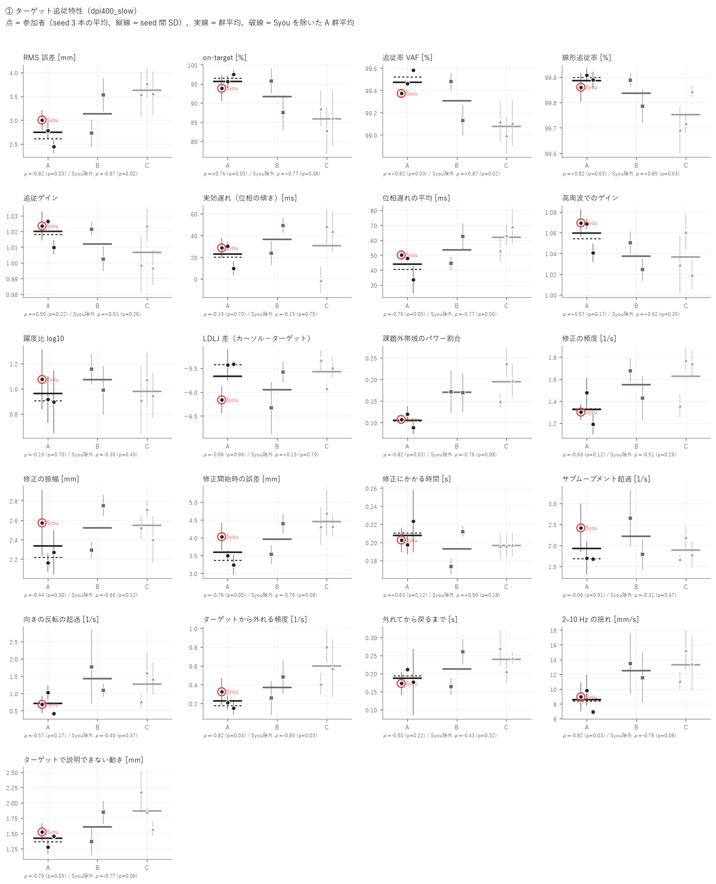
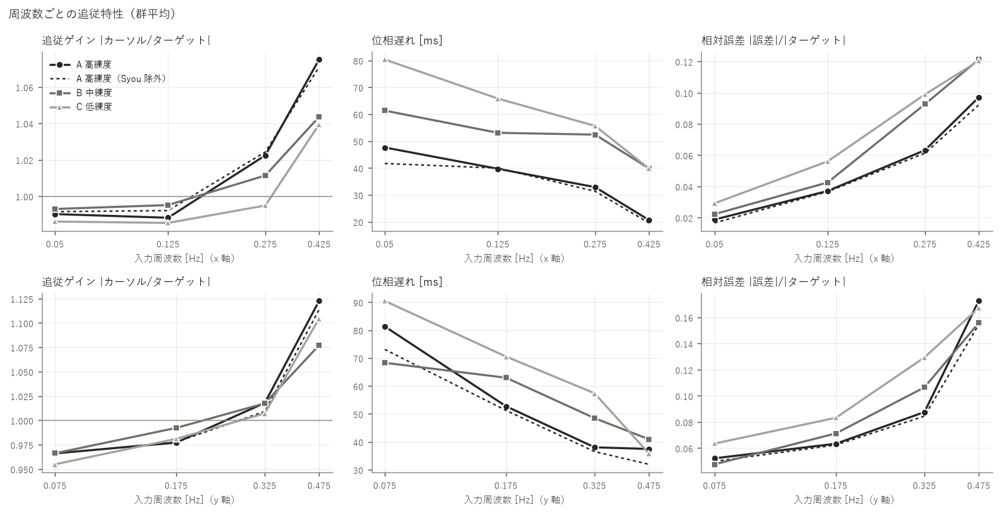
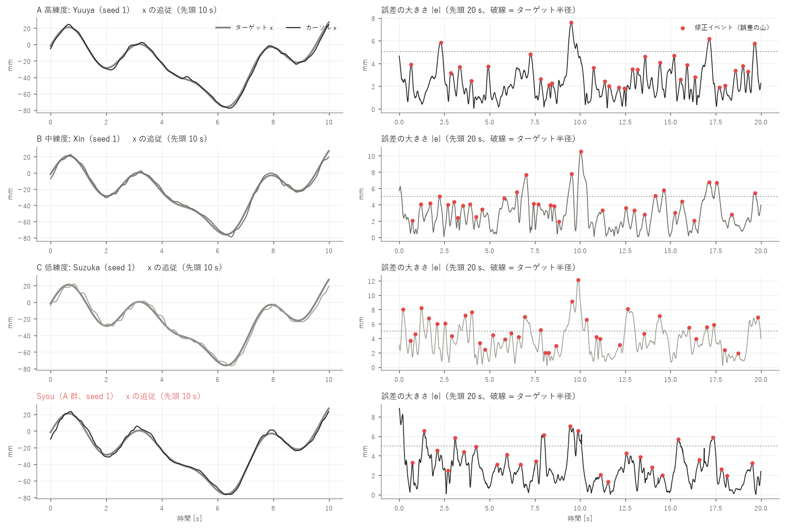
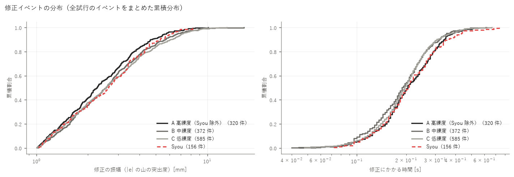
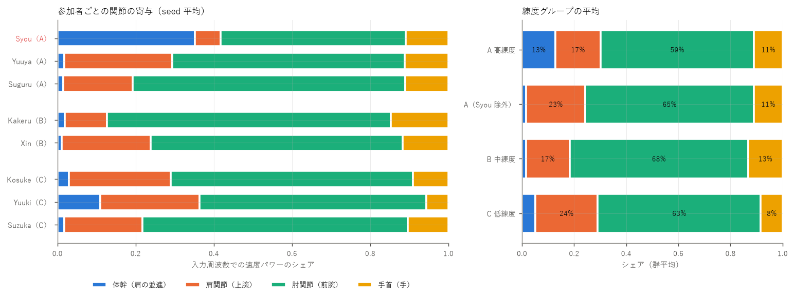
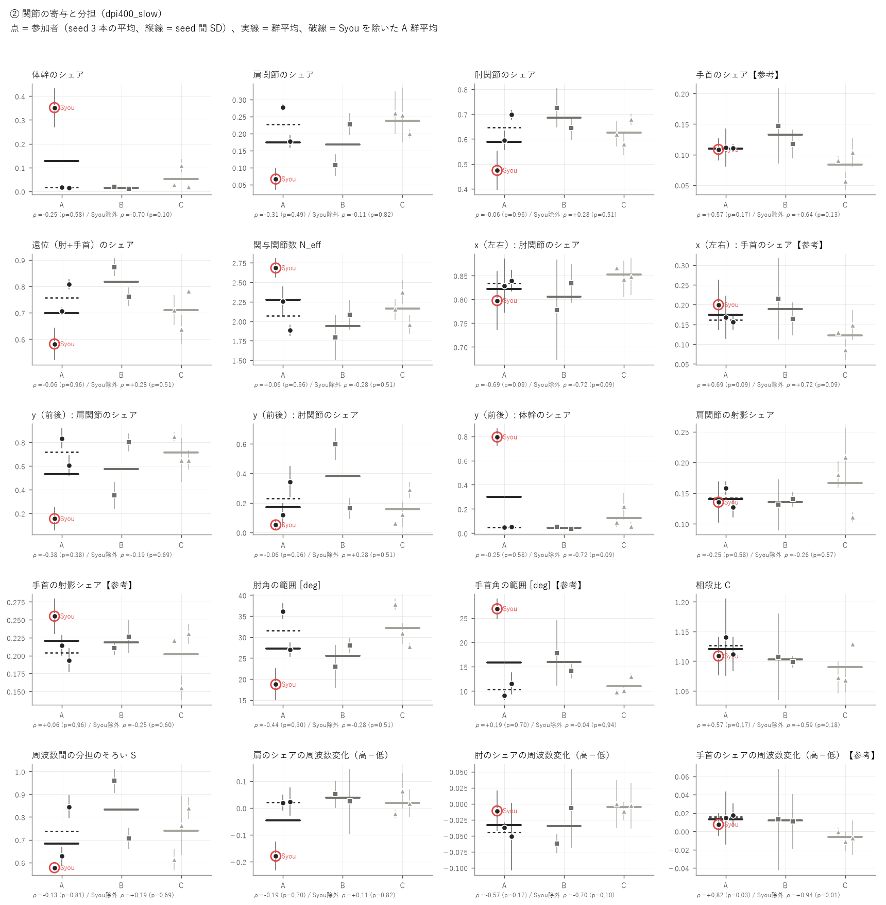
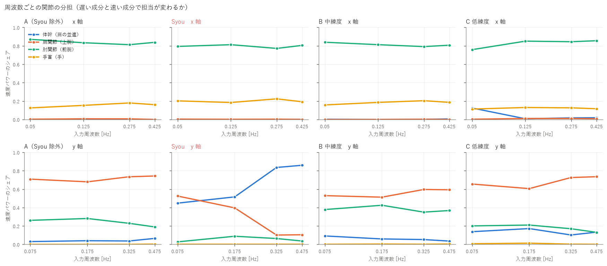
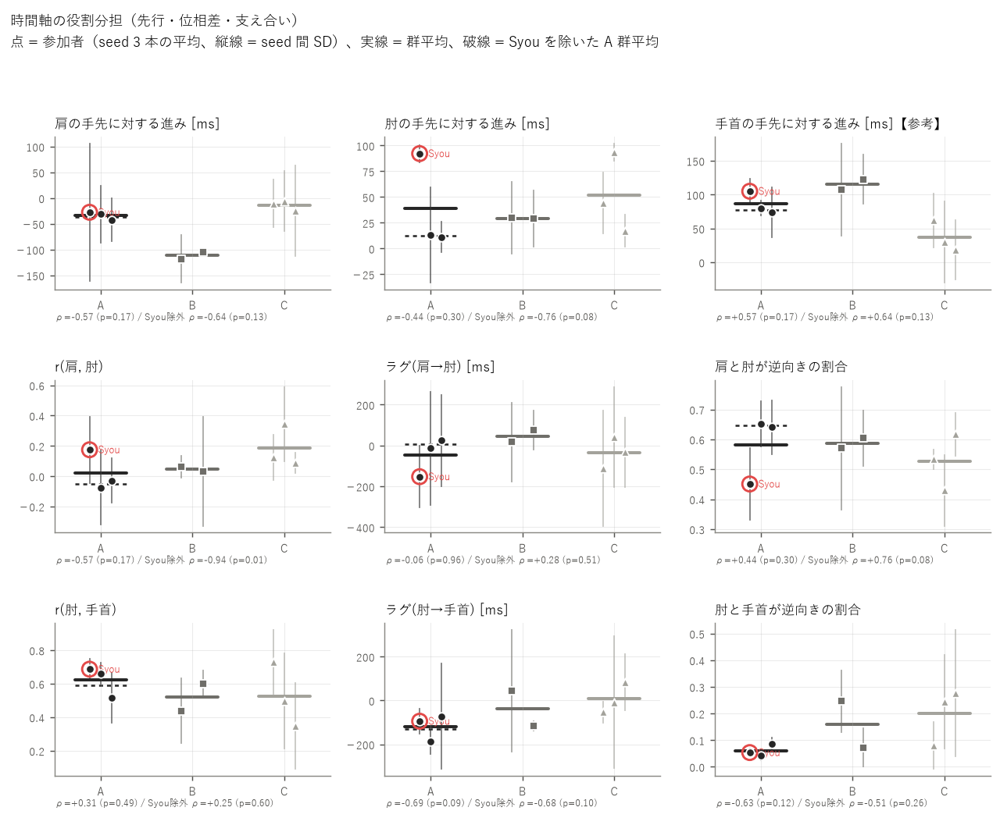
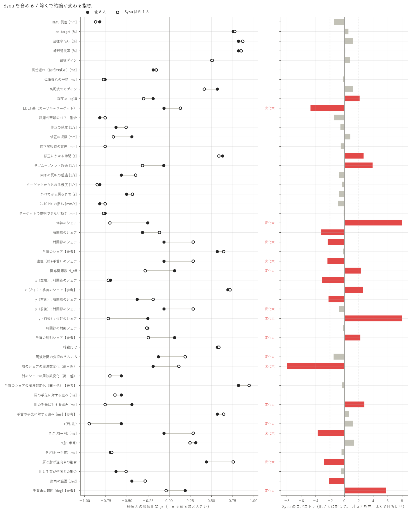

# 練度別の追従特性・上肢協調の解析 — 400 DPI / SLOW

生成: 2026-10-23 03:21　条件名: `dpi400_slow`　スクリプト: `skill_analysis/run_skill.py`

この条件だけを独立に解析した結果です（他条件のデータは混ぜていません）。条件どうしの比較は `results/_compare/` を見てください。

**考察（手書き）: [discussion.md](discussion.md)**（このレポートは再実行で作り直されますが、考察は上書きされません）

## 0. 対象と読み方

- **A 高練度**: Syou, Yuuya, Suguru（解析できた人: 3）
- **B 中練度**: Kakeru, Xin（解析できた人: 2）
- **C 低練度**: Kosuke, Yuuki, Suzuka（解析できた人: 3）
- 試行: 本番の slow 試行 seed 1〜3（各参加者 3 本、計 24 本）。参加者ごとに 3 本を平均してから群を比べる
- 統計: 練度の順位（A=3 / B=2 / C=1）と参加者平均の Spearman ρ。p はラベルの全並べ替えによる正確な p（8 人 560 通り / Syou 除外 7 人 210 通り）、q は族（追従精度・滑らかさ・軌道修正・関節の寄与・時間の役割分担）ごとの BH 補正。g(A−C) は Hedges の g。判別比 D = 参加者間 SD / seed 間 SD（1 付近なら人の違いは試行のばらつきと同程度）
- **人数が 3 / 2 / 3 人と少ないため、p は探索的な目安です。** 1 人の違いで順位が入れ替わるので、必ず「Syou 除外」の列と個人の点（図）を併せて読んでください
- 関節は RealSense + MediaPipe の推定値。既存の検証（aim_eval/README）より、手首（hand）・MCP3 を使う成分（手首のシェアなど）は MoCap で未照合のため【参考】。肘は振幅を 6〜7 % 小さく捉える癖がある

## 1. 要約（p < 0.10 の指標を自動抽出）

### ① ターゲット追従特性

- **RMS 誤差 [mm]**: 高練度ほど小さい（良い向き）。ρ = -0.82（p = 0.03）/ Syou 除外 ρ = -0.87（p = 0.02）、全員でも Syou 除外でも p < 0.1。判別比 D = 1.7
- **on-target [%]**: 高練度ほど大きい（良い向き）。ρ = +0.76（p = 0.05）/ Syou 除外 ρ = +0.77（p = 0.06）、全員でも Syou 除外でも p < 0.1。判別比 D = 1.4
- **追従率 VAF [%]**: 高練度ほど大きい（良い向き）。ρ = +0.82（p = 0.03）/ Syou 除外 ρ = +0.87（p = 0.02）、全員でも Syou 除外でも p < 0.1。判別比 D = 2.1
- **線形追従率 [%]**: 高練度ほど大きい（良い向き）。ρ = +0.82（p = 0.03）/ Syou 除外 ρ = +0.85（p = 0.03）、全員でも Syou 除外でも p < 0.1。判別比 D = 1.9
- **位相遅れの平均 [ms]**: 高練度ほど小さい（良い向き）。ρ = -0.76（p = 0.05）/ Syou 除外 ρ = -0.77（p = 0.06）、全員でも Syou 除外でも p < 0.1。判別比 D = 1.8
- **課題外帯域のパワー割合**: 高練度ほど小さい（良い向き）。ρ = -0.82（p = 0.03）/ Syou 除外 ρ = -0.76（p = 0.08）、全員でも Syou 除外でも p < 0.1。判別比 D = 1.8
- **修正開始時の誤差 [mm]**: 高練度ほど小さい（良い向き）。ρ = -0.76（p = 0.05）/ Syou 除外 ρ = -0.76（p = 0.08）、全員でも Syou 除外でも p < 0.1。判別比 D = 1.5
- **ターゲットから外れる頻度 [1/s]**: 高練度ほど小さい（良い向き）。ρ = -0.82（p = 0.03）/ Syou 除外 ρ = -0.85（p = 0.03）、全員でも Syou 除外でも p < 0.1。判別比 D = 1.4
- **2–10 Hz の揺れ [mm/s]**: 高練度ほど小さい（良い向き）。ρ = -0.82（p = 0.03）/ Syou 除外 ρ = -0.76（p = 0.08）、全員でも Syou 除外でも p < 0.1。判別比 D = 1.1
- **ターゲットで説明できない動き [mm]**: 高練度ほど小さい（良い向き）。ρ = -0.76（p = 0.05）/ Syou 除外 ρ = -0.77（p = 0.06）、全員でも Syou 除外でも p < 0.1。判別比 D = 2.1

### ② 上肢関節の協調・分担

- **体幹のシェア**: 高練度ほど小さい。ρ = -0.25（p = 0.58）/ Syou 除外 ρ = -0.70（p = 0.10）、Syou 除外でのみ p < 0.1。判別比 D = 6.9
- **x（左右）: 肘関節のシェア**: 高練度ほど小さい。ρ = -0.69（p = 0.09）/ Syou 除外 ρ = -0.72（p = 0.09）、全員でも Syou 除外でも p < 0.1。判別比 D = 0.6
- **x（左右）: 手首のシェア【参考】**: 高練度ほど大きい。ρ = +0.69（p = 0.09）/ Syou 除外 ρ = +0.72（p = 0.09）、全員でも Syou 除外でも p < 0.1。判別比 D = 0.9
- **y（前後）: 体幹のシェア**: 高練度ほど小さい。ρ = -0.25（p = 0.58）/ Syou 除外 ρ = -0.72（p = 0.09）、Syou 除外でのみ p < 0.1。判別比 D = 7.5
- **肘のシェアの周波数変化（高−低）**: 高練度ほど小さい。ρ = -0.57（p = 0.17）/ Syou 除外 ρ = -0.70（p = 0.10）、Syou 除外でのみ p < 0.1。判別比 D = 0.8
- **手首のシェアの周波数変化（高−低）【参考】**: 高練度ほど大きい。ρ = +0.82（p = 0.03）/ Syou 除外 ρ = +0.94（p = 0.01）、全員でも Syou 除外でも p < 0.1。判別比 D = 0.5
- **肘の手先に対する進み [ms]**: 高練度ほど小さい。ρ = -0.44（p = 0.30）/ Syou 除外 ρ = -0.76（p = 0.08）、Syou 除外でのみ p < 0.1。判別比 D = 1.5
- **r(肩, 肘)**: 高練度ほど小さい。ρ = -0.57（p = 0.17）/ Syou 除外 ρ = -0.94（p = 0.01）、Syou 除外でのみ p < 0.1。判別比 D = 0.7
- **ラグ(肘→手首) [ms]**: 高練度ほど小さい。ρ = -0.69（p = 0.09）/ Syou 除外 ρ = -0.68（p = 0.10）、全員でのみ p < 0.1。判別比 D = 0.6
- **肩と肘が逆向きの割合**: 高練度ほど大きい。ρ = +0.44（p = 0.30）/ Syou 除外 ρ = +0.76（p = 0.08）、Syou 除外でのみ p < 0.1。判別比 D = 0.8

### Syou の影響

- Syou を除くと ρ の符号が変わる、または |Δρ| ≥ 0.3 の指標: LDLJ 差（カーソル−ターゲット）（-0.06 → +0.13）、体幹のシェア（-0.25 → -0.70）、肘関節のシェア（-0.06 → +0.28）、遠位（肘+手首）のシェア（-0.06 → +0.28）、関与関節数 N_eff（+0.06 → -0.28）、y（前後）: 肘関節のシェア（-0.06 → +0.28）、y（前後）: 体幹のシェア（-0.25 → -0.72）、手首の射影シェア【参考】（+0.06 → -0.25）、周波数間の分担のそろい S（-0.13 → +0.19）、肩のシェアの周波数変化（高−低）（-0.19 → +0.11）、肘の手先に対する進み [ms]（-0.44 → -0.76）、r(肩, 肘)（-0.57 → -0.94）、ラグ(肩→肘) [ms]（-0.06 → +0.28）、肩と肘が逆向きの割合（+0.44 → +0.76）、手首角の範囲 [deg]【参考】（+0.19 → -0.04）
- Syou が他 7 人から外れている指標（|ロバスト z| ≥ 2）: 躍度比 log10（z = +2.2）、LDLJ 差（カーソル−ターゲット）（z = -4.7）、修正にかかる時間 [s]（z = +2.7）、サブムーブメント超過 [1/s]（z = +3.9）、体幹のシェア（z = +73.1）、肩関節のシェア（z = -3.2）、肘関節のシェア（z = -2.3）、遠位（肘+手首）のシェア（z = -2.4）、関与関節数 N_eff（z = +2.3）、x（左右）: 肘関節のシェア（z = -3.1）、x（左右）: 手首のシェア【参考】（z = +2.6）、y（前後）: 肩関節のシェア（z = -2.2）、y（前後）: 体幹のシェア（z = +94.5）、手首の射影シェア【参考】（z = +2.3）、肩のシェアの周波数変化（高−低）（z = -23.6）、肘の手先に対する進み [ms]（z = +2.8）、ラグ(肩→肘) [ms]（z = -3.7）、肩と肘が逆向きの割合（z = -2.8）、肘角の範囲 [deg]（z = -2.2）、手首角の範囲 [deg]【参考】（z = +5.8）

## 2. ① ターゲット追従特性

指標の定義: 追従率 VAF = 1 − Σ|誤差|²/Σ|ターゲットの変動|²、線形追従率 = カーソルのパワーのうち入力周波数に乗った割合、躍度比 = log10(RMS 躍度 カーソル / ターゲット)（0 = ターゲットと同じ滑らかさ）、修正イベント = 誤差の大きさ |e| の山（ずれが最大になり戻り始めた点。突出度 ≥ 1.0 mm）。すべて画面上の mm。

### 群ごとの値（参加者平均の平均 ± SD）

| 指標 | A 高練度 | A（Syou 除外） | B 中練度 | C 低練度 | Syou（個人） |
|---|---|---|---|---|---|
| RMS 誤差 [mm] | 2.75 ± 0.28 | 2.62 ± 0.24 | 3.13 ± 0.57 | 3.63 ± 0.13 | 3.00 |
| on-target [%] | 95.7 ± 1.8 | 96.6 ± 1.4 | 91.6 ± 5.8 | 85.9 ± 2.9 | 93.9 |
| 追従率 VAF [%] | 99.5 ± 0.1 | 99.5 ± 0.1 | 99.3 ± 0.2 | 99.1 ± 0.1 | 99.4 |
| 線形追従率 [%] | 99.9 ± 0.0 | 99.9 ± 0.0 | 99.8 ± 0.1 | 99.8 ± 0.1 | 99.9 |
| 追従ゲイン | 1.020 ± 0.009 | 1.018 ± 0.012 | 1.012 ± 0.013 | 1.007 ± 0.015 | 1.024 |
| 実効遅れ（位相の傾き）[ms] | 22.9 ± 11.5 | 20.0 ± 14.6 | 36.4 ± 18.0 | 30.7 ± 27.4 | 28.6 |
| 位相遅れの平均 [ms] | 43.8 ± 9.0 | 40.7 ± 10.2 | 53.4 ± 12.8 | 62.0 ± 8.1 | 50.1 |
| 高周波でのゲイン | 1.060 ± 0.016 | 1.055 ± 0.020 | 1.037 ± 0.018 | 1.037 ± 0.022 | 1.069 |
| 躍度比 log10 | 0.961 ± 0.098 | 0.905 ± 0.013 | 1.072 ± 0.118 | 0.979 ± 0.085 | 1.074 |
| LDLJ 差（カーソル−ターゲット） | -5.671 ± 0.427 | -5.425 ± 0.011 | -5.955 ± 0.531 | -5.576 ± 0.304 | -6.164 |
| 課題外帯域のパワー割合 | 0.105 ± 0.016 | 0.104 ± 0.022 | 0.170 ± 0.002 | 0.195 ± 0.044 | 0.107 |
| 修正の頻度 [1/s] | 1.322 ± 0.143 | 1.333 ± 0.200 | 1.550 ± 0.177 | 1.625 ± 0.232 | 1.300 |
| 修正の振幅 [mm] | 2.34 ± 0.21 | 2.22 ± 0.08 | 2.52 ± 0.32 | 2.55 ± 0.16 | 2.57 |
| 修正開始時の誤差 [mm] | 3.59 ± 0.40 | 3.37 ± 0.18 | 3.96 ± 0.61 | 4.45 ± 0.21 | 4.03 |
| 修正にかかる時間 [s] | 0.208 ± 0.014 | 0.210 ± 0.018 | 0.193 ± 0.027 | 0.196 ± 0.001 | 0.203 |
| サブムーブメント超過 [1/s] | 1.931 ± 0.421 | 1.688 ± 0.018 | 2.217 ± 0.613 | 1.889 ± 0.276 | 2.417 |
| 向きの反転の超過 [1/s] | 0.711 ± 0.309 | 0.725 ± 0.436 | 1.429 ± 0.477 | 1.269 ± 0.444 | 0.683 |
| ターゲットから外れる頻度 [1/s] | 0.228 ± 0.089 | 0.179 ± 0.041 | 0.371 ± 0.159 | 0.597 ± 0.201 | 0.325 |
| 外れてから戻るまで [s] | 0.187 ± 0.021 | 0.194 ± 0.024 | 0.212 ± 0.068 | 0.240 ± 0.032 | 0.173 |
| 2–10 Hz の揺れ [mm/s] | 8.58 ± 1.50 | 8.38 ± 2.06 | 12.50 ± 1.34 | 13.29 ± 2.08 | 8.96 |
| ターゲットで説明できない動き [mm] | 1.42 ± 0.13 | 1.37 ± 0.12 | 1.61 ± 0.34 | 1.87 ± 0.30 | 1.53 |

### 練度との関係

| 指標 | ρ 全員 | p | q(BH) | ρ Syou除外 | p | g(A−C) 全員 | g(A−C) 除外 | KW p | 判別比 D | Syou z | 除外で変化 |
|---|---|---|---|---|---|---|---|---|---|---|---|
| RMS 誤差 [mm] | -0.82 | 0.03 | 0.08 | -0.87 | 0.02 | -3.25 | -4.26 | 0.08 | 1.7 | -1.4 |  |
| on-target [%] | +0.76 | 0.05 | 0.08 | +0.77 | 0.06 | +3.25 | +3.14 | 0.13 | 1.4 | +0.6 |  |
| 追従率 VAF [%] | +0.82 | 0.03 | 0.08 | +0.87 | 0.02 | +3.58 | +4.38 | 0.08 | 2.1 | +1.2 |  |
| 線形追従率 [%] | +0.82 | 0.03 | 0.08 | +0.85 | 0.03 | +1.78 | +1.59 | 0.10 | 1.9 | +0.2 |  |
| 追従ゲイン | +0.50 | 0.22 | 0.25 | +0.51 | 0.26 | +0.87 | +0.60 | 0.39 | 1.5 | +0.8 |  |
| 実効遅れ（位相の傾き）[ms] | -0.19 | 0.70 | 0.70 | -0.15 | 0.75 | -0.30 | -0.32 | 0.71 | 1.8 | -0.1 |  |
| 位相遅れの平均 [ms] | -0.76 | 0.05 | 0.08 | -0.77 | 0.06 | -1.69 | -1.74 | 0.13 | 1.8 | -0.2 |  |
| 高周波でのゲイン | +0.57 | 0.17 | 0.23 | +0.42 | 0.35 | +0.96 | +0.62 | 0.26 | 1.5 | +1.2 |  |
| 躍度比 log10 | -0.19 | 0.70 | 0.96 | -0.30 | 0.49 | -0.15 | -0.77 | 0.36 | 0.5 | +2.2 |  |
| LDLJ 差（カーソル−ターゲット） | -0.06 | 0.96 | 0.96 | +0.13 | 0.79 | -0.21 | +0.44 | 0.41 | 1.6 | -4.7 | **あり** |
| 課題外帯域のパワー割合 | -0.82 | 0.03 | 0.09 | -0.76 | 0.08 | -2.16 | -1.72 | 0.08 | 1.8 | -1.5 |  |
| 修正の頻度 [1/s] | -0.63 | 0.12 | 0.20 | -0.51 | 0.26 | -1.26 | -0.96 | 0.24 | 1.9 | -0.6 |  |
| 修正の振幅 [mm] | -0.44 | 0.30 | 0.33 | -0.66 | 0.12 | -0.91 | -1.78 | 0.41 | 1.3 | +0.9 |  |
| 修正開始時の誤差 [mm] | -0.76 | 0.05 | 0.12 | -0.76 | 0.08 | -2.15 | -3.87 | 0.13 | 1.5 | -0.5 |  |
| 修正にかかる時間 [s] | +0.63 | 0.12 | 0.20 | +0.59 | 0.18 | +0.93 | +0.95 | 0.24 | 1.0 | +2.7 |  |
| サブムーブメント超過 [1/s] | -0.06 | 0.91 | 0.91 | -0.31 | 0.47 | +0.09 | -0.65 | 0.59 | 1.2 | +3.9 |  |
| 向きの反転の超過 [1/s] | -0.57 | 0.17 | 0.25 | -0.40 | 0.37 | -1.17 | -0.90 | 0.13 | 1.3 | -0.8 |  |
| ターゲットから外れる頻度 [1/s] | -0.82 | 0.03 | 0.12 | -0.85 | 0.03 | -1.90 | -1.83 | 0.10 | 1.4 | -0.3 |  |
| 外れてから戻るまで [s] | -0.50 | 0.22 | 0.27 | -0.43 | 0.32 | -1.56 | -1.12 | 0.39 | 1.2 | -0.8 |  |
| 2–10 Hz の揺れ [mm/s] | -0.82 | 0.03 | 0.12 | -0.76 | 0.08 | -2.08 | -1.72 | 0.08 | 1.1 | -0.9 |  |
| ターゲットで説明できない動き [mm] | -0.76 | 0.05 | 0.12 | -0.77 | 0.06 | -1.55 | -1.41 | 0.13 | 2.1 | -0.1 |  |

### 参加者ごと（主な指標）

| 参加者 | 群 | RMS 誤差 [mm] | on-target [%] | 追従率 VAF [%] | 実効遅れ（位相の傾き）[ms] | 躍度比 log10 | 修正の頻度 [1/s] | 修正の振幅 [mm] | ターゲットから外れる頻度 [1/s] | 2–10 Hz の揺れ [mm/s] |
|---|---|---|---|---|---|---|---|---|---|---|
| **Syou** | A | 3.00 | 93.9 | 99.4 | 28.6 | 1.074 | 1.300 | 2.57 | 0.325 | 8.96 |
| Yuuya | A | 2.78 | 95.6 | 99.5 | 30.4 | 0.914 | 1.475 | 2.16 | 0.208 | 9.84 |
| Suguru | A | 2.45 | 97.6 | 99.6 | 9.7 | 0.896 | 1.192 | 2.27 | 0.150 | 6.93 |
| Kakeru | B | 2.73 | 95.8 | 99.5 | 23.7 | 1.156 | 1.675 | 2.29 | 0.258 | 13.45 |
| Xin | B | 3.53 | 87.5 | 99.1 | 49.1 | 0.988 | 1.425 | 2.75 | 0.483 | 11.55 |
| Kosuke | C | 3.55 | 88.6 | 99.1 | -0.9 | 0.912 | 1.358 | 2.52 | 0.408 | 11.14 |
| Yuuki | C | 3.78 | 82.9 | 99.0 | 48.7 | 1.074 | 1.775 | 2.71 | 0.808 | 15.29 |
| Suzuka | C | 3.57 | 86.2 | 99.1 | 44.3 | 0.949 | 1.742 | 2.40 | 0.575 | 13.46 |









## 3. ② 上肢関節の協調・分担（肩 / 肘 / 手首）

手先（MCP3）の動き = 体幹（肩の並進）+ 肩関節（上腕の回転）+ 肘関節（前腕の回転）+ 手首（手の回転）に足し算で分け、入力周波数での速度パワーのシェアを寄与とする（近傍ビンのノイズを引く。aim_eval の a1 と同じ定義）。「体幹（肩の並進）」は肩の点そのものの移動で、体幹の傾き・回旋と肩甲帯（肩をすくめる・前に出す）の両方を含む。

### 3.1 寄与・運動量の分配

| 指標 | A 高練度 | A（Syou 除外） | B 中練度 | C 低練度 | Syou（個人） |
|---|---|---|---|---|---|
| 体幹のシェア | 0.128 ± 0.194 | 0.016 ± 0.001 | 0.015 ± 0.006 | 0.052 ± 0.050 | 0.352 |
| 肩関節のシェア | 0.173 ± 0.106 | 0.227 ± 0.071 | 0.167 ± 0.085 | 0.238 ± 0.034 | 0.066 |
| 肘関節のシェア | 0.589 ± 0.112 | 0.646 ± 0.073 | 0.685 ± 0.058 | 0.626 ± 0.050 | 0.474 |
| 手首のシェア【参考】 | 0.110 ± 0.001 | 0.111 ± 0.001 | 0.132 ± 0.021 | 0.084 ± 0.024 | 0.108 |
| 遠位（肘+手首）のシェア | 0.699 ± 0.113 | 0.757 ± 0.072 | 0.817 ± 0.079 | 0.710 ± 0.073 | 0.582 |
| 関与関節数 N_eff | 2.276 ± 0.399 | 2.072 ± 0.264 | 1.938 ± 0.206 | 2.161 ± 0.209 | 2.683 |
| x（左右）: 肘関節のシェア | 0.822 ± 0.022 | 0.834 ± 0.007 | 0.806 ± 0.039 | 0.852 ± 0.012 | 0.797 |
| x（左右）: 手首のシェア【参考】 | 0.174 ± 0.023 | 0.162 ± 0.008 | 0.189 ± 0.036 | 0.122 ± 0.032 | 0.200 |
| y（前後）: 肩関節のシェア | 0.531 ± 0.345 | 0.719 ± 0.162 | 0.575 ± 0.317 | 0.716 ± 0.114 | 0.155 |
| y（前後）: 肘関節のシェア | 0.170 ± 0.153 | 0.230 ± 0.159 | 0.379 ± 0.306 | 0.158 ± 0.118 | 0.051 |
| y（前後）: 体幹のシェア | 0.298 ± 0.430 | 0.050 ± 0.003 | 0.043 ± 0.012 | 0.123 ± 0.087 | 0.794 |
| 肩関節の射影シェア | 0.140 ± 0.016 | 0.143 ± 0.022 | 0.136 ± 0.006 | 0.167 ± 0.050 | 0.135 |
| 手首の射影シェア【参考】 | 0.221 ± 0.031 | 0.204 ± 0.015 | 0.218 ± 0.011 | 0.202 ± 0.041 | 0.255 |
| 肘角の範囲 [deg] | 27.3 ± 8.7 | 31.6 ± 6.5 | 25.5 ± 3.6 | 32.2 ± 5.1 | 18.7 |
| 手首角の範囲 [deg]【参考】 | 15.8 ± 9.6 | 10.3 ± 1.7 | 16.0 ± 2.6 | 11.0 ± 1.8 | 26.9 |





### 3.2 時間軸の役割分担（周波数による分担・先行・支え合い）

- **周波数による分担**: 各軸の低い入力周波数 2 つと高い 2 つでのシェアの差（高 − 低）。+ = 速い成分ほどその関節が担う
- **先行**: 入力周波数での手先に対する位相の進み [ms]（+ = 手先より先に動く）。成分の振幅で重み付け
- **相互相関**: 課題の帯域に絞った成分の速度どうし（x・y の平均）。r < 0 = 逆向きに動いて互いを打ち消す＝支え合い（補償）、ラグ + = 前の成分が先行
- **相殺比 C**: Σ|成分| / |手先|。1 = 素直な足し算、> 1 = 打ち消し合いながら手先を作る

| 指標 | A 高練度 | A（Syou 除外） | B 中練度 | C 低練度 | Syou（個人） |
|---|---|---|---|---|---|
| 相殺比 C | 1.120 ± 0.017 | 1.126 ± 0.020 | 1.103 ± 0.006 | 1.090 ± 0.034 | 1.109 |
| 周波数間の分担のそろい S | 0.683 ± 0.142 | 0.737 ± 0.154 | 0.832 ± 0.179 | 0.739 ± 0.115 | 0.577 |
| 肩のシェアの周波数変化（高−低） | -0.045 ± 0.116 | 0.022 ± 0.002 | 0.037 ± 0.019 | 0.020 ± 0.043 | -0.179 |
| 肘のシェアの周波数変化（高−低） | -0.033 ± 0.020 | -0.044 ± 0.010 | -0.035 ± 0.039 | -0.005 ± 0.006 | -0.011 |
| 手首のシェアの周波数変化（高−低）【参考】 | 0.013 ± 0.005 | 0.016 ± 0.002 | 0.012 ± 0.001 | -0.006 ± 0.005 | 0.007 |
| 肩の手先に対する進み [ms] | -33.8 ± 7.7 | -36.9 ± 7.8 | -111.5 ± 9.4 | -13.6 ± 9.7 | -27.6 |
| 肘の手先に対する進み [ms] | 38.8 ± 46.2 | 12.1 ± 1.3 | 29.2 ± 0.5 | 51.6 ± 38.7 | 92.1 |
| 手首の手先に対する進み [ms]【参考】 | 86.2 ± 16.5 | 76.8 ± 4.1 | 114.9 ± 11.1 | 36.6 ± 22.5 | 105.0 |
| r(肩, 肘) | 0.023 ± 0.133 | -0.052 ± 0.033 | 0.047 ± 0.020 | 0.185 ± 0.139 | 0.174 |
| ラグ(肩→肘) [ms] | -47.2 ± 93.5 | 5.6 ± 27.5 | 45.8 ± 41.2 | -34.3 ± 76.4 | -152.8 |
| r(肘, 手首) | 0.622 ± 0.091 | 0.589 ± 0.102 | 0.519 ± 0.115 | 0.525 ± 0.193 | 0.687 |
| ラグ(肘→手首) [ms] | -118.5 ± 61.9 | -130.6 ± 82.5 | -36.1 ± 113.9 | 7.4 ± 69.4 | -94.4 |
| 肩と肘が逆向きの割合 | 0.581 ± 0.113 | 0.646 ± 0.008 | 0.587 ± 0.024 | 0.527 ± 0.094 | 0.451 |
| 肘と手首が逆向きの割合 | 0.060 ± 0.023 | 0.064 ± 0.031 | 0.159 ± 0.122 | 0.200 ± 0.105 | 0.053 |





### 3.3 練度との関係

| 指標 | ρ 全員 | p | q(BH) | ρ Syou除外 | p | g(A−C) 全員 | g(A−C) 除外 | KW p | 判別比 D | Syou z | 除外で変化 |
|---|---|---|---|---|---|---|---|---|---|---|---|
| 体幹のシェア | -0.25 | 0.58 | 0.96 | -0.70 | 0.10 | +0.43 | -0.64 | 0.49 | 6.9 | +73.1 | **あり** |
| 肩関節のシェア | -0.31 | 0.49 | 0.96 | -0.11 | 0.82 | -0.66 | -0.16 | 0.57 | 2.3 | -3.2 |  |
| 肘関節のシェア | -0.06 | 0.96 | 0.96 | +0.28 | 0.51 | -0.35 | +0.24 | 0.41 | 1.7 | -2.3 | **あり** |
| 手首のシェア【参考】 | +0.57 | 0.17 | 0.88 | +0.64 | 0.13 | +1.21 | +0.98 | 0.04 | 1.1 | -0.2 |  |
| 遠位（肘+手首）のシェア | -0.06 | 0.96 | 0.96 | +0.28 | 0.51 | -0.10 | +0.47 | 0.41 | 2.8 | -2.4 | **あり** |
| 関与関節数 N_eff | +0.06 | 0.96 | 0.96 | -0.28 | 0.51 | +0.29 | -0.28 | 0.41 | 1.9 | +2.3 | **あり** |
| x（左右）: 肘関節のシェア | -0.69 | 0.09 | 0.64 | -0.72 | 0.09 | -1.40 | -1.24 | 0.08 | 0.6 | -3.1 |  |
| x（左右）: 手首のシェア【参考】 | +0.69 | 0.09 | 0.64 | +0.72 | 0.09 | +1.53 | +1.10 | 0.08 | 0.9 | +2.6 |  |
| y（前後）: 肩関節のシェア | -0.38 | 0.38 | 0.96 | -0.19 | 0.69 | -0.58 | +0.02 | 0.57 | 2.7 | -2.2 |  |
| y（前後）: 肘関節のシェア | -0.06 | 0.96 | 0.96 | +0.28 | 0.51 | +0.07 | +0.40 | 0.41 | 2.8 | -0.7 | **あり** |
| y（前後）: 体幹のシェア | -0.25 | 0.58 | 0.96 | -0.72 | 0.09 | +0.45 | -0.75 | 0.20 | 7.5 | +94.5 | **あり** |
| 肩関節の射影シェア | -0.25 | 0.58 | 0.96 | -0.26 | 0.57 | -0.57 | -0.41 | 0.76 | 1.4 | -0.2 |  |
| 手首の射影シェア【参考】 | +0.06 | 0.96 | 0.96 | -0.25 | 0.60 | +0.41 | +0.04 | 0.99 | 2.0 | +2.3 | **あり** |
| 相殺比 C | +0.57 | 0.17 | 0.31 | +0.59 | 0.18 | +0.89 | +0.87 | 0.26 | 0.8 | +0.0 |  |
| 周波数間の分担のそろい S | -0.13 | 0.81 | 0.87 | +0.19 | 0.69 | -0.34 | -0.01 | 0.57 | 2.6 | -1.5 | **あり** |
| 肩のシェアの周波数変化（高−低） | -0.19 | 0.70 | 0.82 | +0.11 | 0.82 | -0.60 | +0.04 | 0.36 | 1.4 | -23.6 | **あり** |
| 肘のシェアの周波数変化（高−低） | -0.57 | 0.17 | 0.31 | -0.70 | 0.10 | -1.52 | -3.88 | 0.26 | 0.8 | +0.0 |  |
| 手首のシェアの周波数変化（高−低）【参考】 | +0.82 | 0.03 | 0.31 | +0.94 | 0.01 | +2.96 | +3.61 | 0.08 | 0.5 | -0.3 |  |
| 肩の手先に対する進み [ms] | -0.57 | 0.17 | 0.31 | -0.64 | 0.13 | -1.84 | -1.86 | 0.04 | 0.7 | +0.1 |  |
| 肘の手先に対する進み [ms] | -0.44 | 0.30 | 0.42 | -0.76 | 0.08 | -0.24 | -0.91 | 0.51 | 1.5 | +2.8 | **あり** |
| 手首の手先に対する進み [ms]【参考】 | +0.57 | 0.17 | 0.31 | +0.64 | 0.13 | +2.01 | +1.58 | 0.04 | 0.9 | +0.6 |  |
| r(肩, 肘) | -0.57 | 0.17 | 0.31 | -0.94 | 0.01 | -0.95 | -1.50 | 0.26 | 0.7 | +1.2 | **あり** |
| ラグ(肩→肘) [ms] | -0.06 | 0.96 | 0.96 | +0.28 | 0.51 | -0.12 | +0.45 | 0.41 | 0.4 | -3.7 | **あり** |
| r(肘, 手首) | +0.31 | 0.49 | 0.62 | +0.25 | 0.60 | +0.51 | +0.28 | 0.57 | 0.8 | +1.4 |  |
| ラグ(肘→手首) [ms] | -0.69 | 0.09 | 0.31 | -0.68 | 0.10 | -1.53 | -1.36 | 0.19 | 0.6 | -0.4 |  |
| 肩と肘が逆向きの割合 | +0.44 | 0.30 | 0.42 | +0.76 | 0.08 | +0.41 | +1.13 | 0.51 | 0.8 | -2.8 | **あり** |
| 肘と手首が逆向きの割合 | -0.63 | 0.12 | 0.31 | -0.51 | 0.26 | -1.47 | -1.13 | 0.24 | 1.1 | -0.5 |  |
| 肘角の範囲 [deg] | -0.44 | 0.30 | 0.96 | -0.28 | 0.51 | -0.55 | -0.08 | 0.41 | 2.8 | -2.2 |  |
| 手首角の範囲 [deg]【参考】 | +0.19 | 0.70 | 0.96 | -0.04 | 0.94 | +0.56 | -0.27 | 0.36 | 3.2 | +5.8 | **あり** |

### 参加者ごと（主な指標）

| 参加者 | 群 | 体幹のシェア | 肩関節のシェア | 肘関節のシェア | 手首のシェア【参考】 | 関与関節数 N_eff | 周波数間の分担のそろい S | 相殺比 C | 肘のシェアの周波数変化（高−低） | 肩の手先に対する進み [ms] | r(肩, 肘) |
|---|---|---|---|---|---|---|---|---|---|---|---|
| **Syou** | A | 0.352 | 0.066 | 0.474 | 0.108 | 2.683 | 0.577 | 1.109 | -0.011 | -27.6 | 0.174 |
| Yuuya | A | 0.017 | 0.277 | 0.595 | 0.111 | 2.259 | 0.628 | 1.140 | -0.038 | -31.4 | -0.076 |
| Suguru | A | 0.015 | 0.177 | 0.698 | 0.110 | 1.886 | 0.845 | 1.112 | -0.051 | -42.4 | -0.029 |
| Kakeru | B | 0.019 | 0.107 | 0.726 | 0.147 | 1.792 | 0.959 | 1.107 | -0.062 | -118.1 | 0.061 |
| Xin | B | 0.012 | 0.227 | 0.644 | 0.117 | 2.083 | 0.706 | 1.099 | -0.007 | -104.9 | 0.033 |
| Kosuke | C | 0.029 | 0.261 | 0.620 | 0.091 | 2.154 | 0.613 | 1.073 | -0.001 | -10.5 | 0.124 |
| Yuuki | C | 0.109 | 0.254 | 0.580 | 0.057 | 2.373 | 0.764 | 1.068 | -0.012 | -5.9 | 0.344 |
| Suzuka | C | 0.018 | 0.199 | 0.679 | 0.104 | 1.956 | 0.840 | 1.129 | -0.003 | -24.5 | 0.088 |

## 4. Syou の個別評価（含める / 除く）

図: [Syou を含める / 除くで変わる指標](figures/syou_sensitivity.png)。左 = 練度との ρ（● 全員、○ Syou 除外）、右 = Syou の他 7 人に対するロバスト z。



| 指標 | Syou | A 群平均（除外） | B 群平均 | C 群平均 | z | ρ 全員 → 除外 |
|---|---|---|---|---|---|---|
| y（前後）: 体幹のシェア | 0.794 | 0.050 | 0.043 | 0.123 | +94.5 | -0.25 → -0.72 |
| 体幹のシェア | 0.352 | 0.016 | 0.015 | 0.052 | +73.1 | -0.25 → -0.70 |
| 肩のシェアの周波数変化（高−低） | -0.179 | 0.022 | 0.037 | 0.020 | -23.6 | -0.19 → +0.11 |
| 手首角の範囲 [deg]【参考】 | 26.9 | 10.3 | 16.0 | 11.0 | +5.8 | +0.19 → -0.04 |
| LDLJ 差（カーソル−ターゲット） | -6.164 | -5.425 | -5.955 | -5.576 | -4.7 | -0.06 → +0.13 |
| サブムーブメント超過 [1/s] | 2.417 | 1.688 | 2.217 | 1.889 | +3.9 | -0.06 → -0.31 |
| ラグ(肩→肘) [ms] | -152.8 | 5.6 | 45.8 | -34.3 | -3.7 | -0.06 → +0.28 |
| 肩関節のシェア | 0.066 | 0.227 | 0.167 | 0.238 | -3.2 | -0.31 → -0.11 |
| x（左右）: 肘関節のシェア | 0.797 | 0.834 | 0.806 | 0.852 | -3.1 | -0.69 → -0.72 |
| 肩と肘が逆向きの割合 | 0.451 | 0.646 | 0.587 | 0.527 | -2.8 | +0.44 → +0.76 |
| 肘の手先に対する進み [ms] | 92.1 | 12.1 | 29.2 | 51.6 | +2.8 | -0.44 → -0.76 |
| 修正にかかる時間 [s] | 0.203 | 0.210 | 0.193 | 0.196 | +2.7 | +0.63 → +0.59 |

（|z| の大きい順に 12 指標）

## 5. 計測の確認（試行ごと）

手首の 3 次元変位 / マウスの変位 のゲイン（机の座標系を決める回帰の副産物）と、関節が 4 点そろったフレームの割合。マウスの動きの一部は手首の回転（手首より先）が作るので、手首のゲインは 1 より小さいのが普通（特に x。既存の a0 でも同程度）。参加者間・seed 間で極端に外れていないかを見る。

| 参加者 | 群 | 試行 | ゲイン x | ゲイン y | 有効率 [%] | RS fps |
|---|---|---|---|---|---|---|
| Syou | A | trial_01_slow_s1 | 0.49 | 0.97 | 100 | 29.8 |
| Syou | A | trial_02_slow_s2 | 0.53 | 1.04 | 100 | 29.8 |
| Syou | A | trial_03_slow_s3 | 0.52 | 1.08 | 100 | 29.8 |
| Yuuya | A | trial_01_slow_s1 | 0.58 | 0.84 | 100 | 29.8 |
| Yuuya | A | trial_02_slow_s2 | 0.55 | 0.99 | 100 | 29.8 |
| Yuuya | A | trial_03_slow_s3 | 0.58 | 1.05 | 100 | 29.8 |
| Suguru | A | trial_01_slow_s1 | 0.63 | 0.94 | 100 | 29.8 |
| Suguru | A | trial_02_slow_s2 | 0.58 | 0.97 | 100 | 29.8 |
| Suguru | A | trial_03_slow_s3 | 0.63 | 1.08 | 100 | 29.8 |
| Kakeru | B | trial_01_slow_s1 | 0.48 | 0.83 | 100 | 29.8 |
| Kakeru | B | trial_02_slow_s2 | 0.57 | 0.93 | 100 | 29.8 |
| Kakeru | B | trial_03_slow_s3 | 0.61 | 1.05 | 100 | 29.8 |
| Xin | B | trial_01_slow_s1 | 0.53 | 0.82 | 100 | 29.8 |
| Xin | B | trial_02_slow_s2 | 0.57 | 0.92 | 100 | 29.8 |
| Xin | B | trial_03_slow_s3 | 0.63 | 1.03 | 100 | 29.8 |
| Kosuke | C | trial_01_slow_s1 | 0.58 | 0.99 | 100 | 29.8 |
| Kosuke | C | trial_02_slow_s2 | 0.60 | 0.95 | 100 | 29.8 |
| Kosuke | C | trial_03_slow_s3 | 0.60 | 0.99 | 100 | 29.8 |
| Yuuki | C | trial_01_slow_s1 | 0.69 | 0.98 | 100 | 29.8 |
| Yuuki | C | trial_02_slow_s2 | 0.69 | 1.04 | 97 | 29.8 |
| Yuuki | C | trial_03_slow_s3 | 0.71 | 1.03 | 92 | 29.8 |
| Suzuka | C | trial_01_slow_s1 | 0.58 | 0.97 | 100 | 29.8 |
| Suzuka | C | trial_02_slow_s2 | 0.57 | 1.03 | 97 | 29.8 |
| Suzuka | C | trial_03_slow_s3 | 0.63 | 1.03 | 92 | 29.8 |

## 6. 出力ファイル

- [`data/sessions_used.csv`](data/sessions_used.csv) — 使った試行フォルダと計測の確認値
- [`data/missing.csv`](data/missing.csv) — 欠測
- [`data/trials.csv`](data/trials.csv) — 試行ごとの全指標
- [`data/persons.csv`](data/persons.csv) — 参加者ごとの平均（`__sd` = seed 間 SD）
- [`data/group_tests.csv`](data/group_tests.csv) — 指標ごとの群平均・ρ・p・q・g・D・Syou の z（全員 / Syou 除外）
- [`data/freq_tracking_trials.csv`](data/freq_tracking_trials.csv) — 入力周波数ごとの追従（ゲイン・遅れ・相対誤差）
- [`data/freq_tracking_group.csv`](data/freq_tracking_group.csv) — 同・群平均
- [`data/freq_joint_trials.csv`](data/freq_joint_trials.csv) — 入力周波数ごとの関節のシェア・射影・位相
- [`data/freq_joint_person.csv`](data/freq_joint_person.csv) — 同・参加者平均
- [`data/freq_joint_group.csv`](data/freq_joint_group.csv) — 同・群平均
- [`data/correction_events.csv`](data/correction_events.csv) — 修正イベント 1 件ずつ
- `figures/*.png` — 本文の図、`trials/*.json` — 試行ごとの詳細

## 7. 他条件への展開

```
python skill_analysis/run_skill.py --cond dpi800_slow   # 1 条件
python skill_analysis/run_skill.py --all                # 4 条件（それぞれ独立に results/<条件>/）
python skill_analysis/compare_conditions.py             # 条件 × 指標の比較表（results/_compare/）
```
