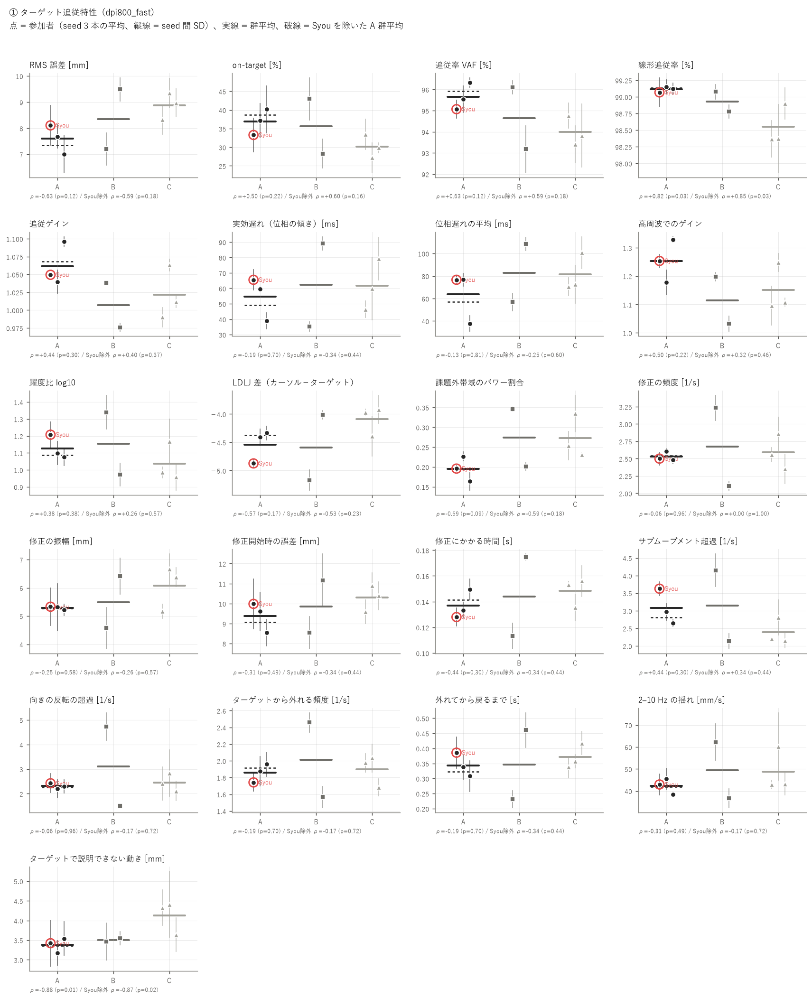
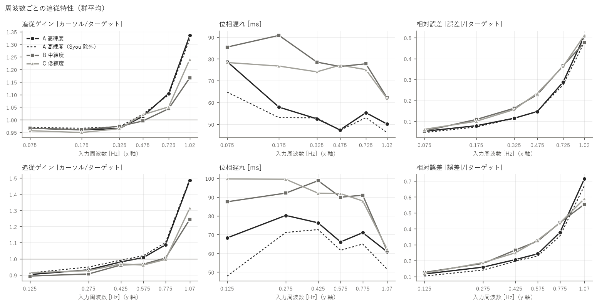
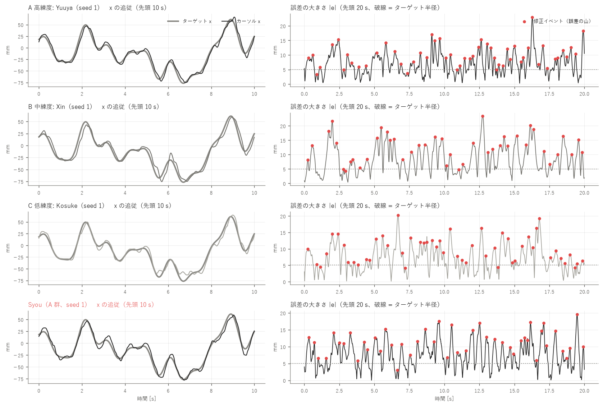
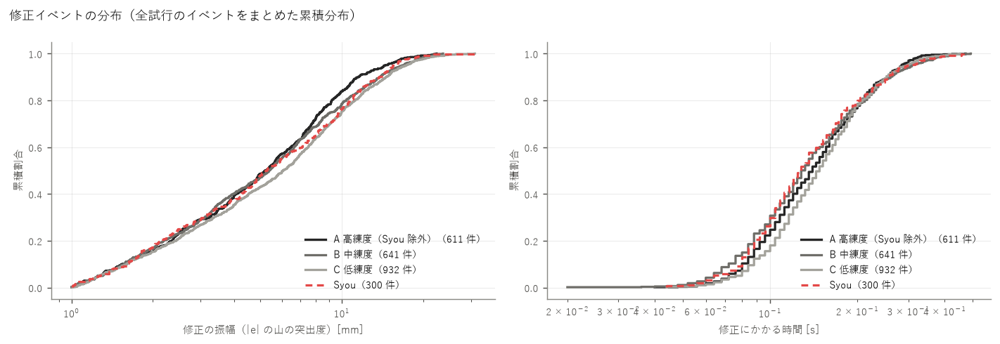
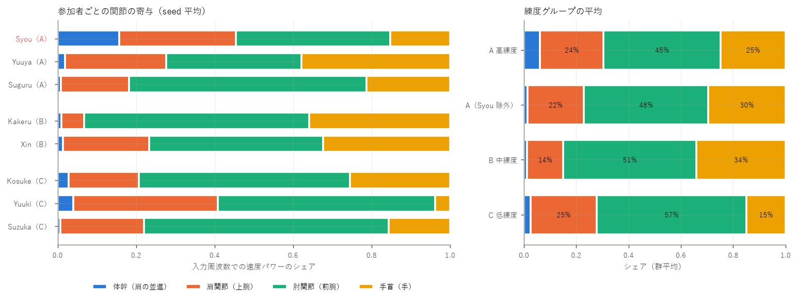
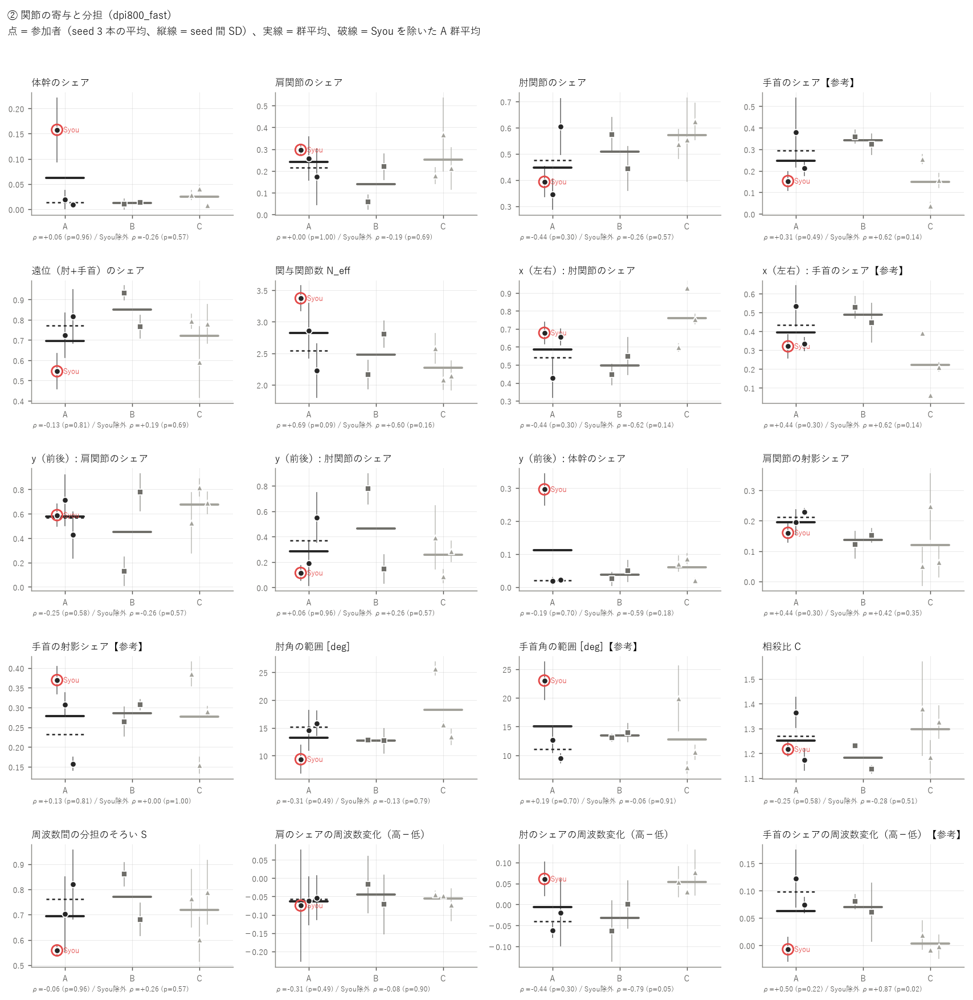
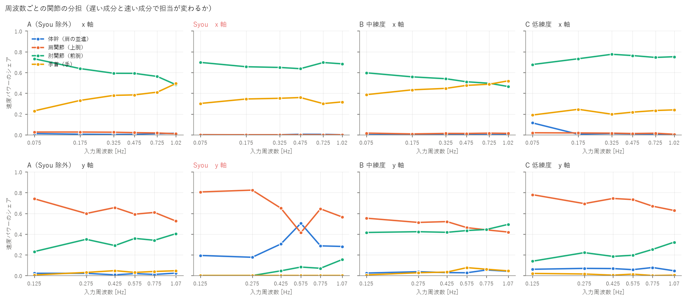
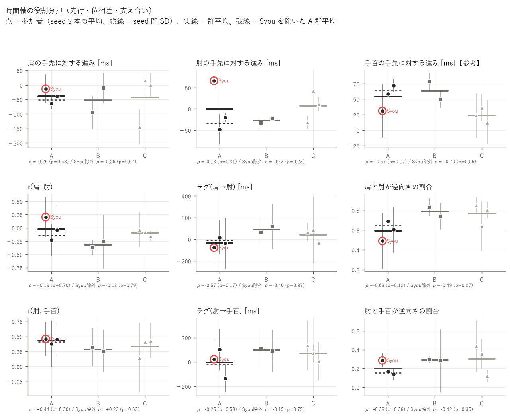
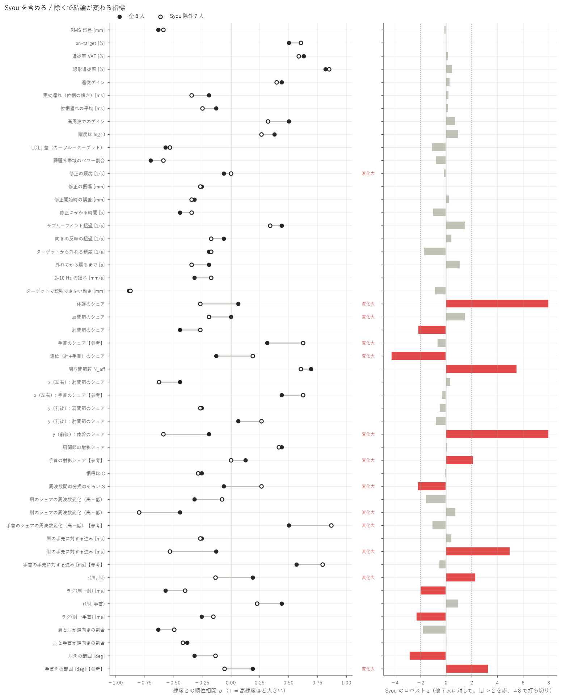

# 練度別の追従特性・上肢協調の解析 — 800 DPI / FAST

生成: 2026-10-23 03:22　条件名: `dpi800_fast`　スクリプト: `skill_analysis/run_skill.py`

この条件だけを独立に解析した結果です（他条件のデータは混ぜていません）。条件どうしの比較は `results/_compare/` を見てください。

**考察（手書き）: [discussion.md](discussion.md)**（このレポートは再実行で作り直されますが、考察は上書きされません）

## 0. 対象と読み方

- **A 高練度**: Syou, Yuuya, Suguru（解析できた人: 3）
- **B 中練度**: Kakeru, Xin（解析できた人: 2）
- **C 低練度**: Kosuke, Yuuki, Suzuka（解析できた人: 3）
- 試行: 本番の fast 試行 seed 1〜3（各参加者 3 本、計 24 本）。参加者ごとに 3 本を平均してから群を比べる
- 統計: 練度の順位（A=3 / B=2 / C=1）と参加者平均の Spearman ρ。p はラベルの全並べ替えによる正確な p（8 人 560 通り / Syou 除外 7 人 210 通り）、q は族（追従精度・滑らかさ・軌道修正・関節の寄与・時間の役割分担）ごとの BH 補正。g(A−C) は Hedges の g。判別比 D = 参加者間 SD / seed 間 SD（1 付近なら人の違いは試行のばらつきと同程度）
- **人数が 3 / 2 / 3 人と少ないため、p は探索的な目安です。** 1 人の違いで順位が入れ替わるので、必ず「Syou 除外」の列と個人の点（図）を併せて読んでください
- 関節は RealSense + MediaPipe の推定値。既存の検証（aim_eval/README）より、手首（hand）・MCP3 を使う成分（手首のシェアなど）は MoCap で未照合のため【参考】。肘は振幅を 6〜7 % 小さく捉える癖がある

## 1. 要約（p < 0.10 の指標を自動抽出）

### ① ターゲット追従特性

- **線形追従率 [%]**: 高練度ほど大きい（良い向き）。ρ = +0.82（p = 0.03）/ Syou 除外 ρ = +0.85（p = 0.03）、全員でも Syou 除外でも p < 0.1。判別比 D = 1.6
- **課題外帯域のパワー割合**: 高練度ほど小さい（良い向き）。ρ = -0.69（p = 0.09）/ Syou 除外 ρ = -0.59（p = 0.18）、全員でのみ p < 0.1。判別比 D = 3.6
- **ターゲットで説明できない動き [mm]**: 高練度ほど小さい（良い向き）。ρ = -0.88（p = 0.01）/ Syou 除外 ρ = -0.87（p = 0.02）、全員でも Syou 除外でも p < 0.1。判別比 D = 1.0

### ② 上肢関節の協調・分担

- **関与関節数 N_eff**: 高練度ほど大きい。ρ = +0.69（p = 0.09）/ Syou 除外 ρ = +0.60（p = 0.16）、全員でのみ p < 0.1。判別比 D = 1.7
- **肘のシェアの周波数変化（高−低）**: 高練度ほど小さい。ρ = -0.44（p = 0.30）/ Syou 除外 ρ = -0.79（p = 0.05）、Syou 除外でのみ p < 0.1。判別比 D = 1.2
- **手首のシェアの周波数変化（高−低）【参考】**: 高練度ほど大きい。ρ = +0.50（p = 0.22）/ Syou 除外 ρ = +0.87（p = 0.02）、Syou 除外でのみ p < 0.1。判別比 D = 1.9
- **手首の手先に対する進み [ms]【参考】**: 高練度ほど大きい。ρ = +0.57（p = 0.17）/ Syou 除外 ρ = +0.79（p = 0.05）、Syou 除外でのみ p < 0.1。判別比 D = 1.1

### Syou の影響

- Syou を除くと ρ の符号が変わる、または |Δρ| ≥ 0.3 の指標: 修正の頻度 [1/s]（-0.06 → +0.00）、体幹のシェア（+0.06 → -0.26）、肩関節のシェア（+0.00 → -0.19）、手首のシェア【参考】（+0.31 → +0.62）、遠位（肘+手首）のシェア（-0.13 → +0.19）、y（前後）: 体幹のシェア（-0.19 → -0.59）、手首の射影シェア【参考】（+0.13 → +0.00）、周波数間の分担のそろい S（-0.06 → +0.26）、肘のシェアの周波数変化（高−低）（-0.44 → -0.79）、手首のシェアの周波数変化（高−低）【参考】（+0.50 → +0.87）、肘の手先に対する進み [ms]（-0.13 → -0.53）、r(肩, 肘)（+0.19 → -0.13）、手首角の範囲 [deg]【参考】（+0.19 → -0.06）
- Syou が他 7 人から外れている指標（|ロバスト z| ≥ 2）: 体幹のシェア（z = +17.8）、肘関節のシェア（z = -2.2）、遠位（肘+手首）のシェア（z = -4.3）、関与関節数 N_eff（z = +5.5）、y（前後）: 体幹のシェア（z = +27.0）、手首の射影シェア【参考】（z = +2.1）、周波数間の分担のそろい S（z = -2.2）、肘の手先に対する進み [ms]（z = +5.0）、r(肩, 肘)（z = +2.3）、ラグ(肩→肘) [ms]（z = -2.0）、ラグ(肘→手首) [ms]（z = -2.3）、肘角の範囲 [deg]（z = -2.9）、手首角の範囲 [deg]【参考】（z = +3.3）

## 2. ① ターゲット追従特性

指標の定義: 追従率 VAF = 1 − Σ|誤差|²/Σ|ターゲットの変動|²、線形追従率 = カーソルのパワーのうち入力周波数に乗った割合、躍度比 = log10(RMS 躍度 カーソル / ターゲット)（0 = ターゲットと同じ滑らかさ）、修正イベント = 誤差の大きさ |e| の山（ずれが最大になり戻り始めた点。突出度 ≥ 1.0 mm）。すべて画面上の mm。

### 群ごとの値（参加者平均の平均 ± SD）

| 指標 | A 高練度 | A（Syou 除外） | B 中練度 | C 低練度 | Syou（個人） |
|---|---|---|---|---|---|
| RMS 誤差 [mm] | 7.60 ± 0.55 | 7.34 ± 0.48 | 8.34 ± 1.62 | 8.88 ± 0.51 | 8.11 |
| on-target [%] | 36.9 ± 3.5 | 38.7 ± 2.1 | 35.6 ± 10.4 | 30.2 ± 3.2 | 33.3 |
| 追従率 VAF [%] | 95.6 ± 0.6 | 95.9 ± 0.6 | 94.6 ± 2.1 | 94.0 ± 0.7 | 95.1 |
| 線形追従率 [%] | 99.1 ± 0.0 | 99.1 ± 0.0 | 98.9 ± 0.2 | 98.5 ± 0.3 | 99.1 |
| 追従ゲイン | 1.062 ± 0.030 | 1.068 ± 0.040 | 1.007 ± 0.044 | 1.022 ± 0.038 | 1.049 |
| 実効遅れ（位相の傾き）[ms] | 54.6 ± 13.9 | 49.2 ± 14.4 | 62.2 ± 38.2 | 61.8 ± 16.5 | 65.5 |
| 位相遅れの平均 [ms] | 63.7 ± 22.5 | 57.2 ± 27.6 | 82.6 ± 36.4 | 81.3 ± 16.9 | 76.6 |
| 高周波でのゲイン | 1.253 ± 0.076 | 1.253 ± 0.107 | 1.115 ± 0.118 | 1.150 ± 0.084 | 1.253 |
| 躍度比 log10 | 1.127 ± 0.071 | 1.087 ± 0.017 | 1.155 ± 0.261 | 1.038 ± 0.114 | 1.207 |
| LDLJ 差（カーソル−ターゲット） | -4.539 ± 0.292 | -4.372 ± 0.055 | -4.592 ± 0.816 | -4.092 ± 0.261 | -4.874 |
| 課題外帯域のパワー割合 | 0.195 ± 0.032 | 0.195 ± 0.045 | 0.274 ± 0.102 | 0.273 ± 0.054 | 0.196 |
| 修正の頻度 [1/s] | 2.531 ± 0.068 | 2.546 ± 0.088 | 2.671 ± 0.795 | 2.589 ± 0.256 | 2.500 |
| 修正の振幅 [mm] | 5.29 ± 0.06 | 5.27 ± 0.07 | 5.49 ± 1.30 | 6.07 ± 0.79 | 5.33 |
| 修正開始時の誤差 [mm] | 9.38 ± 0.74 | 9.07 ± 0.75 | 9.85 ± 1.85 | 10.29 ± 0.66 | 9.98 |
| 修正にかかる時間 [s] | 0.137 ± 0.011 | 0.141 ± 0.011 | 0.144 ± 0.043 | 0.148 ± 0.011 | 0.128 |
| サブムーブメント超過 [1/s] | 3.078 ± 0.501 | 2.804 ± 0.230 | 3.142 ± 1.426 | 2.386 ± 0.367 | 3.625 |
| 向きの反転の超過 [1/s] | 2.308 ± 0.113 | 2.250 ± 0.071 | 3.117 ± 2.275 | 2.456 ± 0.368 | 2.425 |
| ターゲットから外れる頻度 [1/s] | 1.858 ± 0.109 | 1.917 ± 0.059 | 2.013 ± 0.631 | 1.897 ± 0.188 | 1.742 |
| 外れてから戻るまで [s] | 0.344 ± 0.039 | 0.323 ± 0.021 | 0.346 ± 0.162 | 0.371 ± 0.042 | 0.386 |
| 2–10 Hz の揺れ [mm/s] | 42.27 ± 3.59 | 41.95 ± 5.01 | 49.47 ± 18.00 | 48.79 ± 9.93 | 42.93 |
| ターゲットで説明できない動き [mm] | 3.38 ± 0.19 | 3.35 ± 0.26 | 3.50 ± 0.06 | 4.12 ± 0.42 | 3.42 |

### 練度との関係

| 指標 | ρ 全員 | p | q(BH) | ρ Syou除外 | p | g(A−C) 全員 | g(A−C) 除外 | KW p | 判別比 D | Syou z | 除外で変化 |
|---|---|---|---|---|---|---|---|---|---|---|---|
| RMS 誤差 [mm] | -0.63 | 0.12 | 0.32 | -0.59 | 0.18 | -1.93 | -2.24 | 0.24 | 1.6 | -0.2 |  |
| on-target [%] | +0.50 | 0.22 | 0.35 | +0.60 | 0.16 | +1.62 | +2.16 | 0.39 | 1.3 | -0.0 |  |
| 追従率 VAF [%] | +0.63 | 0.12 | 0.32 | +0.59 | 0.18 | +1.98 | +2.16 | 0.24 | 1.7 | +0.2 |  |
| 線形追従率 [%] | +0.82 | 0.03 | 0.23 | +0.85 | 0.03 | +2.07 | +1.71 | 0.10 | 1.6 | +0.5 |  |
| 追従ゲイン | +0.44 | 0.30 | 0.40 | +0.40 | 0.37 | +0.94 | +0.87 | 0.21 | 5.1 | +0.3 |  |
| 実効遅れ（位相の傾き）[ms] | -0.19 | 0.70 | 0.80 | -0.34 | 0.44 | -0.38 | -0.58 | 0.88 | 2.5 | +0.2 |  |
| 位相遅れの平均 [ms] | -0.13 | 0.81 | 0.81 | -0.25 | 0.60 | -0.71 | -0.83 | 0.89 | 2.6 | +0.2 |  |
| 高周波でのゲイン | +0.50 | 0.22 | 0.35 | +0.32 | 0.46 | +1.03 | +0.81 | 0.25 | 3.4 | +0.7 |  |
| 躍度比 log10 | +0.38 | 0.38 | 0.38 | +0.26 | 0.57 | +0.75 | +0.38 | 0.57 | 1.8 | +1.0 |  |
| LDLJ 差（カーソル−ターゲット） | -0.57 | 0.17 | 0.26 | -0.53 | 0.23 | -1.29 | -0.94 | 0.26 | 2.9 | -1.1 |  |
| 課題外帯域のパワー割合 | -0.69 | 0.09 | 0.26 | -0.59 | 0.18 | -1.40 | -1.11 | 0.15 | 3.6 | -0.8 |  |
| 修正の頻度 [1/s] | -0.06 | 0.96 | 0.96 | +0.00 | 1.00 | -0.25 | -0.15 | 0.99 | 2.7 | -0.2 | **あり** |
| 修正の振幅 [mm] | -0.25 | 0.58 | 0.88 | -0.26 | 0.57 | -1.12 | -0.90 | 0.76 | 1.4 | +0.0 |  |
| 修正開始時の誤差 [mm] | -0.31 | 0.49 | 0.88 | -0.34 | 0.44 | -1.04 | -1.28 | 0.71 | 1.1 | +0.2 |  |
| 修正にかかる時間 [s] | -0.44 | 0.30 | 0.88 | -0.34 | 0.44 | -0.81 | -0.44 | 0.51 | 2.6 | -1.0 |  |
| サブムーブメント超過 [1/s] | +0.44 | 0.30 | 0.88 | +0.34 | 0.44 | +1.26 | +0.93 | 0.51 | 3.1 | +1.5 |  |
| 向きの反転の超過 [1/s] | -0.06 | 0.96 | 0.96 | -0.17 | 0.72 | -0.43 | -0.49 | 0.99 | 2.1 | +0.4 |  |
| ターゲットから外れる頻度 [1/s] | -0.19 | 0.70 | 0.88 | -0.17 | 0.72 | -0.20 | +0.09 | 0.88 | 2.1 | -1.8 |  |
| 外れてから戻るまで [s] | -0.19 | 0.70 | 0.88 | -0.34 | 0.44 | -0.54 | -0.96 | 0.88 | 1.7 | +1.1 |  |
| 2–10 Hz の揺れ [mm/s] | -0.31 | 0.49 | 0.88 | -0.17 | 0.72 | -0.70 | -0.58 | 0.71 | 1.7 | -0.0 |  |
| ターゲットで説明できない動き [mm] | -0.88 | 0.01 | 0.11 | -0.87 | 0.02 | -1.83 | -1.49 | 0.06 | 1.0 | -0.9 |  |

### 参加者ごと（主な指標）

| 参加者 | 群 | RMS 誤差 [mm] | on-target [%] | 追従率 VAF [%] | 実効遅れ（位相の傾き）[ms] | 躍度比 log10 | 修正の頻度 [1/s] | 修正の振幅 [mm] | ターゲットから外れる頻度 [1/s] | 2–10 Hz の揺れ [mm/s] |
|---|---|---|---|---|---|---|---|---|---|---|
| **Syou** | A | 8.11 | 33.3 | 95.1 | 65.5 | 1.207 | 2.500 | 5.33 | 1.742 | 42.93 |
| Yuuya | A | 7.68 | 37.2 | 95.5 | 59.4 | 1.099 | 2.608 | 5.31 | 1.875 | 45.49 |
| Suguru | A | 7.01 | 40.2 | 96.3 | 39.0 | 1.075 | 2.483 | 5.22 | 1.958 | 38.40 |
| Kakeru | B | 7.20 | 43.0 | 96.1 | 35.2 | 1.340 | 3.233 | 4.57 | 2.458 | 62.20 |
| Xin | B | 9.49 | 28.3 | 93.2 | 89.2 | 0.971 | 2.108 | 6.41 | 1.567 | 36.74 |
| Kosuke | C | 8.33 | 33.5 | 94.8 | 46.4 | 0.985 | 2.558 | 5.17 | 1.975 | 43.03 |
| Yuuki | C | 9.34 | 27.2 | 93.4 | 59.8 | 1.168 | 2.858 | 6.66 | 2.033 | 60.26 |
| Suzuka | C | 8.97 | 29.8 | 93.8 | 79.2 | 0.959 | 2.350 | 6.38 | 1.683 | 43.09 |









## 3. ② 上肢関節の協調・分担（肩 / 肘 / 手首）

手先（MCP3）の動き = 体幹（肩の並進）+ 肩関節（上腕の回転）+ 肘関節（前腕の回転）+ 手首（手の回転）に足し算で分け、入力周波数での速度パワーのシェアを寄与とする（近傍ビンのノイズを引く。aim_eval の a1 と同じ定義）。「体幹（肩の並進）」は肩の点そのものの移動で、体幹の傾き・回旋と肩甲帯（肩をすくめる・前に出す）の両方を含む。

### 3.1 寄与・運動量の分配

| 指標 | A 高練度 | A（Syou 除外） | B 中練度 | C 低練度 | Syou（個人） |
|---|---|---|---|---|---|
| 体幹のシェア | 0.062 ± 0.083 | 0.014 ± 0.007 | 0.012 ± 0.003 | 0.025 ± 0.017 | 0.157 |
| 肩関節のシェア | 0.243 ± 0.063 | 0.216 ± 0.059 | 0.138 ± 0.115 | 0.253 ± 0.100 | 0.297 |
| 肘関節のシェア | 0.448 ± 0.138 | 0.475 ± 0.183 | 0.509 ± 0.092 | 0.572 ± 0.046 | 0.393 |
| 手首のシェア【参考】 | 0.248 ± 0.117 | 0.296 ± 0.117 | 0.341 ± 0.025 | 0.150 ± 0.109 | 0.153 |
| 遠位（肘+手首）のシェア | 0.696 ± 0.138 | 0.771 ± 0.066 | 0.850 ± 0.117 | 0.722 ± 0.112 | 0.546 |
| 関与関節数 N_eff | 2.818 ± 0.574 | 2.542 ± 0.448 | 2.483 ± 0.453 | 2.270 ± 0.267 | 3.372 |
| x（左右）: 肘関節のシェア | 0.587 ± 0.139 | 0.541 ± 0.161 | 0.497 ± 0.073 | 0.761 ± 0.166 | 0.678 |
| x（左右）: 手首のシェア【参考】 | 0.396 ± 0.120 | 0.434 ± 0.142 | 0.487 ± 0.058 | 0.221 ± 0.165 | 0.320 |
| y（前後）: 肩関節のシェア | 0.576 ± 0.142 | 0.569 ± 0.201 | 0.453 ± 0.459 | 0.678 ± 0.145 | 0.589 |
| y（前後）: 肘関節のシェア | 0.285 ± 0.233 | 0.370 ± 0.255 | 0.462 ± 0.445 | 0.255 ± 0.154 | 0.114 |
| y（前後）: 体幹のシェア | 0.112 ± 0.160 | 0.020 ± 0.003 | 0.037 ± 0.017 | 0.059 ± 0.034 | 0.296 |
| 肩関節の射影シェア | 0.195 ± 0.035 | 0.212 ± 0.024 | 0.137 ± 0.022 | 0.120 ± 0.110 | 0.160 |
| 手首の射影シェア【参考】 | 0.278 ± 0.109 | 0.232 ± 0.106 | 0.286 ± 0.030 | 0.276 ± 0.116 | 0.369 |
| 肘角の範囲 [deg] | 13.2 ± 3.4 | 15.2 ± 0.9 | 12.7 ± 0.1 | 18.2 ± 6.5 | 9.3 |
| 手首角の範囲 [deg]【参考】 | 15.0 ± 7.1 | 11.0 ± 2.3 | 13.5 ± 0.7 | 12.8 ± 6.3 | 23.0 |





### 3.2 時間軸の役割分担（周波数による分担・先行・支え合い）

- **周波数による分担**: 各軸の低い入力周波数 2 つと高い 2 つでのシェアの差（高 − 低）。+ = 速い成分ほどその関節が担う
- **先行**: 入力周波数での手先に対する位相の進み [ms]（+ = 手先より先に動く）。成分の振幅で重み付け
- **相互相関**: 課題の帯域に絞った成分の速度どうし（x・y の平均）。r < 0 = 逆向きに動いて互いを打ち消す＝支え合い（補償）、ラグ + = 前の成分が先行
- **相殺比 C**: Σ|成分| / |手先|。1 = 素直な足し算、> 1 = 打ち消し合いながら手先を作る

| 指標 | A 高練度 | A（Syou 除外） | B 中練度 | C 低練度 | Syou（個人） |
|---|---|---|---|---|---|
| 相殺比 C | 1.251 ± 0.100 | 1.269 ± 0.135 | 1.183 ± 0.068 | 1.297 ± 0.101 | 1.216 |
| 周波数間の分担のそろい S | 0.693 ± 0.131 | 0.761 ± 0.083 | 0.770 ± 0.127 | 0.718 ± 0.101 | 0.558 |
| 肩のシェアの周波数変化（高−低） | -0.063 ± 0.011 | -0.057 ± 0.006 | -0.044 ± 0.038 | -0.055 ± 0.016 | -0.075 |
| 肘のシェアの周波数変化（高−低） | -0.007 ± 0.062 | -0.040 ± 0.030 | -0.031 ± 0.045 | 0.053 ± 0.023 | 0.061 |
| 手首のシェアの周波数変化（高−低）【参考】 | 0.063 ± 0.066 | 0.098 ± 0.035 | 0.070 ± 0.014 | 0.003 ± 0.014 | -0.007 |
| 肩の手先に対する進み [ms] | -38.8 ± 25.1 | -51.5 ± 16.8 | -53.4 ± 60.2 | -43.1 ± 88.5 | -13.2 |
| 肘の手先に対する進み [ms] | -0.8 ± 59.8 | -34.4 ± 20.2 | -27.9 ± 8.5 | 7.4 ± 37.4 | 66.3 |
| 手首の手先に対する進み [ms]【参考】 | 53.9 ± 20.7 | 65.2 ± 9.2 | 63.9 ± 20.3 | 24.2 ± 11.8 | 31.2 |
| r(肩, 肘) | -0.023 ± 0.216 | -0.135 ± 0.133 | -0.316 ± 0.080 | -0.091 ± 0.058 | 0.203 |
| ラグ(肩→肘) [ms] | -32.4 ± 47.3 | -9.7 ± 37.3 | 90.3 ± 37.3 | 40.7 ± 62.5 | -77.8 |
| r(肘, 手首) | 0.428 ± 0.045 | 0.413 ± 0.052 | 0.285 ± 0.046 | 0.329 ± 0.160 | 0.458 |
| ラグ(肘→手首) [ms] | -3.7 ± 121.5 | -16.7 ± 168.9 | 98.6 ± 13.7 | 70.4 ± 65.3 | 22.2 |
| 肩と肘が逆向きの割合 | 0.594 ± 0.100 | 0.647 ± 0.062 | 0.785 ± 0.065 | 0.765 ± 0.111 | 0.490 |
| 肘と手首が逆向きの割合 | 0.198 ± 0.076 | 0.154 ± 0.018 | 0.287 ± 0.011 | 0.303 ± 0.165 | 0.285 |





### 3.3 練度との関係

| 指標 | ρ 全員 | p | q(BH) | ρ Syou除外 | p | g(A−C) 全員 | g(A−C) 除外 | KW p | 判別比 D | Syou z | 除外で変化 |
|---|---|---|---|---|---|---|---|---|---|---|---|
| 体幹のシェア | +0.06 | 0.96 | 1.00 | -0.26 | 0.57 | +0.48 | -0.59 | 0.79 | 3.4 | +17.8 | **あり** |
| 肩関節のシェア | +0.00 | 1.00 | 1.00 | -0.19 | 0.69 | -0.10 | -0.31 | 0.61 | 1.1 | +1.5 | **あり** |
| 肘関節のシェア | -0.44 | 0.30 | 0.90 | -0.26 | 0.57 | -0.97 | -0.63 | 0.51 | 1.2 | -2.2 |  |
| 手首のシェア【参考】 | +0.31 | 0.49 | 1.00 | +0.62 | 0.14 | +0.70 | +0.95 | 0.29 | 2.4 | -0.7 | **あり** |
| 遠位（肘+手首）のシェア | -0.13 | 0.81 | 1.00 | +0.19 | 0.69 | -0.17 | +0.36 | 0.57 | 1.4 | -4.3 | **あり** |
| 関与関節数 N_eff | +0.69 | 0.09 | 0.90 | +0.60 | 0.16 | +0.98 | +0.58 | 0.19 | 1.7 | +5.5 |  |
| x（左右）: 肘関節のシェア | -0.44 | 0.30 | 0.90 | -0.62 | 0.14 | -0.91 | -0.97 | 0.21 | 3.1 | +0.4 |  |
| x（左右）: 手首のシェア【参考】 | +0.44 | 0.30 | 0.90 | +0.62 | 0.14 | +0.97 | +0.98 | 0.21 | 3.1 | -0.3 |  |
| y（前後）: 肩関節のシェア | -0.25 | 0.58 | 1.00 | -0.26 | 0.57 | -0.57 | -0.48 | 0.76 | 1.5 | -0.5 |  |
| y（前後）: 肘関節のシェア | +0.06 | 0.96 | 1.00 | +0.26 | 0.57 | +0.12 | +0.43 | 0.79 | 1.9 | -0.8 |  |
| y（前後）: 体幹のシェア | -0.19 | 0.70 | 1.00 | -0.59 | 0.18 | +0.37 | -1.02 | 0.88 | 4.7 | +27.0 | **あり** |
| 肩関節の射影シェア | +0.44 | 0.30 | 0.90 | +0.42 | 0.35 | +0.73 | +0.74 | 0.41 | 1.6 | +0.1 |  |
| 手首の射影シェア【参考】 | +0.13 | 0.81 | 1.00 | +0.00 | 1.00 | +0.01 | -0.28 | 0.89 | 3.5 | +2.1 | **あり** |
| 相殺比 C | -0.25 | 0.58 | 0.74 | -0.28 | 0.51 | -0.36 | -0.18 | 0.49 | 1.6 | -0.1 |  |
| 周波数間の分担のそろい S | -0.06 | 0.96 | 0.96 | +0.26 | 0.57 | -0.17 | +0.32 | 0.79 | 1.1 | -2.2 | **あり** |
| 肩のシェアの周波数変化（高−低） | -0.31 | 0.49 | 0.74 | -0.08 | 0.90 | -0.49 | -0.14 | 0.57 | 0.3 | -1.6 |  |
| 肘のシェアの周波数変化（高−低） | -0.44 | 0.30 | 0.70 | -0.79 | 0.05 | -1.03 | -2.67 | 0.21 | 1.2 | +0.8 | **あり** |
| 手首のシェアの周波数変化（高−低）【参考】 | +0.50 | 0.22 | 0.70 | +0.87 | 0.02 | +1.02 | +3.00 | 0.25 | 1.9 | -1.1 | **あり** |
| 肩の手先に対する進み [ms] | -0.25 | 0.58 | 0.74 | -0.26 | 0.57 | +0.05 | -0.08 | 0.76 | 1.4 | +0.4 |  |
| 肘の手先に対する進み [ms] | -0.13 | 0.81 | 0.87 | -0.53 | 0.23 | -0.13 | -0.93 | 0.57 | 3.0 | +5.0 | **あり** |
| 手首の手先に対する進み [ms]【参考】 | +0.57 | 0.17 | 0.70 | +0.79 | 0.05 | +1.41 | +2.72 | 0.13 | 1.1 | -0.6 |  |
| r(肩, 肘) | +0.19 | 0.70 | 0.82 | -0.13 | 0.79 | +0.34 | -0.36 | 0.12 | 0.5 | +2.3 | **あり** |
| ラグ(肩→肘) [ms] | -0.57 | 0.17 | 0.70 | -0.40 | 0.37 | -1.06 | -0.66 | 0.13 | 0.4 | -2.0 |  |
| r(肘, 手首) | +0.44 | 0.30 | 0.70 | +0.23 | 0.63 | +0.67 | +0.45 | 0.21 | 0.3 | +1.0 |  |
| ラグ(肘→手首) [ms] | -0.25 | 0.58 | 0.74 | -0.15 | 0.75 | -0.61 | -0.57 | 0.49 | 0.6 | -2.3 |  |
| 肩と肘が逆向きの割合 | -0.63 | 0.12 | 0.70 | -0.49 | 0.27 | -1.29 | -0.88 | 0.15 | 0.9 | -1.8 |  |
| 肘と手首が逆向きの割合 | -0.38 | 0.38 | 0.74 | -0.42 | 0.35 | -0.65 | -0.80 | 0.57 | 0.8 | +0.0 |  |
| 肘角の範囲 [deg] | -0.31 | 0.49 | 1.00 | -0.13 | 0.79 | -0.76 | -0.41 | 0.29 | 2.7 | -2.9 |  |
| 手首角の範囲 [deg]【参考】 | +0.19 | 0.70 | 1.00 | -0.06 | 0.91 | +0.27 | -0.24 | 0.71 | 2.5 | +3.3 | **あり** |

### 参加者ごと（主な指標）

| 参加者 | 群 | 体幹のシェア | 肩関節のシェア | 肘関節のシェア | 手首のシェア【参考】 | 関与関節数 N_eff | 周波数間の分担のそろい S | 相殺比 C | 肘のシェアの周波数変化（高−低） | 肩の手先に対する進み [ms] | r(肩, 肘) |
|---|---|---|---|---|---|---|---|---|---|---|---|
| **Syou** | A | 0.157 | 0.297 | 0.393 | 0.153 | 3.372 | 0.558 | 1.216 | 0.061 | -13.2 | 0.203 |
| Yuuya | A | 0.019 | 0.257 | 0.346 | 0.378 | 2.859 | 0.702 | 1.365 | -0.061 | -63.4 | -0.229 |
| Suguru | A | 0.009 | 0.174 | 0.604 | 0.213 | 2.225 | 0.820 | 1.174 | -0.019 | -39.7 | -0.042 |
| Kakeru | B | 0.010 | 0.057 | 0.574 | 0.359 | 2.163 | 0.860 | 1.231 | -0.063 | -96.0 | -0.372 |
| Xin | B | 0.014 | 0.219 | 0.443 | 0.323 | 2.803 | 0.681 | 1.135 | 0.000 | -10.8 | -0.259 |
| Kosuke | C | 0.028 | 0.179 | 0.538 | 0.255 | 2.576 | 0.765 | 1.380 | 0.054 | -144.9 | -0.042 |
| Yuuki | C | 0.041 | 0.367 | 0.554 | 0.038 | 2.085 | 0.602 | 1.185 | 0.030 | 15.5 | -0.075 |
| Suzuka | C | 0.007 | 0.212 | 0.624 | 0.156 | 2.148 | 0.788 | 1.326 | 0.076 | 0.2 | -0.155 |

## 4. Syou の個別評価（含める / 除く）

図: [Syou を含める / 除くで変わる指標](figures/syou_sensitivity.png)。左 = 練度との ρ（● 全員、○ Syou 除外）、右 = Syou の他 7 人に対するロバスト z。



| 指標 | Syou | A 群平均（除外） | B 群平均 | C 群平均 | z | ρ 全員 → 除外 |
|---|---|---|---|---|---|---|
| y（前後）: 体幹のシェア | 0.296 | 0.020 | 0.037 | 0.059 | +27.0 | -0.19 → -0.59 |
| 体幹のシェア | 0.157 | 0.014 | 0.012 | 0.025 | +17.8 | +0.06 → -0.26 |
| 関与関節数 N_eff | 3.372 | 2.542 | 2.483 | 2.270 | +5.5 | +0.69 → +0.60 |
| 肘の手先に対する進み [ms] | 66.3 | -34.4 | -27.9 | 7.4 | +5.0 | -0.13 → -0.53 |
| 遠位（肘+手首）のシェア | 0.546 | 0.771 | 0.850 | 0.722 | -4.3 | -0.13 → +0.19 |
| 手首角の範囲 [deg]【参考】 | 23.0 | 11.0 | 13.5 | 12.8 | +3.3 | +0.19 → -0.06 |
| 肘角の範囲 [deg] | 9.3 | 15.2 | 12.7 | 18.2 | -2.9 | -0.31 → -0.13 |
| r(肩, 肘) | 0.203 | -0.135 | -0.316 | -0.091 | +2.3 | +0.19 → -0.13 |
| ラグ(肘→手首) [ms] | 22.2 | -16.7 | 98.6 | 70.4 | -2.3 | -0.25 → -0.15 |
| 周波数間の分担のそろい S | 0.558 | 0.761 | 0.770 | 0.718 | -2.2 | -0.06 → +0.26 |
| 肘関節のシェア | 0.393 | 0.475 | 0.509 | 0.572 | -2.2 | -0.44 → -0.26 |
| 手首の射影シェア【参考】 | 0.369 | 0.232 | 0.286 | 0.276 | +2.1 | +0.13 → +0.00 |

（|z| の大きい順に 12 指標）

## 5. 計測の確認（試行ごと）

手首の 3 次元変位 / マウスの変位 のゲイン（机の座標系を決める回帰の副産物）と、関節が 4 点そろったフレームの割合。マウスの動きの一部は手首の回転（手首より先）が作るので、手首のゲインは 1 より小さいのが普通（特に x。既存の a0 でも同程度）。参加者間・seed 間で極端に外れていないかを見る。

| 参加者 | 群 | 試行 | ゲイン x | ゲイン y | 有効率 [%] | RS fps |
|---|---|---|---|---|---|---|
| Syou | A | trial_04_fast_s1 | 0.35 | 1.01 | 100 | 29.8 |
| Syou | A | trial_05_fast_s2 | 0.41 | 1.01 | 100 | 29.8 |
| Syou | A | trial_06_fast_s3 | 0.34 | 0.97 | 100 | 29.8 |
| Yuuya | A | trial_04_fast_s1 | 0.28 | 0.71 | 100 | 29.8 |
| Yuuya | A | trial_05_fast_s2 | 0.30 | 0.98 | 100 | 29.8 |
| Yuuya | A | trial_06_fast_s3 | 0.34 | 0.81 | 100 | 29.8 |
| Suguru | A | trial_04_fast_s1 | 0.47 | 1.08 | 100 | 29.8 |
| Suguru | A | trial_05_fast_s2 | 0.56 | 1.16 | 100 | 29.8 |
| Suguru | A | trial_06_fast_s3 | 0.51 | 0.89 | 100 | 29.8 |
| Kakeru | B | trial_04_fast_s1 | 0.29 | 0.88 | 100 | 29.8 |
| Kakeru | B | trial_05_fast_s2 | 0.32 | 1.07 | 100 | 29.8 |
| Kakeru | B | trial_06_fast_s3 | 0.29 | 0.76 | 100 | 29.8 |
| Xin | B | trial_04_fast_s1 | 0.37 | 0.99 | 100 | 29.8 |
| Xin | B | trial_05_fast_s2 | 0.43 | 1.07 | 100 | 29.8 |
| Xin | B | trial_06_fast_s3 | 0.33 | 0.86 | 100 | 29.8 |
| Kosuke | C | trial_04_fast_s1 | 0.39 | 0.81 | 100 | 29.8 |
| Kosuke | C | trial_05_fast_s2 | 0.36 | 0.71 | 100 | 29.8 |
| Kosuke | C | trial_06_fast_s3 | 0.43 | 0.72 | 100 | 29.8 |
| Yuuki | C | trial_04_fast_s1 | 0.64 | 0.97 | 100 | 29.8 |
| Yuuki | C | trial_05_fast_s2 | 0.73 | 0.94 | 100 | 29.8 |
| Yuuki | C | trial_06_fast_s3 | 0.62 | 1.02 | 100 | 29.8 |
| Suzuka | C | trial_04_fast_s1 | 0.52 | 0.97 | 95 | 29.8 |
| Suzuka | C | trial_05_fast_s2 | 0.51 | 1.01 | 90 | 29.8 |
| Suzuka | C | trial_06_fast_s3 | 0.49 | 0.96 | 95 | 29.8 |

## 6. 出力ファイル

- [`data/sessions_used.csv`](data/sessions_used.csv) — 使った試行フォルダと計測の確認値
- [`data/missing.csv`](data/missing.csv) — 欠測
- [`data/trials.csv`](data/trials.csv) — 試行ごとの全指標
- [`data/persons.csv`](data/persons.csv) — 参加者ごとの平均（`__sd` = seed 間 SD）
- [`data/group_tests.csv`](data/group_tests.csv) — 指標ごとの群平均・ρ・p・q・g・D・Syou の z（全員 / Syou 除外）
- [`data/freq_tracking_trials.csv`](data/freq_tracking_trials.csv) — 入力周波数ごとの追従（ゲイン・遅れ・相対誤差）
- [`data/freq_tracking_group.csv`](data/freq_tracking_group.csv) — 同・群平均
- [`data/freq_joint_trials.csv`](data/freq_joint_trials.csv) — 入力周波数ごとの関節のシェア・射影・位相
- [`data/freq_joint_person.csv`](data/freq_joint_person.csv) — 同・参加者平均
- [`data/freq_joint_group.csv`](data/freq_joint_group.csv) — 同・群平均
- [`data/correction_events.csv`](data/correction_events.csv) — 修正イベント 1 件ずつ
- `figures/*.png` — 本文の図、`trials/*.json` — 試行ごとの詳細

## 7. 他条件への展開

```
python skill_analysis/run_skill.py --cond dpi800_slow   # 1 条件
python skill_analysis/run_skill.py --all                # 4 条件（それぞれ独立に results/<条件>/）
python skill_analysis/compare_conditions.py             # 条件 × 指標の比較表（results/_compare/）
```
