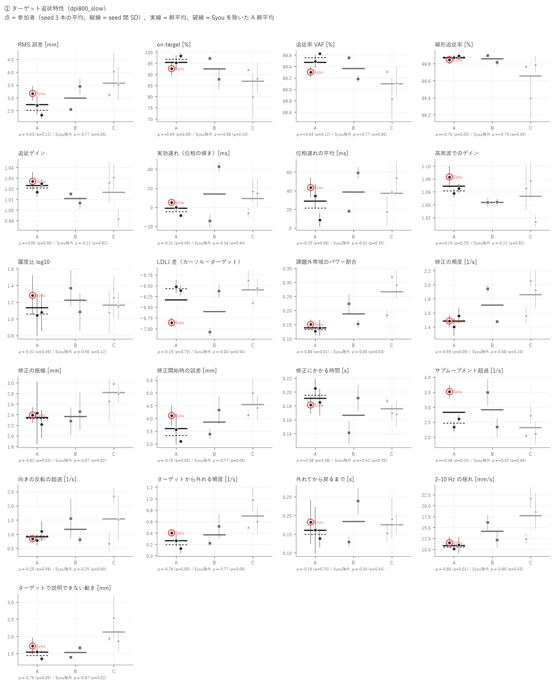
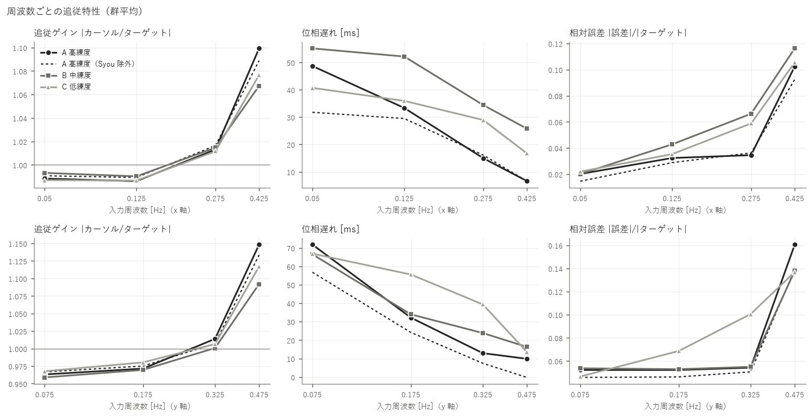
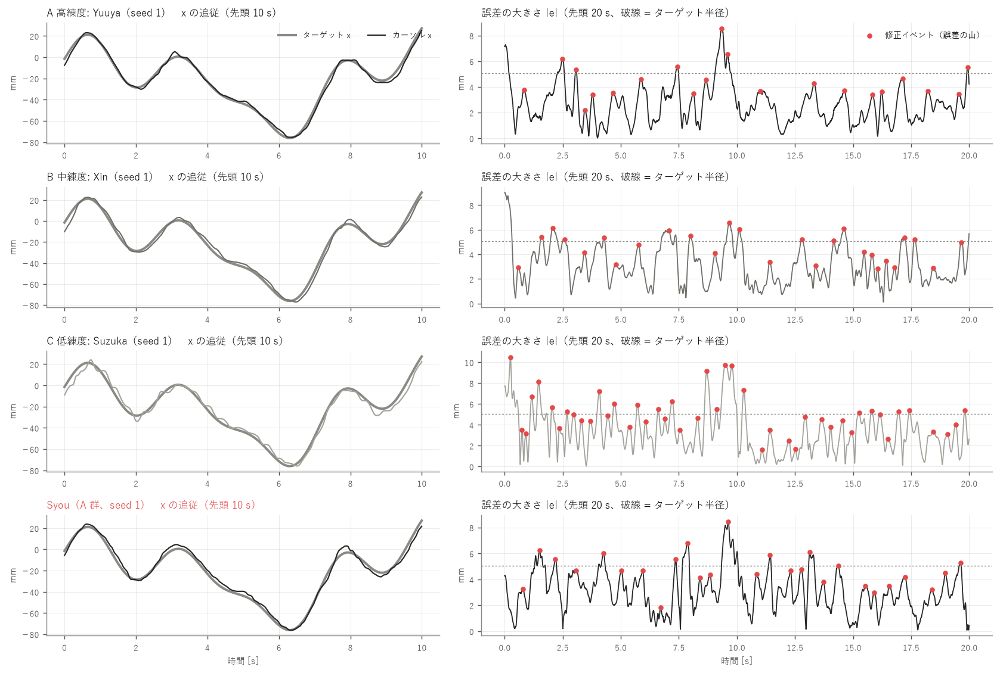
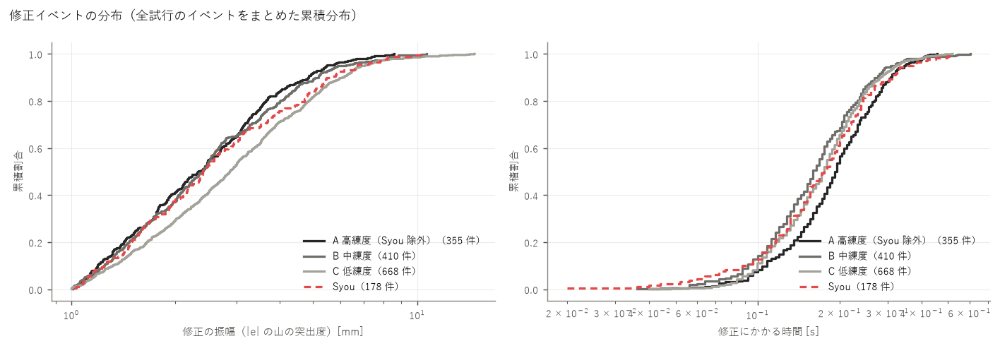
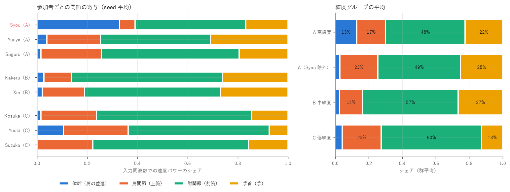
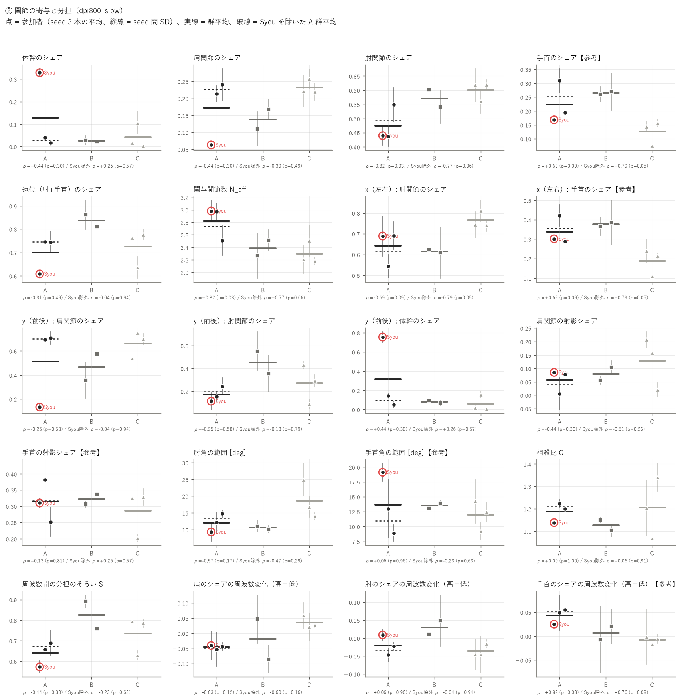
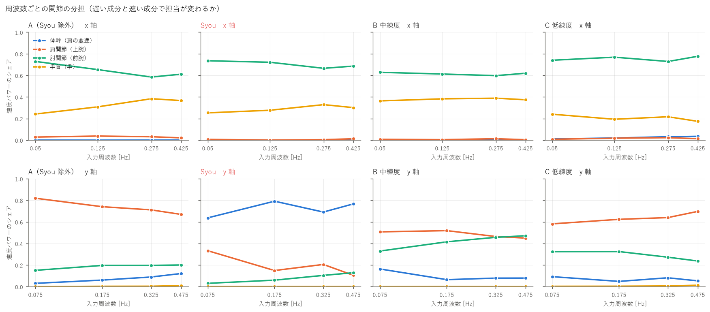
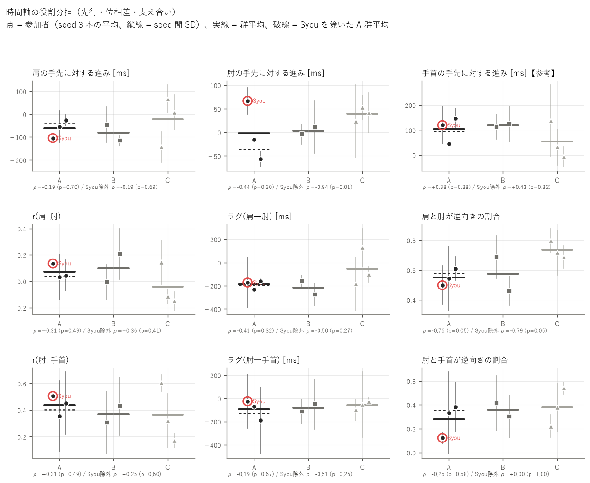
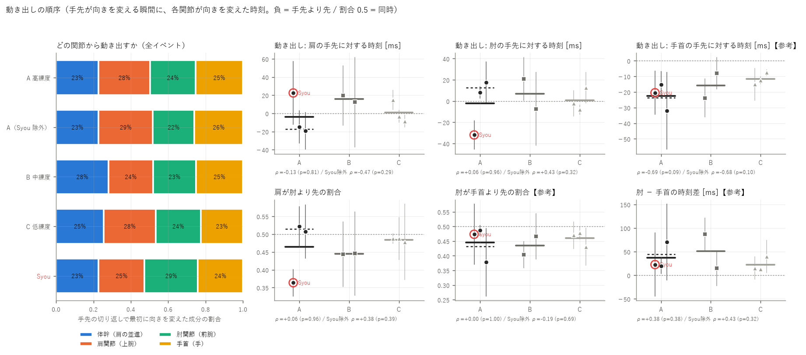
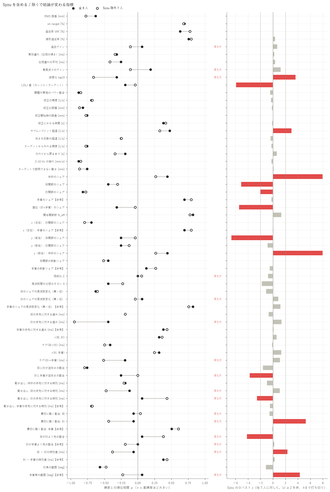

# 練度別の追従特性・上肢協調の解析 — 800 DPI / SLOW

生成: 2026-10-23 04:12　条件名: `dpi800_slow`　スクリプト: `skill_analysis/run_skill.py`

この条件だけを独立に解析した結果です（他条件のデータは混ぜていません）。条件どうしの比較は `results/_compare/` を見てください。

**考察（手書き）: [discussion.md](discussion.md)**（このレポートは再実行で作り直されますが、考察は上書きされません）

## 0. 対象と読み方

- **A 高練度**: Syou, Yuuya, Suguru（解析できた人: 3）
- **B 中練度**: Kakeru, Xin（解析できた人: 2）
- **C 低練度**: Kosuke, Yuuki, Suzuka（解析できた人: 3）
- 試行: 本番の slow 試行 seed 1〜3（各参加者 3 本、計 24 本）。参加者ごとに 3 本を平均してから群を比べる
- 統計: 練度の順位（A=3 / B=2 / C=1）と参加者平均の Spearman ρ。p はラベルの全並べ替えによる正確な p（8 人 560 通り / Syou 除外 7 人 210 通り）、q は族（追従精度・滑らかさ・軌道修正・関節の寄与・時間の役割分担）ごとの BH 補正。g(A−C) は Hedges の g。判別比 D = 参加者間 SD / seed 間 SD（1 付近なら人の違いは試行のばらつきと同程度）
- **人数が 3 / 2 / 3 人と少ないため、p は探索的な目安です。** 1 人の違いで順位が入れ替わるので、必ず「Syou 除外」の列と個人の点（図）を併せて読んでください
- 関節は RealSense + MediaPipe の推定値。既存の検証（aim_eval/README）より、手首（hand）・MCP3 を使う成分（手首のシェアなど）は MoCap で未照合のため【参考】。肘は振幅を 6〜7 % 小さく捉える癖がある

## 1. 要約（p < 0.10 の指標を自動抽出）

### ① ターゲット追従特性

- **RMS 誤差 [mm]**: 高練度ほど小さい（良い向き）。ρ = -0.63（p = 0.12）/ Syou 除外 ρ = -0.77（p = 0.06）、Syou 除外でのみ p < 0.1。判別比 D = 1.8
- **on-target [%]**: 高練度ほど大きい（良い向き）。ρ = +0.69（p = 0.09）/ Syou 除外 ρ = +0.68（p = 0.10）、全員でのみ p < 0.1。判別比 D = 1.6
- **追従率 VAF [%]**: 高練度ほど大きい（良い向き）。ρ = +0.63（p = 0.12）/ Syou 除外 ρ = +0.77（p = 0.06）、Syou 除外でのみ p < 0.1。判別比 D = 2.2
- **線形追従率 [%]**: 高練度ほど大きい（良い向き）。ρ = +0.76（p = 0.05）/ Syou 除外 ρ = +0.79（p = 0.05）、全員でも Syou 除外でも p < 0.1。判別比 D = 2.5
- **課題外帯域のパワー割合**: 高練度ほど小さい（良い向き）。ρ = -0.88（p = 0.01）/ Syou 除外 ρ = -0.85（p = 0.03）、全員でも Syou 除外でも p < 0.1。判別比 D = 3.4
- **修正の頻度 [1/s]**: 高練度ほど小さい。ρ = -0.69（p = 0.09）/ Syou 除外 ρ = -0.68（p = 0.10）、全員でのみ p < 0.1。判別比 D = 2.4
- **修正の振幅 [mm]**: 高練度ほど小さい（良い向き）。ρ = -0.82（p = 0.03）/ Syou 除外 ρ = -0.87（p = 0.02）、全員でも Syou 除外でも p < 0.1。判別比 D = 1.0
- **修正開始時の誤差 [mm]**: 高練度ほど小さい（良い向き）。ρ = -0.76（p = 0.05）/ Syou 除外 ρ = -0.77（p = 0.06）、全員でも Syou 除外でも p < 0.1。判別比 D = 1.7
- **ターゲットから外れる頻度 [1/s]**: 高練度ほど小さい（良い向き）。ρ = -0.76（p = 0.05）/ Syou 除外 ρ = -0.77（p = 0.06）、全員でも Syou 除外でも p < 0.1。判別比 D = 2.3
- **2–10 Hz の揺れ [mm/s]**: 高練度ほど小さい（良い向き）。ρ = -0.88（p = 0.01）/ Syou 除外 ρ = -0.85（p = 0.03）、全員でも Syou 除外でも p < 0.1。判別比 D = 2.3
- **ターゲットで説明できない動き [mm]**: 高練度ほど小さい（良い向き）。ρ = -0.76（p = 0.05）/ Syou 除外 ρ = -0.87（p = 0.02）、全員でも Syou 除外でも p < 0.1。判別比 D = 2.1

### ② 上肢関節の協調・分担

- **肘関節のシェア**: 高練度ほど小さい。ρ = -0.82（p = 0.03）/ Syou 除外 ρ = -0.77（p = 0.06）、全員でも Syou 除外でも p < 0.1。判別比 D = 1.5
- **手首のシェア【参考】**: 高練度ほど大きい。ρ = +0.69（p = 0.09）/ Syou 除外 ρ = +0.79（p = 0.05）、全員でも Syou 除外でも p < 0.1。判別比 D = 2.6
- **関与関節数 N_eff**: 高練度ほど大きい。ρ = +0.82（p = 0.03）/ Syou 除外 ρ = +0.77（p = 0.06）、全員でも Syou 除外でも p < 0.1。判別比 D = 1.6
- **x（左右）: 肘関節のシェア**: 高練度ほど小さい。ρ = -0.69（p = 0.09）/ Syou 除外 ρ = -0.79（p = 0.05）、全員でも Syou 除外でも p < 0.1。判別比 D = 1.3
- **x（左右）: 手首のシェア【参考】**: 高練度ほど大きい。ρ = +0.69（p = 0.09）/ Syou 除外 ρ = +0.79（p = 0.05）、全員でも Syou 除外でも p < 0.1。判別比 D = 1.8
- **手首のシェアの周波数変化（高−低）【参考】**: 高練度ほど大きい。ρ = +0.82（p = 0.03）/ Syou 除外 ρ = +0.76（p = 0.08）、全員でも Syou 除外でも p < 0.1。判別比 D = 0.8
- **肘の手先に対する進み [ms]**: 高練度ほど小さい。ρ = -0.44（p = 0.30）/ Syou 除外 ρ = -0.94（p = 0.01）、Syou 除外でのみ p < 0.1。判別比 D = 1.0
- **肩と肘が逆向きの割合**: 高練度ほど小さい。ρ = -0.76（p = 0.05）/ Syou 除外 ρ = -0.79（p = 0.05）、全員でも Syou 除外でも p < 0.1。判別比 D = 1.0
- **動き出し: 手首の手先に対する時刻 [ms]【参考】**: 高練度ほど小さい。ρ = -0.69（p = 0.09）/ Syou 除外 ρ = -0.68（p = 0.10）、全員でのみ p < 0.1。判別比 D = 0.8

### Syou の影響

- Syou を除くと ρ の符号が変わる、または |Δρ| ≥ 0.3 の指標: 追従ゲイン（+0.06 → -0.11）、高周波でのゲイン（+0.19 → -0.11）、躍度比 log10（-0.31 → -0.66）、相殺比 C（+0.00 → +0.06）、肘のシェアの周波数変化（高−低）（+0.06 → -0.04）、肘の手先に対する進み [ms]（-0.44 → -0.94）、ラグ(肘→手首) [ms]（-0.19 → -0.51）、肘と手首が逆向きの割合（-0.25 → +0.00）、動き出し: 肩の手先に対する時刻 [ms]（-0.13 → -0.47）、動き出し: 肘の手先に対する時刻 [ms]（+0.06 → +0.43）、最初に動く割合: 肩（-0.06 → +0.04）、最初に動く割合: 肘（-0.06 → -0.43）、肩が肘より先の割合（+0.06 → +0.38）、肘が手首より先の割合【参考】（+0.00 → -0.19）、肩 − 肘の時刻差 [ms]（-0.06 → -0.38）、手首角の範囲 [deg]【参考】（+0.06 → -0.23）
- Syou が他 7 人から外れている指標（|ロバスト z| ≥ 2）: 躍度比 log10（z = +3.7）、LDLJ 差（カーソル−ターゲット）（z = -5.9）、サブムーブメント超過 [1/s]（z = +3.0）、体幹のシェア（z = +34.7）、肩関節のシェア（z = -5.1）、肘関節のシェア（z = -2.0）、遠位（肘+手首）のシェア（z = -5.5）、y（前後）: 肩関節のシェア（z = -6.7）、y（前後）: 体幹のシェア（z = +9.1）、肘と手首が逆向きの割合（z = -3.8）、動き出し: 肘の手先に対する時刻 [ms]（z = -2.6）、最初に動く割合: 肘（z = +5.3）、肩が肘より先の割合（z = -4.2）、肩 − 肘の時刻差 [ms]（z = +2.4）、手首角の範囲 [deg]【参考】（z = +4.3）

## 2. ① ターゲット追従特性

指標の定義: 追従率 VAF = 1 − Σ|誤差|²/Σ|ターゲットの変動|²、線形追従率 = カーソルのパワーのうち入力周波数に乗った割合、躍度比 = log10(RMS 躍度 カーソル / ターゲット)（0 = ターゲットと同じ滑らかさ）、修正イベント = 誤差の大きさ |e| の山（ずれが最大になり戻り始めた点。突出度 ≥ 1.0 mm）。すべて画面上の mm。

### 群ごとの値（参加者平均の平均 ± SD）

| 指標 | A 高練度 | A（Syou 除外） | B 中練度 | C 低練度 | Syou（個人） |
|---|---|---|---|---|---|
| RMS 誤差 [mm] | 2.73 ± 0.42 | 2.51 ± 0.27 | 2.99 ± 0.63 | 3.58 ± 0.46 | 3.17 |
| on-target [%] | 95.4 ± 2.9 | 96.7 ± 2.2 | 92.5 ± 6.6 | 86.9 ± 6.2 | 92.6 |
| 追従率 VAF [%] | 99.5 ± 0.2 | 99.6 ± 0.1 | 99.4 ± 0.3 | 99.1 ± 0.2 | 99.3 |
| 線形追従率 [%] | 99.9 ± 0.0 | 99.9 ± 0.0 | 99.9 ± 0.1 | 99.7 ± 0.2 | 99.8 |
| 追従ゲイン | 1.023 ± 0.005 | 1.021 ± 0.006 | 1.011 ± 0.006 | 1.017 ± 0.021 | 1.027 |
| 実効遅れ（位相の傾き）[ms] | -1.3 ± 6.8 | -4.4 ± 5.8 | 14.0 ± 40.1 | 9.0 ± 12.5 | 5.0 |
| 位相遅れの平均 [ms] | 28.8 ± 18.1 | 21.5 ± 18.3 | 38.5 ± 29.2 | 37.2 ± 18.3 | 43.4 |
| 高周波でのゲイン | 1.069 ± 0.013 | 1.061 ± 0.005 | 1.044 ± 0.001 | 1.053 ± 0.034 | 1.083 |
| 躍度比 log10 | 1.134 ± 0.128 | 1.060 ± 0.024 | 1.223 ± 0.202 | 1.165 ± 0.090 | 1.280 |
| LDLJ 差（カーソル−ターゲット） | -6.331 ± 0.459 | -6.068 ± 0.060 | -6.602 ± 0.670 | -6.094 ± 0.265 | -6.858 |
| 課題外帯域のパワー割合 | 0.138 ± 0.012 | 0.132 ± 0.008 | 0.188 ± 0.051 | 0.266 ± 0.072 | 0.150 |
| 修正の頻度 [1/s] | 1.481 ± 0.079 | 1.479 ± 0.112 | 1.708 ± 0.330 | 1.856 ± 0.259 | 1.483 |
| 修正の振幅 [mm] | 2.35 ± 0.11 | 2.32 ± 0.15 | 2.37 ± 0.13 | 2.82 ± 0.16 | 2.39 |
| 修正開始時の誤差 [mm] | 3.59 ± 0.50 | 3.33 ± 0.33 | 3.85 ± 0.66 | 4.54 ± 0.45 | 4.11 |
| 修正にかかる時間 [s] | 0.191 ± 0.013 | 0.195 ± 0.014 | 0.166 ± 0.035 | 0.176 ± 0.011 | 0.181 |
| サブムーブメント超過 [1/s] | 2.819 ± 0.619 | 2.471 ± 0.194 | 2.913 ± 0.819 | 2.311 ± 0.367 | 3.517 |
| 向きの反転の超過 [1/s] | 0.908 ± 0.169 | 0.942 ± 0.224 | 1.175 ± 0.530 | 1.533 ± 0.838 | 0.842 |
| ターゲットから外れる頻度 [1/s] | 0.264 ± 0.138 | 0.196 ± 0.100 | 0.367 ± 0.212 | 0.697 ± 0.254 | 0.400 |
| 外れてから戻るまで [s] | 0.161 ± 0.022 | 0.150 ± 0.016 | 0.184 ± 0.077 | 0.175 ± 0.019 | 0.182 |
| 2–10 Hz の揺れ [mm/s] | 10.87 ± 0.71 | 10.55 ± 0.62 | 14.16 ± 2.86 | 17.69 ± 4.74 | 11.52 |
| ターゲットで説明できない動き [mm] | 1.53 ± 0.18 | 1.44 ± 0.14 | 1.52 ± 0.20 | 2.13 ± 0.38 | 1.71 |

### 練度との関係

| 指標 | ρ 全員 | p | q(BH) | ρ Syou除外 | p | g(A−C) 全員 | g(A−C) 除外 | KW p | 判別比 D | Syou z | 除外で変化 |
|---|---|---|---|---|---|---|---|---|---|---|---|
| RMS 誤差 [mm] | -0.63 | 0.12 | 0.24 | -0.77 | 0.06 | -1.53 | -1.90 | 0.24 | 1.8 | +0.0 |  |
| on-target [%] | +0.69 | 0.09 | 0.24 | +0.68 | 0.10 | +1.39 | +1.37 | 0.19 | 1.6 | +0.0 |  |
| 追従率 VAF [%] | +0.63 | 0.12 | 0.24 | +0.77 | 0.06 | +1.49 | +1.67 | 0.24 | 2.2 | -0.0 |  |
| 線形追従率 [%] | +0.76 | 0.05 | 0.24 | +0.79 | 0.05 | +1.09 | +0.91 | 0.08 | 2.5 | +0.4 |  |
| 追従ゲイン | +0.06 | 0.96 | 0.96 | -0.11 | 0.82 | +0.33 | +0.18 | 0.41 | 1.7 | +0.7 | **あり** |
| 実効遅れ（位相の傾き）[ms] | -0.31 | 0.49 | 0.77 | -0.34 | 0.44 | -0.81 | -0.90 | 0.71 | 2.9 | +0.3 |  |
| 位相遅れの平均 [ms] | -0.25 | 0.58 | 0.77 | -0.42 | 0.35 | -0.37 | -0.62 | 0.76 | 2.0 | +0.4 |  |
| 高周波でのゲイン | +0.19 | 0.70 | 0.80 | -0.11 | 0.82 | +0.49 | +0.22 | 0.36 | 1.6 | +1.3 | **あり** |
| 躍度比 log10 | -0.31 | 0.49 | 0.70 | -0.66 | 0.12 | -0.23 | -1.02 | 0.57 | 0.5 | +3.7 | **あり** |
| LDLJ 差（カーソル−ターゲット） | -0.19 | 0.70 | 0.70 | -0.04 | 0.94 | -0.51 | +0.09 | 0.36 | 3.3 | -5.9 |  |
| 課題外帯域のパワー割合 | -0.88 | 0.01 | 0.03 | -0.85 | 0.03 | -1.99 | -1.66 | 0.06 | 3.4 | -0.5 |  |
| 修正の頻度 [1/s] | -0.69 | 0.09 | 0.14 | -0.68 | 0.10 | -1.57 | -1.24 | 0.19 | 2.4 | -0.3 |  |
| 修正の振幅 [mm] | -0.82 | 0.03 | 0.10 | -0.87 | 0.02 | -2.67 | -2.25 | 0.08 | 1.0 | -0.2 |  |
| 修正開始時の誤差 [mm] | -0.76 | 0.05 | 0.10 | -0.77 | 0.06 | -1.60 | -2.15 | 0.13 | 1.7 | -0.1 |  |
| 修正にかかる時間 [s] | +0.38 | 0.38 | 0.47 | +0.42 | 0.35 | +1.01 | +1.19 | 0.57 | 1.4 | -0.2 |  |
| サブムーブメント超過 [1/s] | +0.48 | 0.24 | 0.34 | +0.32 | 0.46 | +0.80 | +0.36 | 0.40 | 2.4 | +3.0 |  |
| 向きの反転の超過 [1/s] | -0.25 | 0.58 | 0.64 | -0.25 | 0.60 | -0.83 | -0.62 | 0.76 | 1.6 | -0.4 |  |
| ターゲットから外れる頻度 [1/s] | -0.76 | 0.05 | 0.10 | -0.77 | 0.06 | -1.70 | -1.70 | 0.13 | 2.3 | -0.3 |  |
| 外れてから戻るまで [s] | -0.19 | 0.70 | 0.70 | -0.34 | 0.44 | -0.56 | -1.00 | 0.88 | 0.9 | +0.6 |  |
| 2–10 Hz の揺れ [mm/s] | -0.88 | 0.01 | 0.10 | -0.85 | 0.03 | -1.61 | -1.34 | 0.06 | 2.3 | -0.3 |  |
| ターゲットで説明できない動き [mm] | -0.76 | 0.05 | 0.10 | -0.87 | 0.02 | -1.61 | -1.57 | 0.08 | 2.1 | +0.1 |  |

### 参加者ごと（主な指標）

| 参加者 | 群 | RMS 誤差 [mm] | on-target [%] | 追従率 VAF [%] | 実効遅れ（位相の傾き）[ms] | 躍度比 log10 | 修正の頻度 [1/s] | 修正の振幅 [mm] | ターゲットから外れる頻度 [1/s] | 2–10 Hz の揺れ [mm/s] |
|---|---|---|---|---|---|---|---|---|---|---|
| **Syou** | A | 3.17 | 92.6 | 99.3 | 5.0 | 1.280 | 1.483 | 2.39 | 0.400 | 11.52 |
| Yuuya | A | 2.70 | 95.2 | 99.5 | -0.3 | 1.044 | 1.400 | 2.43 | 0.267 | 10.11 |
| Suguru | A | 2.32 | 98.3 | 99.6 | -8.5 | 1.077 | 1.558 | 2.22 | 0.125 | 10.98 |
| Kakeru | B | 2.54 | 97.2 | 99.5 | -14.3 | 1.366 | 1.942 | 2.27 | 0.217 | 16.18 |
| Xin | B | 3.44 | 87.8 | 99.2 | 42.3 | 1.080 | 1.475 | 2.46 | 0.517 | 12.14 |
| Kosuke | C | 3.14 | 92.3 | 99.3 | -5.4 | 1.080 | 1.567 | 2.66 | 0.500 | 12.50 |
| Yuuki | C | 4.06 | 80.1 | 98.8 | 17.3 | 1.259 | 2.067 | 2.99 | 0.983 | 21.80 |
| Suzuka | C | 3.53 | 88.3 | 99.1 | 15.1 | 1.156 | 1.933 | 2.80 | 0.608 | 18.76 |









## 3. ② 上肢関節の協調・分担（肩 / 肘 / 手首）

手先（MCP3）の動き = 体幹（肩の並進）+ 肩関節（上腕の回転）+ 肘関節（前腕の回転）+ 手首（手の回転）に足し算で分け、入力周波数での速度パワーのシェアを寄与とする（近傍ビンのノイズを引く。aim_eval の a1 と同じ定義）。「体幹（肩の並進）」は肩の点そのものの移動で、体幹の傾き・回旋と肩甲帯（肩をすくめる・前に出す）の両方を含む。

### 3.1 寄与・運動量の分配

| 指標 | A 高練度 | A（Syou 除外） | B 中練度 | C 低練度 | Syou（個人） |
|---|---|---|---|---|---|
| 体幹のシェア | 0.128 ± 0.174 | 0.028 ± 0.017 | 0.025 ± 0.004 | 0.042 ± 0.056 | 0.329 |
| 肩関節のシェア | 0.172 ± 0.096 | 0.227 ± 0.019 | 0.139 ± 0.041 | 0.233 ± 0.021 | 0.063 |
| 肘関節のシェア | 0.475 ± 0.064 | 0.493 ± 0.079 | 0.571 ± 0.043 | 0.600 ± 0.033 | 0.440 |
| 手首のシェア【参考】 | 0.224 ± 0.075 | 0.252 ± 0.081 | 0.265 ± 0.006 | 0.126 ± 0.044 | 0.169 |
| 遠位（肘+手首）のシェア | 0.699 ± 0.079 | 0.745 ± 0.002 | 0.836 ± 0.036 | 0.725 ± 0.077 | 0.608 |
| 関与関節数 N_eff | 2.821 ± 0.272 | 2.740 ± 0.330 | 2.388 ± 0.173 | 2.298 ± 0.179 | 2.983 |
| x（左右）: 肘関節のシェア | 0.641 ± 0.084 | 0.617 ± 0.103 | 0.616 ± 0.010 | 0.764 ± 0.040 | 0.689 |
| x（左右）: 手首のシェア【参考】 | 0.338 ± 0.074 | 0.356 ± 0.094 | 0.376 ± 0.013 | 0.188 ± 0.068 | 0.302 |
| y（前後）: 肩関節のシェア | 0.511 ± 0.327 | 0.700 ± 0.009 | 0.465 ± 0.155 | 0.662 ± 0.111 | 0.134 |
| y（前後）: 肘関節のシェア | 0.169 ± 0.067 | 0.198 ± 0.064 | 0.454 ± 0.139 | 0.269 ± 0.174 | 0.111 |
| y（前後）: 体幹のシェア | 0.315 ± 0.383 | 0.096 ± 0.064 | 0.081 ± 0.016 | 0.061 ± 0.083 | 0.755 |
| 肩関節の射影シェア | 0.057 ± 0.044 | 0.042 ± 0.051 | 0.080 ± 0.035 | 0.129 ± 0.096 | 0.086 |
| 手首の射影シェア【参考】 | 0.315 ± 0.065 | 0.317 ± 0.092 | 0.321 ± 0.021 | 0.285 ± 0.072 | 0.310 |
| 肘角の範囲 [deg] | 12.1 ± 2.7 | 13.4 ± 1.8 | 10.6 ± 0.6 | 18.6 ± 5.7 | 9.3 |
| 手首角の範囲 [deg]【参考】 | 13.7 ± 5.2 | 10.9 ± 2.9 | 13.5 ± 0.6 | 12.0 ± 2.5 | 19.1 |





### 3.2 時間軸の役割分担（周波数による分担・先行・支え合い）

- **周波数による分担**: 各軸の低い入力周波数 2 つと高い 2 つでのシェアの差（高 − 低）。+ = 速い成分ほどその関節が担う
- **先行**: 入力周波数での手先に対する位相の進み [ms]（+ = 手先より先に動く）。成分の振幅で重み付け
- **相互相関**: 課題の帯域に絞った成分の速度どうし（x・y の平均）。r < 0 = 逆向きに動いて互いを打ち消す＝支え合い（補償）、ラグ + = 前の成分が先行
- **相殺比 C**: Σ|成分| / |手先|。1 = 素直な足し算、> 1 = 打ち消し合いながら手先を作る

| 指標 | A 高練度 | A（Syou 除外） | B 中練度 | C 低練度 | Syou（個人） |
|---|---|---|---|---|---|
| 相殺比 C | 1.187 ± 0.044 | 1.211 ± 0.017 | 1.127 ± 0.032 | 1.204 ± 0.136 | 1.138 |
| 周波数間の分担のそろい S | 0.640 ± 0.061 | 0.674 ± 0.021 | 0.825 ± 0.094 | 0.737 ± 0.093 | 0.572 |
| 肩のシェアの周波数変化（高−低） | -0.046 ± 0.006 | -0.048 ± 0.006 | -0.019 ± 0.093 | 0.035 ± 0.020 | -0.040 |
| 肘のシェアの周波数変化（高−低） | -0.020 ± 0.028 | -0.034 ± 0.017 | 0.031 ± 0.027 | -0.035 ± 0.018 | 0.009 |
| 手首のシェアの周波数変化（高−低）【参考】 | 0.043 ± 0.016 | 0.052 ± 0.004 | 0.007 ± 0.019 | -0.008 ± 0.008 | 0.025 |
| 肩の手先に対する進み [ms] | -61.6 ± 39.5 | -40.2 ± 19.4 | -80.9 ± 48.8 | -23.3 ± 107.6 | -104.3 |
| 肘の手先に対する進み [ms] | -1.9 ± 62.8 | -36.1 ± 29.2 | 3.4 ± 10.8 | 39.3 ± 14.9 | 66.6 |
| 手首の手先に対する進み [ms]【参考】 | 103.4 ± 52.7 | 95.3 ± 71.8 | 118.5 ± 7.9 | 54.3 ± 74.6 | 119.5 |
| r(肩, 肘) | 0.071 ± 0.056 | 0.039 ± 0.008 | 0.100 ± 0.153 | -0.040 ± 0.160 | 0.135 |
| ラグ(肩→肘) [ms] | -188.0 ± 39.9 | -195.8 ± 53.0 | -216.7 ± 82.5 | -51.9 ± 161.0 | -172.2 |
| r(肘, 手首) | 0.437 ± 0.077 | 0.403 ± 0.070 | 0.367 ± 0.088 | 0.364 ± 0.220 | 0.505 |
| ラグ(肘→手首) [ms] | -96.3 ± 85.9 | -131.9 ± 84.5 | -81.9 ± 45.2 | -60.2 ± 37.7 | -25.0 |
| 肩と肘が逆向きの割合 | 0.552 ± 0.056 | 0.578 ± 0.046 | 0.575 ± 0.160 | 0.734 ± 0.057 | 0.499 |
| 肘と手首が逆向きの割合 | 0.279 ± 0.138 | 0.357 ± 0.035 | 0.357 ± 0.080 | 0.380 ± 0.160 | 0.122 |





### 3.3 動き出しの順序（どの関節から動かすか）

手先（MCP3）が軸ごとに向きを変える瞬間（＝新しい動きの始まり）をイベントとし、各成分が同じ向きに切り返した時刻との差 τ を測る（負 = 手先より先 = その関節から動き出した）。「最初に動く割合」は、関与した成分の中で最初に切り返した成分の割合。「先の割合」は 2 成分がどちらも関与したイベントで一方が先だった割合（0.5 = 順序なし）。肩・肘は MediaPipe Pose、手首は Hand で推定しており、モデルの平滑化の違いが成分間の見かけの時間差になりうる（全員に同じだけ乗るので練度の比較には効かないが、絶対的な順序は割り引いて読む）。

| 指標 | A 高練度 | A（Syou 除外） | B 中練度 | C 低練度 | Syou（個人） |
|---|---|---|---|---|---|
| 動き出し: 体幹の手先に対する時刻 [ms] | 31.6 ± 15.0 | 39.9 ± 6.2 | 7.5 ± 19.7 | 39.2 ± 31.4 | 15.0 |
| 動き出し: 肩の手先に対する時刻 [ms] | -3.9 ± 23.0 | -17.1 ± 3.1 | 16.0 ± 5.3 | 1.1 ± 12.2 | 22.5 |
| 動き出し: 肘の手先に対する時刻 [ms] | -2.2 ± 26.2 | 12.7 ± 6.6 | 6.8 ± 20.0 | 0.8 ± 10.8 | -31.9 |
| 動き出し: 手首の手先に対する時刻 [ms]【参考】 | -22.6 ± 8.6 | -23.7 ± 11.9 | -15.9 ± 11.1 | -11.7 ± 3.8 | -20.5 |
| 最初に動く割合: 肩 | 0.274 ± 0.024 | 0.287 ± 0.011 | 0.237 ± 0.000 | 0.279 ± 0.021 | 0.248 |
| 最初に動く割合: 肘 | 0.244 ± 0.042 | 0.221 ± 0.021 | 0.230 ± 0.005 | 0.237 ± 0.020 | 0.289 |
| 最初に動く割合: 手首【参考】 | 0.255 ± 0.027 | 0.263 ± 0.031 | 0.252 ± 0.039 | 0.227 ± 0.024 | 0.237 |
| 肩が肘より先の割合 | 0.464 ± 0.088 | 0.515 ± 0.011 | 0.445 ± 0.001 | 0.485 ± 0.005 | 0.364 |
| 肘が手首より先の割合【参考】 | 0.446 ± 0.060 | 0.432 ± 0.077 | 0.435 ± 0.044 | 0.460 ± 0.025 | 0.473 |
| 肩 − 肘の時刻差 [ms] | 10.8 ± 54.8 | -20.5 ± 11.1 | 32.4 ± 4.9 | 8.3 ± 4.7 | 73.4 |
| 肘 − 手首の時刻差 [ms]【参考】 | 37.6 ± 28.4 | 45.0 ± 35.8 | 51.1 ± 51.2 | 22.7 ± 14.9 | 22.8 |



### 3.4 練度との関係

| 指標 | ρ 全員 | p | q(BH) | ρ Syou除外 | p | g(A−C) 全員 | g(A−C) 除外 | KW p | 判別比 D | Syou z | 除外で変化 |
|---|---|---|---|---|---|---|---|---|---|---|---|
| 体幹のシェア | +0.44 | 0.30 | 0.45 | +0.26 | 0.57 | +0.54 | -0.21 | 0.51 | 6.5 | +34.7 |  |
| 肩関節のシェア | -0.44 | 0.30 | 0.45 | -0.30 | 0.49 | -0.70 | -0.21 | 0.21 | 2.1 | -5.1 |  |
| 肘関節のシェア | -0.82 | 0.03 | 0.21 | -0.77 | 0.06 | -1.96 | -1.46 | 0.10 | 1.5 | -2.0 |  |
| 手首のシェア【参考】 | +0.69 | 0.09 | 0.26 | +0.79 | 0.05 | +1.28 | +1.55 | 0.08 | 2.6 | -0.3 |  |
| 遠位（肘+手首）のシェア | -0.31 | 0.49 | 0.66 | -0.04 | 0.94 | -0.27 | +0.23 | 0.10 | 2.3 | -5.5 |  |
| 関与関節数 N_eff | +0.82 | 0.03 | 0.21 | +0.77 | 0.06 | +1.81 | +1.34 | 0.10 | 1.6 | +1.4 |  |
| x（左右）: 肘関節のシェア | -0.69 | 0.09 | 0.26 | -0.79 | 0.05 | -1.50 | -1.57 | 0.08 | 1.3 | -0.0 |  |
| x（左右）: 手首のシェア【参考】 | +0.69 | 0.09 | 0.26 | +0.79 | 0.05 | +1.69 | +1.57 | 0.08 | 1.8 | +0.1 |  |
| y（前後）: 肩関節のシェア | -0.25 | 0.58 | 0.67 | -0.04 | 0.94 | -0.49 | +0.31 | 0.49 | 3.2 | -6.7 |  |
| y（前後）: 肘関節のシェア | -0.25 | 0.58 | 0.67 | -0.13 | 0.79 | -0.61 | -0.35 | 0.20 | 2.0 | -0.9 |  |
| y（前後）: 体幹のシェア | +0.44 | 0.30 | 0.45 | +0.26 | 0.57 | +0.74 | +0.33 | 0.51 | 7.5 | +9.1 |  |
| 肩関節の射影シェア | -0.44 | 0.30 | 0.45 | -0.51 | 0.26 | -0.77 | -0.75 | 0.51 | 2.1 | +0.1 |  |
| 手首の射影シェア【参考】 | +0.13 | 0.81 | 0.87 | +0.26 | 0.57 | +0.34 | +0.29 | 0.89 | 2.4 | -0.5 |  |
| 相殺比 C | +0.00 | 1.00 | 1.00 | +0.06 | 0.91 | -0.14 | +0.05 | 0.61 | 1.9 | -0.8 | **あり** |
| 周波数間の分担のそろい S | -0.44 | 0.30 | 0.75 | -0.23 | 0.63 | -0.98 | -0.59 | 0.21 | 2.8 | -1.8 |  |
| 肩のシェアの周波数変化（高−低） | -0.63 | 0.12 | 0.57 | -0.60 | 0.16 | -4.36 | -3.62 | 0.24 | 1.3 | -1.1 |  |
| 肘のシェアの周波数変化（高−低） | +0.06 | 0.96 | 1.00 | -0.04 | 0.94 | +0.54 | +0.05 | 0.13 | 0.8 | +0.9 | **あり** |
| 手首のシェアの周波数変化（高−低）【参考】 | +0.82 | 0.03 | 0.35 | +0.76 | 0.08 | +3.25 | +6.60 | 0.08 | 0.8 | +1.2 |  |
| 肩の手先に対する進み [ms] | -0.19 | 0.70 | 0.82 | -0.19 | 0.69 | -0.38 | -0.14 | 0.71 | 1.1 | -0.7 |  |
| 肘の手先に対する進み [ms] | -0.44 | 0.30 | 0.75 | -0.94 | 0.01 | -0.72 | -2.64 | 0.41 | 1.0 | +1.4 | **あり** |
| 手首の手先に対する進み [ms]【参考】 | +0.38 | 0.38 | 0.76 | +0.43 | 0.32 | +0.61 | +0.40 | 0.57 | 0.9 | +0.1 |  |
| r(肩, 肘) | +0.31 | 0.49 | 0.76 | +0.36 | 0.41 | +0.74 | +0.44 | 0.57 | 0.9 | +0.6 |  |
| ラグ(肩→肘) [ms] | -0.41 | 0.32 | 0.75 | -0.50 | 0.27 | -0.93 | -0.78 | 0.39 | 1.0 | -0.2 |  |
| r(肘, 手首) | +0.31 | 0.49 | 0.76 | +0.25 | 0.60 | +0.35 | +0.15 | 0.57 | 0.8 | +1.4 |  |
| ラグ(肘→手首) [ms] | -0.19 | 0.67 | 0.82 | -0.51 | 0.26 | -0.44 | -0.90 | 0.83 | 0.3 | +1.1 | **あり** |
| 肩と肘が逆向きの割合 | -0.76 | 0.05 | 0.35 | -0.79 | 0.05 | -2.60 | -2.14 | 0.08 | 1.0 | -1.6 |  |
| 肘と手首が逆向きの割合 | -0.25 | 0.58 | 0.81 | +0.00 | 1.00 | -0.54 | -0.13 | 0.76 | 0.7 | -3.8 | **あり** |
| 動き出し: 体幹の手先に対する時刻 [ms] | -0.19 | 0.70 | 1.00 | -0.21 | 0.66 | -0.25 | +0.02 | 0.36 | 0.9 | -1.0 |  |
| 動き出し: 肩の手先に対する時刻 [ms] | -0.13 | 0.81 | 1.00 | -0.47 | 0.29 | -0.22 | -1.30 | 0.57 | 0.7 | +1.1 | **あり** |
| 動き出し: 肘の手先に対する時刻 [ms] | +0.06 | 0.96 | 1.00 | +0.43 | 0.32 | -0.12 | +0.90 | 0.79 | 1.1 | -2.6 | **あり** |
| 動き出し: 手首の手先に対する時刻 [ms]【参考】 | -0.69 | 0.09 | 0.94 | -0.68 | 0.10 | -1.31 | -1.15 | 0.19 | 0.8 | -0.5 |  |
| 最初に動く割合: 肩 | -0.06 | 0.96 | 1.00 | +0.04 | 0.94 | -0.18 | +0.31 | 0.13 | 0.5 | -0.6 | **あり** |
| 最初に動く割合: 肘 | -0.06 | 0.96 | 1.00 | -0.43 | 0.32 | +0.16 | -0.59 | 0.79 | 0.6 | +5.3 | **あり** |
| 最初に動く割合: 手首【参考】 | +0.50 | 0.22 | 1.00 | +0.60 | 0.16 | +0.85 | +0.98 | 0.39 | 0.6 | -0.1 |  |
| 肩が肘より先の割合 | +0.06 | 0.96 | 1.00 | +0.38 | 0.39 | -0.26 | +2.91 | 0.41 | 0.7 | -4.2 | **あり** |
| 肘が手首より先の割合【参考】 | +0.00 | 1.00 | 1.00 | -0.19 | 0.69 | -0.24 | -0.40 | 0.61 | 0.7 | +0.2 | **あり** |
| 肩 − 肘の時刻差 [ms] | -0.06 | 0.96 | 1.00 | -0.38 | 0.39 | +0.05 | -2.80 | 0.41 | 0.7 | +2.4 | **あり** |
| 肘 − 手首の時刻差 [ms]【参考】 | +0.38 | 0.38 | 1.00 | +0.43 | 0.32 | +0.53 | +0.68 | 0.57 | 0.8 | +0.3 |  |
| 肘角の範囲 [deg] | -0.57 | 0.17 | 0.44 | -0.47 | 0.29 | -1.17 | -0.79 | 0.13 | 2.1 | -1.2 |  |
| 手首角の範囲 [deg]【参考】 | +0.06 | 0.96 | 0.96 | -0.23 | 0.63 | +0.33 | -0.28 | 0.79 | 1.5 | +4.3 | **あり** |

### 参加者ごと（主な指標）

| 参加者 | 群 | 体幹のシェア | 肩関節のシェア | 肘関節のシェア | 手首のシェア【参考】 | 関与関節数 N_eff | 周波数間の分担のそろい S | 相殺比 C | 肘のシェアの周波数変化（高−低） | 肩の手先に対する進み [ms] | r(肩, 肘) |
|---|---|---|---|---|---|---|---|---|---|---|---|
| **Syou** | A | 0.329 | 0.063 | 0.440 | 0.169 | 2.983 | 0.572 | 1.138 | 0.009 | -104.3 | 0.135 |
| Yuuya | A | 0.040 | 0.214 | 0.438 | 0.309 | 2.973 | 0.659 | 1.223 | -0.046 | -53.9 | 0.033 |
| Suguru | A | 0.016 | 0.240 | 0.549 | 0.194 | 2.506 | 0.689 | 1.199 | -0.022 | -26.5 | 0.045 |
| Kakeru | B | 0.028 | 0.110 | 0.601 | 0.261 | 2.266 | 0.891 | 1.150 | 0.012 | -46.4 | -0.007 |
| Xin | B | 0.022 | 0.168 | 0.541 | 0.270 | 2.511 | 0.759 | 1.104 | 0.049 | -115.5 | 0.208 |
| Kosuke | C | 0.016 | 0.222 | 0.618 | 0.144 | 2.206 | 0.795 | 1.204 | -0.046 | -142.7 | 0.144 |
| Yuuki | C | 0.106 | 0.258 | 0.561 | 0.075 | 2.504 | 0.629 | 1.068 | -0.046 | 66.2 | -0.115 |
| Suzuka | C | 0.003 | 0.220 | 0.620 | 0.157 | 2.184 | 0.786 | 1.341 | -0.015 | 6.8 | -0.150 |

## 4. Syou の個別評価（含める / 除く）

図: [Syou を含める / 除くで変わる指標](figures/syou_sensitivity.png)。左 = 練度との ρ（● 全員、○ Syou 除外）、右 = Syou の他 7 人に対するロバスト z。



| 指標 | Syou | A 群平均（除外） | B 群平均 | C 群平均 | z | ρ 全員 → 除外 |
|---|---|---|---|---|---|---|
| 体幹のシェア | 0.329 | 0.028 | 0.025 | 0.042 | +34.7 | +0.44 → +0.26 |
| y（前後）: 体幹のシェア | 0.755 | 0.096 | 0.081 | 0.061 | +9.1 | +0.44 → +0.26 |
| y（前後）: 肩関節のシェア | 0.134 | 0.700 | 0.465 | 0.662 | -6.7 | -0.25 → -0.04 |
| LDLJ 差（カーソル−ターゲット） | -6.858 | -6.068 | -6.602 | -6.094 | -5.9 | -0.19 → -0.04 |
| 遠位（肘+手首）のシェア | 0.608 | 0.745 | 0.836 | 0.725 | -5.5 | -0.31 → -0.04 |
| 最初に動く割合: 肘 | 0.289 | 0.221 | 0.230 | 0.237 | +5.3 | -0.06 → -0.43 |
| 肩関節のシェア | 0.063 | 0.227 | 0.139 | 0.233 | -5.1 | -0.44 → -0.30 |
| 手首角の範囲 [deg]【参考】 | 19.1 | 10.9 | 13.5 | 12.0 | +4.3 | +0.06 → -0.23 |
| 肩が肘より先の割合 | 0.364 | 0.515 | 0.445 | 0.485 | -4.2 | +0.06 → +0.38 |
| 肘と手首が逆向きの割合 | 0.122 | 0.357 | 0.357 | 0.380 | -3.8 | -0.25 → +0.00 |
| 躍度比 log10 | 1.280 | 1.060 | 1.223 | 1.165 | +3.7 | -0.31 → -0.66 |
| サブムーブメント超過 [1/s] | 3.517 | 2.471 | 2.913 | 2.311 | +3.0 | +0.48 → +0.32 |

（|z| の大きい順に 12 指標）

## 5. 計測の確認（試行ごと）

手首の 3 次元変位 / マウスの変位 のゲイン（机の座標系を決める回帰の副産物）と、関節が 4 点そろったフレームの割合。マウスの動きの一部は手首の回転（手首より先）が作るので、手首のゲインは 1 より小さいのが普通（特に x。既存の a0 でも同程度）。参加者間・seed 間で極端に外れていないかを見る。

| 参加者 | 群 | 試行 | ゲイン x | ゲイン y | 有効率 [%] | RS fps |
|---|---|---|---|---|---|---|
| Syou | A | trial_01_slow_s1 | 0.42 | 1.13 | 100 | 29.8 |
| Syou | A | trial_02_slow_s2 | 0.51 | 1.11 | 100 | 29.8 |
| Syou | A | trial_03_slow_s3 | 0.47 | 1.15 | 100 | 29.8 |
| Yuuya | A | trial_01_slow_s1 | 0.47 | 0.93 | 100 | 29.8 |
| Yuuya | A | trial_02_slow_s2 | 0.32 | 0.93 | 100 | 29.8 |
| Yuuya | A | trial_03_slow_s3 | 0.37 | 0.82 | 100 | 29.8 |
| Suguru | A | trial_01_slow_s1 | 0.44 | 1.01 | 100 | 29.8 |
| Suguru | A | trial_02_slow_s2 | 0.51 | 0.95 | 100 | 29.8 |
| Suguru | A | trial_03_slow_s3 | 0.57 | 1.11 | 100 | 29.8 |
| Kakeru | B | trial_01_slow_s1 | 0.43 | 0.92 | 100 | 29.8 |
| Kakeru | B | trial_02_slow_s2 | 0.35 | 0.92 | 100 | 29.8 |
| Kakeru | B | trial_03_slow_s3 | 0.38 | 0.94 | 100 | 29.8 |
| Xin | B | trial_01_slow_s1 | 0.44 | 0.92 | 100 | 29.8 |
| Xin | B | trial_02_slow_s2 | 0.45 | 0.99 | 100 | 29.8 |
| Xin | B | trial_03_slow_s3 | 0.47 | 1.05 | 100 | 29.8 |
| Kosuke | C | trial_01_slow_s1 | 0.45 | 0.95 | 100 | 29.8 |
| Kosuke | C | trial_02_slow_s2 | 0.38 | 0.92 | 100 | 29.8 |
| Kosuke | C | trial_03_slow_s3 | 0.40 | 0.94 | 100 | 29.8 |
| Yuuki | C | trial_01_slow_s1 | 0.63 | 1.04 | 100 | 29.8 |
| Yuuki | C | trial_02_slow_s2 | 0.65 | 1.05 | 100 | 29.8 |
| Yuuki | C | trial_03_slow_s3 | 0.65 | 1.02 | 100 | 29.8 |
| Suzuka | C | trial_01_slow_s1 | 0.46 | 0.96 | 100 | 29.8 |
| Suzuka | C | trial_02_slow_s2 | 0.49 | 1.00 | 100 | 29.8 |
| Suzuka | C | trial_03_slow_s3 | 0.50 | 1.01 | 100 | 29.8 |

## 6. 出力ファイル

- [`data/sessions_used.csv`](data/sessions_used.csv) — 使った試行フォルダと計測の確認値
- [`data/missing.csv`](data/missing.csv) — 欠測
- [`data/trials.csv`](data/trials.csv) — 試行ごとの全指標
- [`data/persons.csv`](data/persons.csv) — 参加者ごとの平均（`__sd` = seed 間 SD）
- [`data/group_tests.csv`](data/group_tests.csv) — 指標ごとの群平均・ρ・p・q・g・D・Syou の z（全員 / Syou 除外）
- [`data/freq_tracking_trials.csv`](data/freq_tracking_trials.csv) — 入力周波数ごとの追従（ゲイン・遅れ・相対誤差）
- [`data/freq_tracking_group.csv`](data/freq_tracking_group.csv) — 同・群平均
- [`data/freq_joint_trials.csv`](data/freq_joint_trials.csv) — 入力周波数ごとの関節のシェア・射影・位相
- [`data/freq_joint_person.csv`](data/freq_joint_person.csv) — 同・参加者平均
- [`data/freq_joint_group.csv`](data/freq_joint_group.csv) — 同・群平均
- [`data/correction_events.csv`](data/correction_events.csv) — 修正イベント 1 件ずつ
- [`data/initiation_events.csv`](data/initiation_events.csv) — 手先の切り返し 1 件ずつの各成分の時刻差（tau_*_ms）と最初に動いた成分
- `figures/*.png` — 本文の図、`trials/*.json` — 試行ごとの詳細

## 7. 他条件への展開

```
python skill_analysis/run_skill.py --cond dpi800_slow   # 1 条件
python skill_analysis/run_skill.py --all                # 4 条件（それぞれ独立に results/<条件>/）
python skill_analysis/compare_conditions.py             # 条件 × 指標の比較表（results/_compare/）
```
