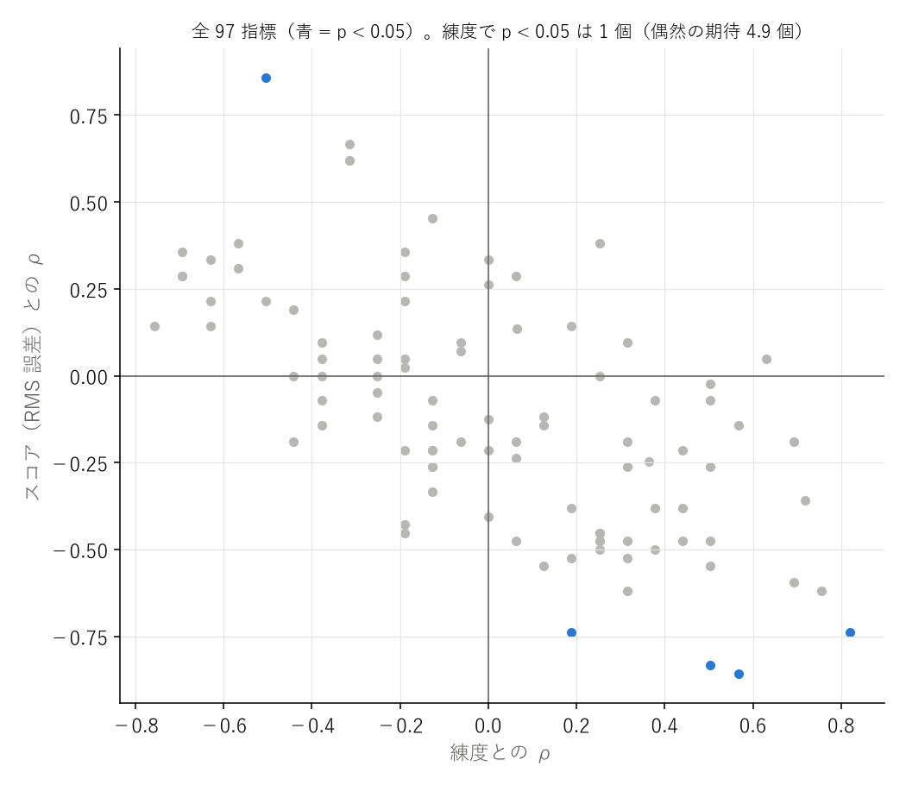
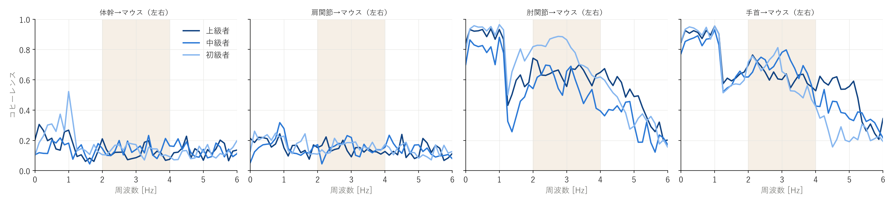
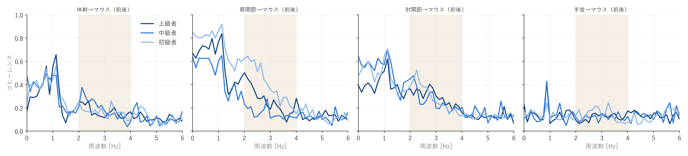
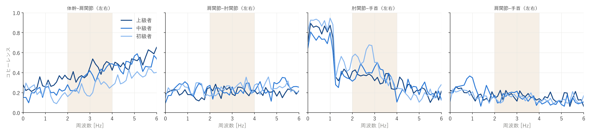
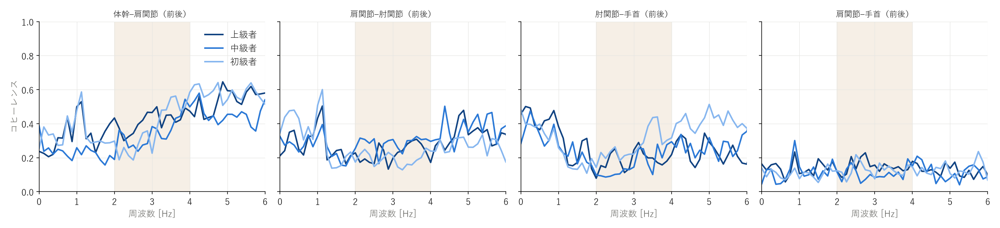
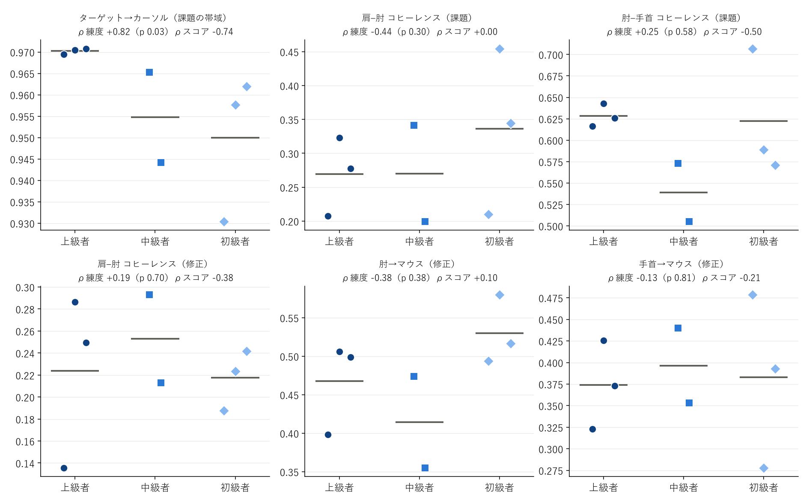
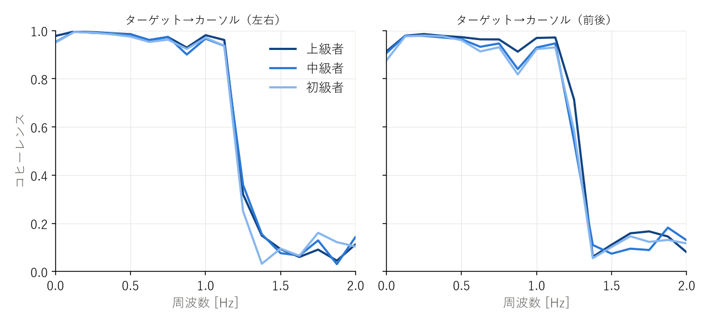
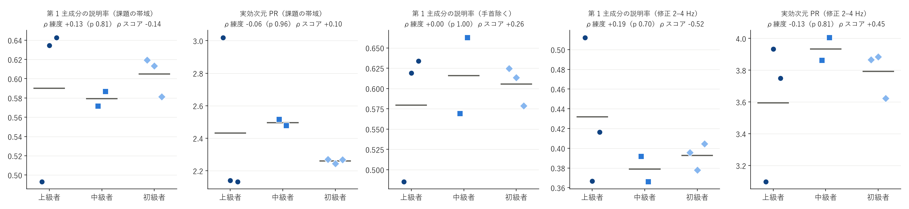
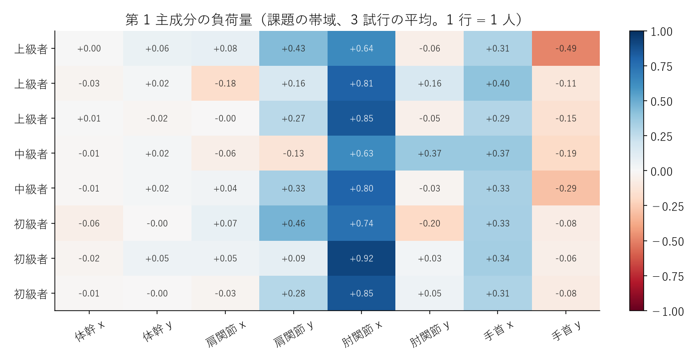

# 時系列 PCA・コヒーレンス解析 — dpi400_fast

参加者 8 人（上級 3 / 中級 2 / 初級 3）。各指標は 3 試行の平均。p は全並べ替えの正確な値、q は族ごとの BH 補正。

**探索的な解析。多数の指標を見ているので、p < 0.05 でも q が大きいものは偶然の可能性がある。差が無かった指標もすべて載せる。**

- 全 97 指標のうち、練度と p < 0.05: 1 個 / スコアと p < 0.05: 5 個 / 試行間でスコアと p < 0.05: 22 個（偶然の期待はそれぞれ約 4.9 個）

## 時系列 PCA（課題の帯域）

| 指標 | 上級 | 中級 | 初級 | ρ練度（p / q） | 外れ値除外 ρ | ρスコア（p） | 試行間 r（p） | D | 判定 |
|---|---|---|---|---|---|---|---|---|---|
| pca_task_vaf1 | 0.590 | 0.579 | 0.605 | +0.13（0.81 / 1.00） | +0.47 | -0.14（0.75） | +0.39（0.06） | 0.6 | 差なし |
| pca_task_vaf2 | 0.236 | 0.238 | 0.266 | -0.44（0.30 / 1.00） | -0.51 | +0.19（0.66） | -0.59（0.00） | 0.6 | 試行間でスコアと連動 |
| pca_task_pr | 2.431 | 2.497 | 2.260 | -0.06（0.96 / 1.00） | -0.38 | +0.10（0.84） | -0.32（0.13） | 0.8 | 差なし |
| pca_task_n90 | 3.111 | 3.667 | 2.889 | +0.07（0.89 / 1.00） | -0.22 | +0.14（0.75） | +0.26（0.22） | 1.1 | 差なし |
| pca_task_nohand_vaf1 | 0.579 | 0.616 | 0.606 | +0.00（1.00 / 1.00） | +0.34 | +0.26（0.54） | +0.24（0.26） | 0.8 | 差なし |
| pca_task_nohand_vaf2 | 0.263 | 0.237 | 0.285 | -0.38（0.38 / 1.00） | -0.43 | +0.00（1.00） | -0.21（0.33） | 0.9 | 差なし |
| pca_task_nohand_pr | 2.413 | 2.230 | 2.197 | -0.13（0.81 / 1.00） | -0.51 | -0.26（0.54） | -0.24（0.26） | 1.0 | 差なし |
| pca_task_nohand_n90 | 2.889 | 3.000 | 2.333 | +0.72（0.05 / 0.40） | +0.68 | -0.36（0.38） | +0.10（0.64） | 0.9 | 差なし |

## 時系列 PCA（修正の帯域）

| 指標 | 上級 | 中級 | 初級 | ρ練度（p / q） | 外れ値除外 ρ | ρスコア（p） | 試行間 r（p） | D | 判定 |
|---|---|---|---|---|---|---|---|---|---|
| pca_corr_vaf1 | 0.432 | 0.379 | 0.393 | +0.19（0.70 / 0.93） | -0.11 | -0.52（0.20） | +0.12（0.58） | 1.6 | 差なし |
| pca_corr_vaf2 | 0.240 | 0.266 | 0.261 | -0.19（0.70 / 0.93） | +0.09 | +0.36（0.39） | +0.24（0.26） | 1.2 | 差なし |
| pca_corr_pr | 3.594 | 3.934 | 3.792 | -0.13（0.81 / 0.93） | +0.19 | +0.45（0.27） | -0.18（0.39） | 1.3 | 差なし |
| pca_corr_n90 | 4.556 | 4.667 | 4.333 | +0.36（0.50 / 0.93） | +0.66 | -0.25（0.56） | -0.07（0.74） | 0.5 | 差なし |
| pca_corr_nohand_vaf1 | 0.502 | 0.443 | 0.414 | +0.57（0.17 / 0.87） | +0.43 | -0.86（0.01） | +0.01（0.96） | 2.0 | スコアと関係あり |
| pca_corr_nohand_vaf2 | 0.256 | 0.288 | 0.301 | -0.31（0.49 / 0.93） | -0.09 | +0.67（0.08） | +0.09（0.67） | 1.6 | 差なし |
| pca_corr_nohand_pr | 2.854 | 3.127 | 3.227 | -0.50（0.22 / 0.87） | -0.34 | +0.86（0.01） | -0.03（0.88） | 1.6 | スコアと関係あり |
| pca_corr_nohand_n90 | 3.111 | 3.000 | 3.111 | +0.00（1.00 / 1.00） | -0.43 | -0.13（0.86） | +0.08（0.70） | 1.1 | 差なし |

## ターゲット→カーソルのコヒーレンス

| 指標 | 上級 | 中級 | 初級 | ρ練度（p / q） | 外れ値除外 ρ | ρスコア（p） | 試行間 r（p） | D | 判定 |
|---|---|---|---|---|---|---|---|---|---|
| tc_x_task | 0.974 | 0.966 | 0.966 | +0.25（0.58 / 0.58） | +0.26 | -0.45（0.27） | -0.21（0.33） | 1.6 | 差なし |
| tc_y_task | 0.966 | 0.943 | 0.934 | +0.76（0.05 / 0.08） | +0.66 | -0.62（0.11） | -0.33（0.12） | 1.9 | 差なし |
| tc_xy_task | 0.970 | 0.955 | 0.950 | +0.82（0.03 / 0.08） | +0.76 | -0.74（0.05） | -0.35（0.10） | 2.1 | 練度と関係あり、スコアと関係あり（補正後は残らない） |

## 成分どうしのコヒーレンス

| 指標 | 上級 | 中級 | 初級 | ρ練度（p / q） | 外れ値除外 ρ | ρスコア（p） | 試行間 r（p） | D | 判定 |
|---|---|---|---|---|---|---|---|---|---|
| jj_trunk_upperarm_x_task | 0.262 | 0.200 | 0.244 | +0.19（0.70 / 0.84） | +0.15 | -0.74（0.05） | -0.19（0.38） | 1.1 | スコアと関係あり（補正後は残らない） |
| jj_trunk_upperarm_x_corr | 0.414 | 0.358 | 0.240 | +0.63（0.12 / 0.84） | +0.60 | +0.05（0.93） | -0.59（0.00） | 1.1 | 試行間でスコアと連動 |
| jj_upperarm_forearm_x_task | 0.205 | 0.245 | 0.236 | -0.25（0.58 / 0.84） | +0.00 | +0.00（1.00） | -0.28（0.18） | 1.3 | 差なし |
| jj_upperarm_forearm_x_corr | 0.222 | 0.221 | 0.242 | -0.13（0.81 / 0.88） | +0.08 | -0.26（0.54） | -0.03（0.89） | 1.0 | 差なし |
| jj_forearm_hand_x_task | 0.839 | 0.738 | 0.904 | -0.13（0.81 / 0.88） | +0.04 | -0.07（0.88） | +0.37（0.08） | 3.2 | 差なし |
| jj_forearm_hand_x_corr | 0.343 | 0.379 | 0.462 | -0.63（0.12 / 0.84） | -0.53 | +0.33（0.43） | -0.26（0.22） | 1.2 | 差なし |
| jj_upperarm_hand_x_task | 0.206 | 0.285 | 0.205 | +0.06（0.96 / 1.00） | +0.28 | -0.24（0.58） | -0.35（0.09） | 1.0 | 差なし |
| jj_upperarm_hand_x_corr | 0.166 | 0.154 | 0.145 | +0.31（0.49 / 0.84） | +0.17 | -0.52（0.20） | -0.34（0.10） | 0.7 | 差なし |
| jj_trunk_upperarm_y_task | 0.338 | 0.230 | 0.384 | -0.19（0.70 / 0.84） | -0.30 | +0.29（0.50） | +0.03（0.88） | 1.0 | 差なし |
| jj_trunk_upperarm_y_corr | 0.417 | 0.345 | 0.374 | +0.00（1.00 / 1.00） | -0.34 | +0.33（0.43） | -0.00（0.99） | 1.4 | 差なし |
| jj_upperarm_forearm_y_task | 0.334 | 0.295 | 0.436 | -0.38（0.38 / 0.84） | -0.28 | +0.05（0.93） | -0.28（0.18） | 0.6 | 差なし |
| jj_upperarm_forearm_y_corr | 0.226 | 0.285 | 0.194 | +0.19（0.70 / 0.84） | +0.62 | +0.14（0.75） | +0.07（0.73） | 2.1 | 差なし |
| jj_forearm_hand_y_task | 0.418 | 0.339 | 0.341 | +0.25（0.58 / 0.84） | +0.17 | +0.00（1.00） | +0.20（0.35） | 0.7 | 差なし |
| jj_forearm_hand_y_corr | 0.186 | 0.165 | 0.271 | -0.25（0.58 / 0.84） | -0.53 | +0.05（0.93） | -0.23（0.27） | 2.0 | 差なし |
| jj_upperarm_hand_y_task | 0.133 | 0.122 | 0.101 | +0.31（0.49 / 0.84） | +0.60 | -0.48（0.24） | +0.38（0.07） | 1.1 | 差なし |
| jj_upperarm_hand_y_corr | 0.148 | 0.107 | 0.129 | +0.57（0.17 / 0.84） | +0.40 | -0.14（0.75） | +0.61（0.00） | 0.8 | 試行間でスコアと連動 |
| jj_trunk_upperarm_xy_task | 0.300 | 0.215 | 0.314 | -0.19（0.70 / 0.84） | -0.30 | +0.02（0.98） | -0.10（0.65） | 1.1 | 差なし |
| jj_trunk_upperarm_xy_corr | 0.416 | 0.351 | 0.307 | +0.50（0.22 / 0.84） | +0.34 | -0.02（0.98） | -0.43（0.04） | 1.3 | 試行間でスコアと連動 |
| jj_upperarm_forearm_xy_task | 0.269 | 0.270 | 0.336 | -0.44（0.30 / 0.84） | -0.36 | +0.00（1.00） | -0.33（0.12） | 0.9 | 差なし |
| jj_upperarm_forearm_xy_corr | 0.224 | 0.253 | 0.218 | +0.19（0.70 / 0.84） | +0.60 | -0.38（0.36） | +0.01（0.96） | 1.6 | 差なし |
| jj_forearm_hand_xy_task | 0.628 | 0.539 | 0.622 | +0.25（0.58 / 0.84） | +0.13 | -0.50（0.22） | +0.28（0.18） | 0.7 | 差なし |
| jj_forearm_hand_xy_corr | 0.265 | 0.272 | 0.366 | -0.57（0.17 / 0.84） | -0.53 | +0.31（0.46） | -0.34（0.11） | 1.7 | 差なし |
| jj_upperarm_hand_xy_task | 0.169 | 0.204 | 0.153 | +0.25（0.58 / 0.84） | +0.53 | -0.45（0.27） | -0.19（0.39） | 1.5 | 差なし |
| jj_upperarm_hand_xy_corr | 0.157 | 0.130 | 0.137 | +0.31（0.49 / 0.84） | +0.06 | -0.26（0.54） | +0.07（0.73） | 0.6 | 差なし |

## 成分どうしの位相

| 指標 | 上級 | 中級 | 初級 | ρ練度（p / q） | 外れ値除外 ρ | ρスコア（p） | 試行間 r（p） | D | 判定 |
|---|---|---|---|---|---|---|---|---|---|
| jjph_trunk_upperarm_x_task | 129.950 | 48.554 | 132.428 | -0.13（0.81 / 0.93） | -0.21 | -0.14（0.75） | -0.02（0.94） | 1.8 | 差なし |
| jjph_trunk_upperarm_x_corr | 167.579 | 171.728 | 163.539 | +0.25（0.58 / 0.77） | +0.11 | +0.38（0.36） | -0.09（0.68） | 0.6 | 差なし |
| jjph_upperarm_forearm_x_task | 136.094 | 145.222 | 100.305 | +0.38（0.38 / 0.77） | +0.70 | -0.50（0.22） | -0.57（0.00） | 3.0 | 試行間でスコアと連動 |
| jjph_upperarm_forearm_x_corr | 150.262 | 129.788 | 152.026 | +0.25（0.58 / 0.77） | +0.57 | -0.48（0.24） | -0.14（0.50） | 1.2 | 差なし |
| jjph_forearm_hand_x_task | 13.524 | 18.843 | 8.974 | +0.44（0.30 / 0.77） | +0.64 | -0.21（0.62） | -0.59（0.00） | 1.5 | 試行間でスコアと連動 |
| jjph_forearm_hand_x_corr | 36.043 | 32.313 | 26.524 | +0.50（0.22 / 0.77） | +0.43 | -0.83（0.02） | -0.36（0.08） | 0.7 | スコアと関係あり（補正後は残らない） |
| jjph_upperarm_hand_x_task | 156.286 | 157.524 | 112.914 | +0.31（0.49 / 0.77） | +0.11 | +0.10（0.84） | -0.65（0.00） | 2.8 | 試行間でスコアと連動 |
| jjph_upperarm_hand_x_corr | 140.529 | 116.330 | 160.607 | -0.38（0.38 / 0.77） | -0.30 | -0.07（0.88） | +0.02（0.93） | 1.0 | 差なし |
| jjph_trunk_upperarm_y_task | 66.650 | 42.390 | 74.577 | -0.25（0.58 / 0.77） | -0.55 | +0.12（0.79） | -0.32（0.13） | 1.0 | 差なし |
| jjph_trunk_upperarm_y_corr | 166.522 | 171.182 | 163.054 | +0.50（0.22 / 0.77） | +0.45 | -0.26（0.54） | -0.36（0.08） | 1.2 | 差なし |
| jjph_upperarm_forearm_y_task | 46.852 | 52.754 | 36.598 | +0.38（0.38 / 0.77） | +0.28 | -0.07（0.88） | +0.10（0.63） | 0.8 | 差なし |
| jjph_upperarm_forearm_y_corr | 138.630 | 157.029 | 114.389 | +0.44（0.30 / 0.77） | +0.62 | -0.38（0.36） | +0.09（0.69） | 1.1 | 差なし |
| jjph_forearm_hand_y_task | 29.955 | 32.290 | 30.851 | +0.06（0.96 / 0.96） | +0.02 | -0.19（0.66） | +0.24（0.26） | 0.6 | 差なし |
| jjph_forearm_hand_y_corr | 148.355 | 137.325 | 157.693 | -0.25（0.58 / 0.77） | -0.09 | -0.12（0.79） | -0.43（0.03） | 1.3 | 試行間でスコアと連動 |
| jjph_upperarm_hand_y_task | 99.564 | 108.242 | 71.948 | +0.44（0.30 / 0.77） | +0.45 | -0.48（0.24） | +0.61（0.00） | 0.6 | 試行間でスコアと連動 |
| jjph_upperarm_hand_y_corr | 54.518 | 108.110 | 66.375 | -0.06（0.96 / 0.96） | -0.38 | +0.07（0.88） | -0.37（0.08） | 1.1 | 差なし |
| jjph_trunk_upperarm_xy_task | 98.300 | 45.472 | 103.503 | -0.19（0.70 / 0.89） | -0.30 | +0.05（0.93） | -0.21（0.32） | 1.5 | 差なし |
| jjph_trunk_upperarm_xy_corr | 167.050 | 171.455 | 163.297 | +0.50（0.22 / 0.77） | +0.47 | -0.07（0.88） | -0.23（0.27） | 0.7 | 差なし |
| jjph_upperarm_forearm_xy_task | 91.473 | 98.988 | 68.451 | +0.50（0.22 / 0.77） | +0.70 | -0.55（0.17） | -0.31（0.14） | 1.9 | 差なし |
| jjph_upperarm_forearm_xy_corr | 144.446 | 143.409 | 133.207 | +0.25（0.58 / 0.77） | +0.68 | -0.48（0.24） | -0.07（0.75） | 1.2 | 差なし |
| jjph_forearm_hand_xy_task | 21.740 | 25.566 | 19.912 | +0.13（0.81 / 0.93） | +0.19 | -0.12（0.79） | +0.16（0.47） | 0.7 | 差なし |
| jjph_forearm_hand_xy_corr | 92.199 | 84.819 | 92.108 | +0.06（0.96 / 0.96） | +0.17 | -0.48（0.24） | -0.46（0.03） | 1.0 | 試行間でスコアと連動 |
| jjph_upperarm_hand_xy_task | 127.925 | 132.883 | 92.431 | +0.69（0.09 / 0.77） | +0.62 | -0.60（0.13） | +0.45（0.03） | 1.2 | 試行間でスコアと連動 |
| jjph_upperarm_hand_xy_corr | 97.523 | 112.220 | 113.491 | -0.25（0.58 / 0.77） | -0.66 | -0.05（0.93） | -0.37（0.08） | 0.8 | 差なし |

## 成分→マウスのコヒーレンス（修正の帯域）

| 指標 | 上級 | 中級 | 初級 | ρ練度（p / q） | 外れ値除外 ρ | ρスコア（p） | 試行間 r（p） | D | 判定 |
|---|---|---|---|---|---|---|---|---|---|
| jm_trunk_x_corr | 0.119 | 0.143 | 0.133 | -0.19（0.70 / 0.88） | -0.15 | -0.45（0.27） | -0.12（0.59） | 0.9 | 差なし |
| jm_upperarm_x_corr | 0.144 | 0.147 | 0.156 | -0.13（0.81 / 0.88） | +0.08 | -0.33（0.43） | -0.25（0.24） | 1.2 | 差なし |
| jm_forearm_x_corr | 0.648 | 0.565 | 0.776 | -0.69（0.09 / 0.87） | -0.64 | +0.36（0.39） | +0.02（0.92） | 1.3 | 差なし |
| jm_hand_x_corr | 0.629 | 0.675 | 0.625 | -0.13（0.81 / 0.88） | +0.00 | -0.21（0.62） | -0.60（0.00） | 1.9 | 試行間でスコアと連動 |
| jm_trunk_y_corr | 0.168 | 0.185 | 0.165 | +0.00（1.00 / 1.00） | +0.36 | -0.40（0.33） | -0.20（0.34） | 0.8 | 差なし |
| jm_upperarm_y_corr | 0.264 | 0.153 | 0.401 | -0.57（0.17 / 0.87） | -0.64 | +0.38（0.36） | +0.01（0.97） | 1.7 | 差なし |
| jm_forearm_y_corr | 0.288 | 0.264 | 0.284 | +0.13（0.81 / 0.88） | +0.08 | -0.55（0.17） | -0.54（0.01） | 1.2 | 試行間でスコアと連動 |
| jm_hand_y_corr | 0.119 | 0.118 | 0.141 | -0.19（0.70 / 0.88） | -0.11 | -0.21（0.62） | -0.03（0.90） | 0.8 | 差なし |
| jm_trunk_xy_corr | 0.143 | 0.164 | 0.149 | -0.19（0.70 / 0.88） | +0.09 | -0.43（0.30） | -0.23（0.28） | 0.9 | 差なし |
| jm_upperarm_xy_corr | 0.204 | 0.150 | 0.279 | -0.50（0.22 / 0.87） | -0.55 | +0.21（0.62） | -0.11（0.62） | 1.5 | 差なし |
| jm_forearm_xy_corr | 0.468 | 0.415 | 0.530 | -0.38（0.38 / 0.88） | -0.30 | +0.10（0.84） | -0.28（0.18） | 1.2 | 差なし |
| jm_hand_xy_corr | 0.374 | 0.397 | 0.383 | -0.13（0.81 / 0.88） | +0.00 | -0.21（0.62） | -0.53（0.01） | 1.5 | 試行間でスコアと連動 |

## 成分→マウスの位相

| 指標 | 上級 | 中級 | 初級 | ρ練度（p / q） | 外れ値除外 ρ | ρスコア（p） | 試行間 r（p） | D | 判定 |
|---|---|---|---|---|---|---|---|---|---|
| jmph_trunk_x_corr | 93.343 | 128.165 | 104.678 | -0.19（0.70 / 0.84） | -0.06 | +0.21（0.62） | +0.49（0.02） | 1.0 | 試行間でスコアと連動 |
| jmph_upperarm_x_corr | 115.025 | 75.396 | 150.934 | -0.63（0.12 / 0.49） | -0.64 | +0.14（0.75） | +0.04（0.84） | 1.3 | 差なし |
| jmph_forearm_x_corr | 41.865 | 46.191 | 37.503 | +0.31（0.49 / 0.65） | +0.36 | -0.62（0.11） | -0.49（0.01） | 1.7 | 試行間でスコアと連動 |
| jmph_hand_x_corr | 16.945 | 21.341 | 13.284 | +0.31（0.49 / 0.65） | +0.47 | -0.19（0.66） | +0.42（0.04） | 0.9 | 試行間でスコアと連動 |
| jmph_trunk_y_corr | 143.369 | 76.355 | 105.231 | +0.50（0.22 / 0.65） | +0.30 | -0.48（0.24） | -0.04（0.84） | 1.9 | 差なし |
| jmph_upperarm_y_corr | 38.762 | 51.817 | 37.999 | +0.00（1.00 / 1.00） | +0.09 | -0.21（0.62） | +0.09（0.66） | 1.8 | 差なし |
| jmph_forearm_y_corr | 14.402 | 10.680 | 11.364 | +0.06（0.96 / 1.00） | -0.25 | +0.29（0.50） | -0.04（0.87） | 1.1 | 差なし |
| jmph_hand_y_corr | 55.597 | 65.040 | 68.760 | -0.31（0.49 / 0.65） | -0.32 | +0.62（0.11） | +0.00（0.99） | 1.3 | 差なし |
| jmph_trunk_xy_corr | 118.356 | 102.260 | 104.955 | +0.69（0.09 / 0.49） | +0.57 | -0.19（0.66） | +0.47（0.02） | 0.6 | 試行間でスコアと連動 |
| jmph_upperarm_xy_corr | 76.894 | 63.606 | 94.466 | -0.76（0.05 / 0.49） | -0.79 | +0.14（0.75） | +0.07（0.76） | 1.3 | 差なし |
| jmph_forearm_xy_corr | 28.133 | 28.435 | 24.434 | +0.38（0.38 / 0.65） | +0.19 | -0.38（0.36） | -0.29（0.17） | 1.1 | 差なし |
| jmph_hand_xy_corr | 36.271 | 43.191 | 41.022 | -0.31（0.49 / 0.65） | -0.32 | +0.62（0.11） | +0.08（0.73） | 1.2 | 差なし |

## 計測の確認（手先→マウス）

| 指標 | 上級 | 中級 | 初級 | ρ練度（p / q） | 外れ値除外 ρ | ρスコア（p） | 試行間 r（p） | D | 判定 |
|---|---|---|---|---|---|---|---|---|---|
| em_x_corr | 0.849 | 0.776 | 0.857 | -0.06（0.96 / 0.96） | +0.13 | -0.19（0.66） | -0.25（0.24） | 0.9 | 差なし |
| em_x_task | 0.893 | 0.845 | 0.943 | -0.63（0.12 / 0.24） | -0.64 | +0.21（0.62） | -0.36（0.08） | 1.2 | 差なし |
| em_y_corr | 0.559 | 0.458 | 0.663 | -0.44（0.30 / 0.45） | -0.36 | -0.19（0.66） | -0.68（0.00） | 1.1 | 試行間でスコアと連動 |
| em_y_task | 0.743 | 0.763 | 0.861 | -0.69（0.09 / 0.24） | -0.64 | +0.29（0.50） | -0.60（0.00） | 0.6 | 試行間でスコアと連動 |
| em_xy_corr | 0.704 | 0.617 | 0.760 | -0.38（0.38 / 0.45） | -0.28 | -0.14（0.75） | -0.59（0.00） | 1.0 | 試行間でスコアと連動 |
| em_xy_task | 0.818 | 0.804 | 0.902 | -0.69（0.09 / 0.24） | -0.64 | +0.29（0.50） | -0.56（0.00） | 0.7 | 試行間でスコアと連動 |

## 図

