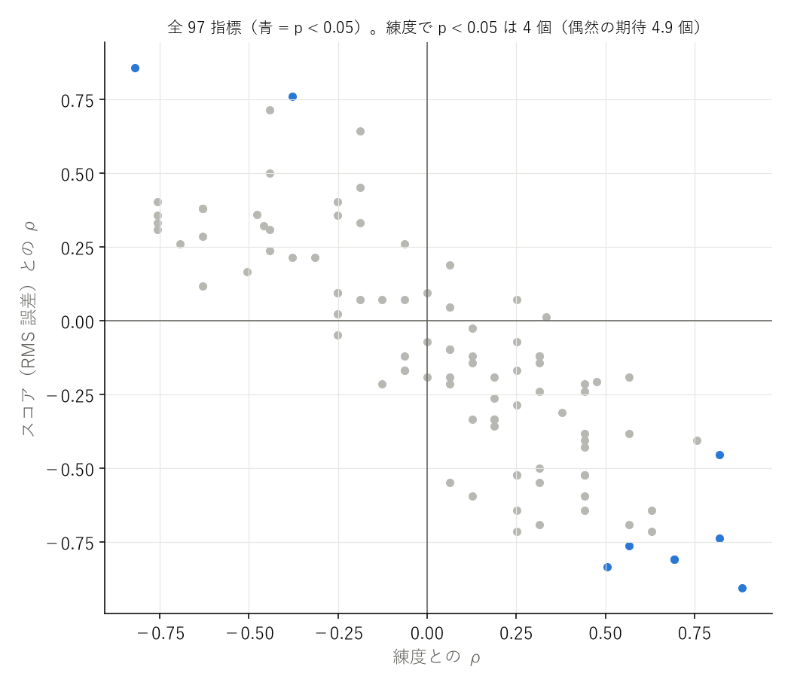
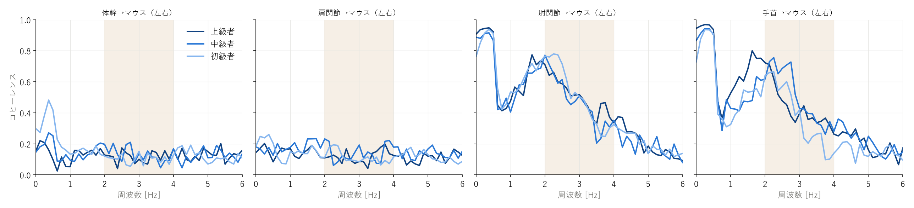
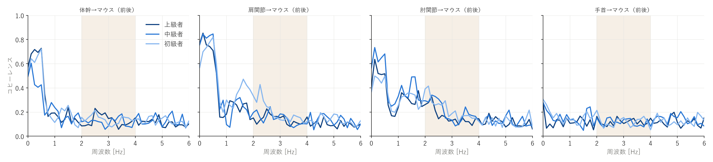
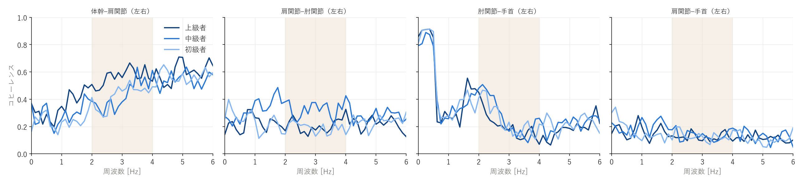
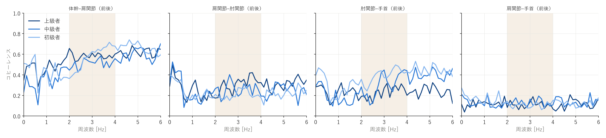
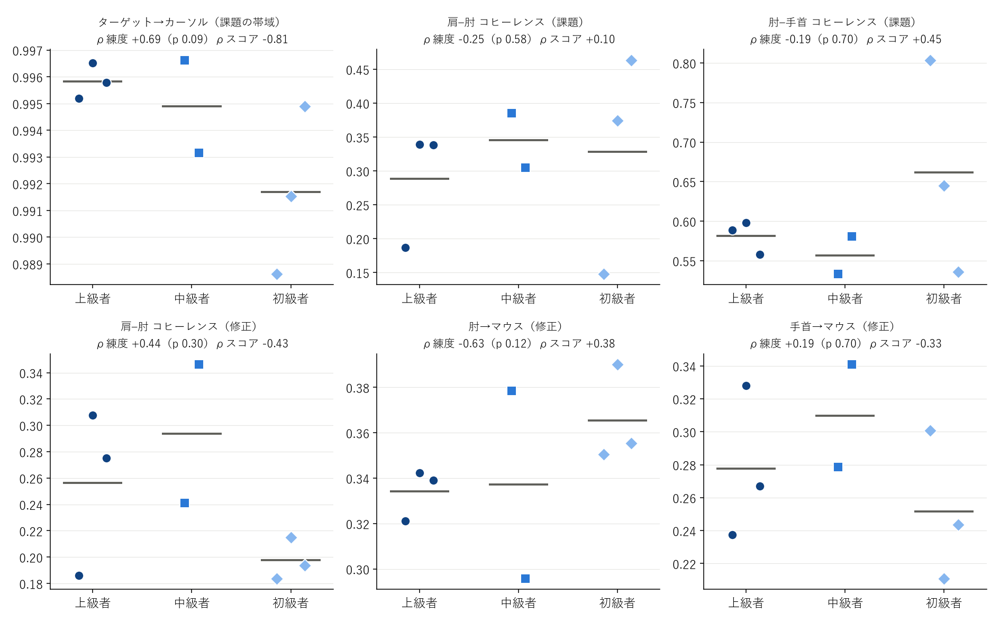
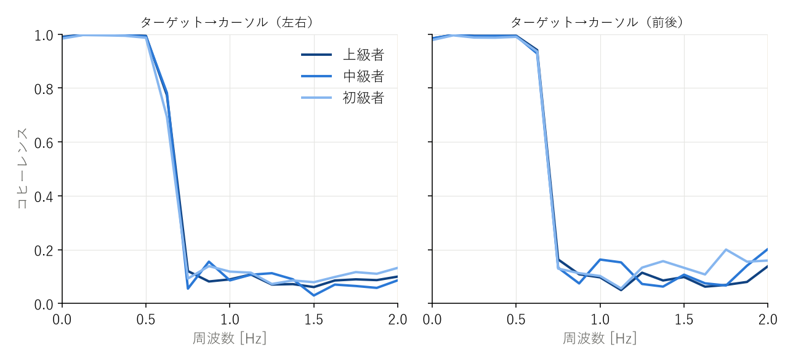
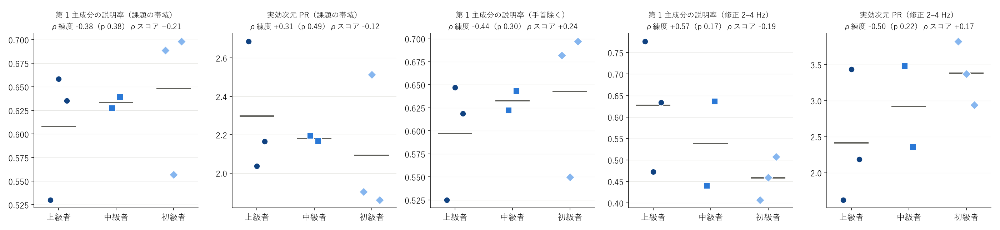
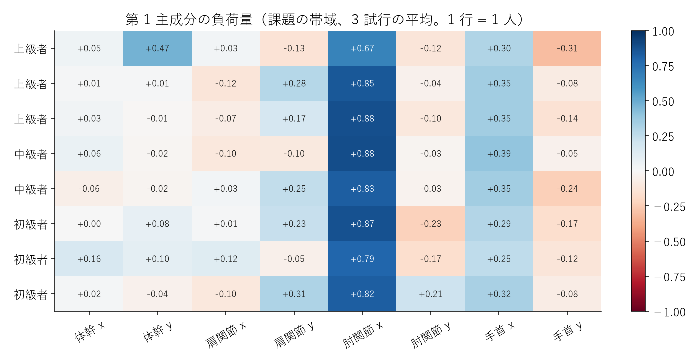

# 時系列 PCA・コヒーレンス解析 — dpi400_slow

参加者 8 人（上級 3 / 中級 2 / 初級 3）。各指標は 3 試行の平均。p は全並べ替えの正確な値、q は族ごとの BH 補正。

**探索的な解析。多数の指標を見ているので、p < 0.05 でも q が大きいものは偶然の可能性がある。差が無かった指標もすべて載せる。**

- 全 97 指標のうち、練度と p < 0.05: 4 個 / スコアと p < 0.05: 8 個 / 試行間でスコアと p < 0.05: 15 個（偶然の期待はそれぞれ約 4.9 個）

## 時系列 PCA（課題の帯域）

| 指標 | 上級 | 中級 | 初級 | ρ練度（p / q） | 外れ値除外 ρ | ρスコア（p） | 試行間 r（p） | D | 判定 |
|---|---|---|---|---|---|---|---|---|---|
| pca_task_vaf1 | 0.608 | 0.633 | 0.648 | -0.38（0.38 / 0.56） | -0.19 | +0.21（0.62） | -0.28（0.19） | 1.6 | 差なし |
| pca_task_vaf2 | 0.243 | 0.221 | 0.232 | +0.31（0.49 / 0.56） | +0.08 | -0.14（0.75） | +0.15（0.47） | 0.6 | 差なし |
| pca_task_pr | 2.296 | 2.180 | 2.091 | +0.31（0.49 / 0.56） | +0.11 | -0.12（0.79） | +0.24（0.25） | 1.7 | 差なし |
| pca_task_n90 | 2.889 | 2.833 | 2.556 | +0.48（0.26 / 0.56） | +0.42 | -0.21（0.64） | +0.15（0.49） | 1.0 | 差なし |
| pca_task_nohand_vaf1 | 0.597 | 0.633 | 0.643 | -0.44（0.30 / 0.56） | -0.26 | +0.24（0.58） | -0.44（0.03） | 1.8 | 試行間でスコアと連動 |
| pca_task_nohand_vaf2 | 0.257 | 0.250 | 0.247 | +0.19（0.70 / 0.70） | +0.17 | -0.19（0.66） | +0.27（0.19） | 0.6 | 差なし |
| pca_task_nohand_pr | 2.318 | 2.122 | 2.091 | +0.44（0.30 / 0.56） | +0.26 | -0.24（0.58） | +0.36（0.08） | 1.8 | 差なし |
| pca_task_nohand_n90 | 2.778 | 2.833 | 2.556 | +0.33（0.49 / 0.56） | +0.25 | +0.01（0.99） | +0.10（0.64） | 0.8 | 差なし |

## 時系列 PCA（修正の帯域）

| 指標 | 上級 | 中級 | 初級 | ρ練度（p / q） | 外れ値除外 ρ | ρスコア（p） | 試行間 r（p） | D | 判定 |
|---|---|---|---|---|---|---|---|---|---|
| pca_corr_vaf1 | 0.628 | 0.538 | 0.458 | +0.57（0.17 / 0.27） | +0.43 | -0.19（0.66） | -0.37（0.08） | 1.8 | 差なし |
| pca_corr_vaf2 | 0.179 | 0.213 | 0.242 | -0.63（0.12 / 0.24） | -0.51 | +0.12（0.79） | +0.14（0.53） | 1.7 | 差なし |
| pca_corr_pr | 2.415 | 2.918 | 3.379 | -0.50（0.22 / 0.27） | -0.34 | +0.17（0.70） | +0.35（0.09） | 1.7 | 差なし |
| pca_corr_n90 | 3.444 | 3.667 | 4.333 | -0.48（0.23 / 0.27） | -0.33 | +0.36（0.37） | +0.44（0.03） | 1.7 | 試行間でスコアと連動 |
| pca_corr_nohand_vaf1 | 0.692 | 0.599 | 0.497 | +0.76（0.05 / 0.20） | +0.70 | -0.40（0.33） | -0.26（0.22） | 1.8 | 差なし |
| pca_corr_nohand_vaf2 | 0.185 | 0.219 | 0.268 | -0.69（0.09 / 0.23） | -0.60 | +0.26（0.54） | +0.07（0.76） | 1.5 | 差なし |
| pca_corr_nohand_pr | 2.001 | 2.415 | 2.862 | -0.76（0.05 / 0.20） | -0.68 | +0.36（0.39） | +0.29（0.17） | 1.8 | 差なし |
| pca_corr_nohand_n90 | 2.556 | 2.833 | 3.222 | -0.46（0.29 / 0.29） | -0.29 | +0.32（0.44） | +0.51（0.01） | 3.0 | 試行間でスコアと連動 |

## ターゲット→カーソルのコヒーレンス

| 指標 | 上級 | 中級 | 初級 | ρ練度（p / q） | 外れ値除外 ρ | ρスコア（p） | 試行間 r（p） | D | 判定 |
|---|---|---|---|---|---|---|---|---|---|
| tc_x_task | 0.997 | 0.996 | 0.993 | +0.63（0.12 / 0.12） | +0.77 | -0.71（0.06） | -0.72（0.00） | 1.6 | 試行間でスコアと連動 |
| tc_y_task | 0.995 | 0.994 | 0.990 | +0.69（0.09 / 0.12） | +0.70 | -0.81（0.02） | -0.23（0.28） | 1.6 | スコアと関係あり |
| tc_xy_task | 0.996 | 0.995 | 0.992 | +0.69（0.09 / 0.12） | +0.70 | -0.81（0.02） | -0.59（0.00） | 2.4 | スコアと関係あり、試行間でスコアと連動 |

## 成分どうしのコヒーレンス

| 指標 | 上級 | 中級 | 初級 | ρ練度（p / q） | 外れ値除外 ρ | ρスコア（p） | 試行間 r（p） | D | 判定 |
|---|---|---|---|---|---|---|---|---|---|
| jj_trunk_upperarm_x_task | 0.280 | 0.290 | 0.283 | -0.06（0.96 / 1.00） | +0.25 | -0.17（0.70） | +0.12（0.59） | 0.7 | 差なし |
| jj_trunk_upperarm_x_corr | 0.563 | 0.431 | 0.425 | +0.82（0.03 / 0.60） | +0.76 | -0.45（0.27） | +0.22（0.31） | 0.8 | 練度と関係あり（補正後は残らない） |
| jj_upperarm_forearm_x_task | 0.195 | 0.235 | 0.304 | -0.25（0.58 / 1.00） | -0.17 | +0.10（0.84） | +0.21（0.32） | 1.1 | 差なし |
| jj_upperarm_forearm_x_corr | 0.207 | 0.327 | 0.188 | +0.31（0.49 / 1.00） | +0.47 | -0.55（0.17） | -0.30（0.16） | 0.8 | 差なし |
| jj_forearm_hand_x_task | 0.896 | 0.840 | 0.906 | -0.25（0.58 / 1.00） | -0.28 | -0.05（0.93） | -0.05（0.82） | 1.0 | 差なし |
| jj_forearm_hand_x_corr | 0.203 | 0.274 | 0.250 | -0.13（0.81 / 1.00） | +0.21 | +0.07（0.88） | +0.35（0.09） | 0.6 | 差なし |
| jj_upperarm_hand_x_task | 0.168 | 0.163 | 0.253 | +0.00（1.00 / 1.00） | +0.08 | -0.07（0.88） | +0.13（0.54） | 1.7 | 差なし |
| jj_upperarm_hand_x_corr | 0.123 | 0.138 | 0.129 | -0.19（0.70 / 1.00） | -0.06 | +0.07（0.88） | -0.24（0.26） | 0.6 | 差なし |
| jj_trunk_upperarm_y_task | 0.501 | 0.307 | 0.530 | -0.06（0.96 / 1.00） | +0.13 | -0.17（0.70） | +0.30（0.16） | 2.1 | 差なし |
| jj_trunk_upperarm_y_corr | 0.585 | 0.511 | 0.572 | +0.13（0.81 / 1.00） | -0.19 | -0.02（0.98） | -0.02（0.93） | 2.1 | 差なし |
| jj_upperarm_forearm_y_task | 0.381 | 0.455 | 0.353 | +0.19（0.70 / 1.00） | +0.26 | -0.36（0.39） | -0.08（0.71） | 1.0 | 差なし |
| jj_upperarm_forearm_y_corr | 0.306 | 0.260 | 0.207 | +0.44（0.30 / 1.00） | +0.77 | -0.38（0.36） | -0.12（0.57） | 1.2 | 差なし |
| jj_forearm_hand_y_task | 0.268 | 0.274 | 0.417 | -0.25（0.58 / 1.00） | -0.26 | +0.40（0.33） | -0.05（0.83） | 1.7 | 差なし |
| jj_forearm_hand_y_corr | 0.229 | 0.307 | 0.394 | -0.76（0.05 / 0.60） | -0.68 | +0.40（0.33） | -0.00（0.98） | 2.5 | 差なし |
| jj_upperarm_hand_y_task | 0.098 | 0.132 | 0.177 | -0.44（0.30 / 1.00） | -0.26 | +0.31（0.46） | +0.09（0.68） | 0.7 | 差なし |
| jj_upperarm_hand_y_corr | 0.109 | 0.128 | 0.107 | +0.06（0.96 / 1.00） | +0.28 | +0.05（0.93） | -0.46（0.02） | 1.0 | 試行間でスコアと連動 |
| jj_trunk_upperarm_xy_task | 0.391 | 0.299 | 0.407 | -0.13（0.81 / 1.00） | +0.15 | -0.21（0.62） | +0.23（0.28） | 1.3 | 差なし |
| jj_trunk_upperarm_xy_corr | 0.574 | 0.471 | 0.499 | +0.25（0.58 / 1.00） | +0.00 | -0.07（0.88） | +0.14（0.53） | 1.2 | 差なし |
| jj_upperarm_forearm_xy_task | 0.288 | 0.345 | 0.328 | -0.25（0.58 / 1.00） | -0.17 | +0.10（0.84） | +0.04（0.84） | 1.0 | 差なし |
| jj_upperarm_forearm_xy_corr | 0.256 | 0.294 | 0.198 | +0.44（0.30 / 1.00） | +0.79 | -0.43（0.30） | -0.26（0.23） | 0.8 | 差なし |
| jj_forearm_hand_xy_task | 0.582 | 0.557 | 0.662 | -0.19（0.70 / 1.00） | -0.28 | +0.45（0.27） | -0.06（0.79） | 1.3 | 差なし |
| jj_forearm_hand_xy_corr | 0.216 | 0.290 | 0.322 | -0.63（0.12 / 0.97） | -0.51 | +0.38（0.36） | +0.34（0.11） | 1.8 | 差なし |
| jj_upperarm_hand_xy_task | 0.133 | 0.148 | 0.215 | -0.31（0.49 / 1.00） | -0.26 | +0.21（0.62） | +0.15（0.48） | 1.5 | 差なし |
| jj_upperarm_hand_xy_corr | 0.116 | 0.133 | 0.118 | -0.06（0.96 / 1.00） | +0.11 | -0.12（0.79） | -0.41（0.04） | 0.9 | 試行間でスコアと連動 |

## 成分どうしの位相

| 指標 | 上級 | 中級 | 初級 | ρ練度（p / q） | 外れ値除外 ρ | ρスコア（p） | 試行間 r（p） | D | 判定 |
|---|---|---|---|---|---|---|---|---|---|
| jjph_trunk_upperarm_x_task | 149.837 | 111.515 | 106.049 | +0.31（0.49 / 0.87） | +0.40 | -0.24（0.58） | -0.14（0.51） | 1.1 | 差なし |
| jjph_trunk_upperarm_x_corr | 175.040 | 156.275 | 172.726 | -0.06（0.96 / 1.00） | -0.13 | +0.07（0.88） | +0.24（0.26） | 1.0 | 差なし |
| jjph_upperarm_forearm_x_task | 129.638 | 134.794 | 84.815 | +0.44（0.30 / 0.87） | +0.76 | -0.64（0.10） | +0.11（0.61） | 2.5 | 差なし |
| jjph_upperarm_forearm_x_corr | 161.002 | 157.998 | 156.371 | +0.25（0.58 / 0.87） | +0.26 | -0.52（0.20） | -0.13（0.54） | 0.6 | 差なし |
| jjph_forearm_hand_x_task | 8.801 | 10.240 | 7.206 | +0.13（0.81 / 1.00） | +0.53 | -0.33（0.43） | -0.15（0.47） | 1.2 | 差なし |
| jjph_forearm_hand_x_corr | 30.839 | 30.526 | 26.994 | +0.13（0.81 / 1.00） | +0.34 | -0.60（0.13） | +0.22（0.30） | 1.5 | 差なし |
| jjph_upperarm_hand_x_task | 114.100 | 139.367 | 79.628 | +0.25（0.58 / 0.87） | +0.53 | -0.64（0.10） | +0.23（0.29） | 1.6 | 差なし |
| jjph_upperarm_hand_x_corr | 134.855 | 142.347 | 128.670 | +0.06（0.96 / 1.00） | -0.08 | +0.19（0.66） | -0.18（0.41） | 1.0 | 差なし |
| jjph_trunk_upperarm_y_task | 42.252 | 29.556 | 52.976 | -0.38（0.38 / 0.87） | -0.70 | +0.76（0.04） | -0.27（0.20） | 0.8 | スコアと関係あり（補正後は残らない） |
| jjph_trunk_upperarm_y_corr | 175.364 | 177.458 | 173.636 | +0.25（0.58 / 0.87） | +0.13 | -0.17（0.70） | -0.05（0.82） | 1.1 | 差なし |
| jjph_upperarm_forearm_y_task | 41.780 | 33.256 | 35.746 | +0.25（0.58 / 0.87） | +0.00 | +0.07（0.88） | +0.16（0.47） | 0.8 | 差なし |
| jjph_upperarm_forearm_y_corr | 169.250 | 168.130 | 144.619 | +0.57（0.17 / 0.87） | +0.70 | -0.38（0.36） | -0.27（0.19） | 1.2 | 差なし |
| jjph_forearm_hand_y_task | 25.280 | 29.231 | 26.173 | +0.25（0.58 / 0.87） | +0.26 | -0.29（0.50） | +0.31（0.14） | 0.8 | 差なし |
| jjph_forearm_hand_y_corr | 171.652 | 175.109 | 171.608 | +0.06（0.96 / 1.00） | +0.11 | -0.19（0.66） | -0.08（0.73） | 0.5 | 差なし |
| jjph_upperarm_hand_y_task | 82.996 | 56.189 | 43.109 | +0.57（0.17 / 0.87） | +0.76 | -0.76（0.04） | +0.59（0.00） | 0.9 | スコアと関係あり（補正後は残らない）、試行間でスコアと連動 |
| jjph_upperarm_hand_y_corr | 85.067 | 108.745 | 96.012 | +0.00（1.00 / 1.00） | -0.06 | -0.19（0.66） | -0.17（0.43） | 0.7 | 差なし |
| jjph_trunk_upperarm_xy_task | 96.044 | 70.536 | 79.512 | +0.31（0.49 / 0.87） | +0.23 | -0.12（0.79） | -0.29（0.17） | 1.1 | 差なし |
| jjph_trunk_upperarm_xy_corr | 175.202 | 166.866 | 173.181 | +0.38（0.38 / 0.87） | +0.13 | -0.31（0.46） | +0.22（0.30） | 0.8 | 差なし |
| jjph_upperarm_forearm_xy_task | 85.709 | 84.025 | 60.280 | +0.44（0.30 / 0.87） | +0.76 | -0.52（0.20） | +0.19（0.37） | 1.8 | 差なし |
| jjph_upperarm_forearm_xy_corr | 165.126 | 163.064 | 150.495 | +0.88（0.01 / 0.26） | +0.94 | -0.90（0.00） | -0.30（0.16） | 0.6 | 練度と関係あり（補正後は残らない）、スコアと関係あり（補正後は残らない） |
| jjph_forearm_hand_xy_task | 17.040 | 19.736 | 16.689 | +0.19（0.70 / 0.99） | +0.26 | -0.26（0.54） | +0.27（0.19） | 0.7 | 差なし |
| jjph_forearm_hand_xy_corr | 101.246 | 102.817 | 99.301 | +0.06（0.96 / 1.00） | +0.26 | -0.55（0.17） | +0.17（0.42） | 1.5 | 差なし |
| jjph_upperarm_hand_xy_task | 98.548 | 97.778 | 61.369 | +0.50（0.22 / 0.87） | +0.87 | -0.83（0.02） | +0.53（0.01） | 1.3 | スコアと関係あり（補正後は残らない）、試行間でスコアと連動 |
| jjph_upperarm_hand_xy_corr | 109.961 | 125.546 | 112.341 | -0.25（0.58 / 0.87） | -0.40 | +0.02（0.98） | -0.25（0.24） | 0.8 | 差なし |

## 成分→マウスのコヒーレンス（修正の帯域）

| 指標 | 上級 | 中級 | 初級 | ρ練度（p / q） | 外れ値除外 ρ | ρスコア（p） | 試行間 r（p） | D | 判定 |
|---|---|---|---|---|---|---|---|---|---|
| jm_trunk_x_corr | 0.117 | 0.133 | 0.103 | +0.25（0.58 / 0.94） | +0.72 | -0.52（0.20） | -0.16（0.45） | 0.8 | 差なし |
| jm_upperarm_x_corr | 0.118 | 0.141 | 0.113 | +0.31（0.49 / 0.94） | +0.60 | -0.69（0.07） | -0.32（0.13） | 0.9 | 差なし |
| jm_forearm_x_corr | 0.503 | 0.471 | 0.509 | +0.13（0.81 / 0.96） | +0.08 | -0.12（0.79） | +0.47（0.02） | 0.5 | 試行間でスコアと連動 |
| jm_hand_x_corr | 0.436 | 0.504 | 0.385 | +0.19（0.70 / 0.94） | +0.45 | -0.33（0.43） | -0.06（0.78） | 1.0 | 差なし |
| jm_trunk_y_corr | 0.129 | 0.118 | 0.140 | -0.19（0.70 / 0.94） | -0.45 | +0.64（0.10） | -0.32（0.13） | 0.7 | 差なし |
| jm_upperarm_y_corr | 0.140 | 0.144 | 0.199 | -0.82（0.03 / 0.30） | -0.79 | +0.86（0.01） | +0.46（0.02） | 0.8 | 練度と関係あり（補正後は残らない）、スコアと関係あり（補正後は残らない）、試行間でスコアと連動 |
| jm_forearm_y_corr | 0.166 | 0.203 | 0.222 | -0.76（0.05 / 0.30） | -0.68 | +0.31（0.46） | +0.45（0.03） | 0.8 | 試行間でスコアと連動 |
| jm_hand_y_corr | 0.119 | 0.115 | 0.118 | +0.06（0.96 / 0.96） | -0.26 | -0.10（0.84） | -0.30（0.15） | 0.5 | 差なし |
| jm_trunk_xy_corr | 0.123 | 0.125 | 0.122 | -0.06（0.96 / 0.96） | +0.09 | +0.26（0.54） | -0.36（0.08） | 0.5 | 差なし |
| jm_upperarm_xy_corr | 0.129 | 0.143 | 0.156 | -0.63（0.12 / 0.36） | -0.51 | +0.29（0.50） | +0.24（0.27） | 0.7 | 差なし |
| jm_forearm_xy_corr | 0.334 | 0.337 | 0.365 | -0.63（0.12 / 0.36） | -0.60 | +0.38（0.36） | +0.53（0.01） | 0.5 | 試行間でスコアと連動 |
| jm_hand_xy_corr | 0.277 | 0.310 | 0.252 | +0.19（0.70 / 0.94） | +0.45 | -0.33（0.43） | -0.13（0.55） | 0.9 | 差なし |

## 成分→マウスの位相

| 指標 | 上級 | 中級 | 初級 | ρ練度（p / q） | 外れ値除外 ρ | ρスコア（p） | 試行間 r（p） | D | 判定 |
|---|---|---|---|---|---|---|---|---|---|
| jmph_trunk_x_corr | 75.972 | 94.139 | 121.793 | -0.44（0.30 / 0.72） | -0.79 | +0.71（0.06） | +0.07（0.73） | 0.9 | 差なし |
| jmph_upperarm_x_corr | 140.761 | 125.774 | 141.859 | +0.06（0.96 / 1.00） | +0.13 | -0.10（0.84） | +0.07（0.76） | 0.9 | 差なし |
| jmph_forearm_x_corr | 33.894 | 36.754 | 30.052 | +0.25（0.58 / 0.87） | +0.53 | -0.71（0.06） | +0.09（0.66） | 2.3 | 差なし |
| jmph_hand_x_corr | 17.693 | 14.448 | 13.048 | +0.44（0.30 / 0.72） | +0.28 | -0.21（0.62） | -0.23（0.28） | 1.0 | 差なし |
| jmph_trunk_y_corr | 111.380 | 109.272 | 97.291 | +0.13（0.81 / 0.97） | +0.34 | -0.14（0.75） | +0.20（0.34） | 0.6 | 差なし |
| jmph_upperarm_y_corr | 63.322 | 58.580 | 29.048 | +0.82（0.03 / 0.34） | +0.79 | -0.74（0.05） | +0.34（0.10） | 0.8 | 練度と関係あり（補正後は残らない）、スコアと関係あり（補正後は残らない） |
| jmph_forearm_y_corr | 14.488 | 11.207 | 13.383 | +0.00（1.00 / 1.00） | +0.32 | +0.10（0.84） | -0.04（0.85） | 1.0 | 差なし |
| jmph_hand_y_corr | 62.236 | 58.355 | 83.792 | -0.25（0.58 / 0.87） | -0.26 | +0.36（0.39） | +0.59（0.00） | 0.8 | 試行間でスコアと連動 |
| jmph_trunk_xy_corr | 93.676 | 101.706 | 109.542 | -0.44（0.30 / 0.72） | -0.28 | +0.50（0.22） | +0.19（0.37） | 0.7 | 差なし |
| jmph_upperarm_xy_corr | 102.041 | 92.177 | 85.453 | +0.57（0.17 / 0.72） | +0.51 | -0.69（0.07） | +0.30（0.15） | 0.6 | 差なし |
| jmph_forearm_xy_corr | 24.191 | 23.980 | 21.718 | +0.31（0.49 / 0.87） | +0.76 | -0.50（0.22） | +0.01（0.97） | 1.3 | 差なし |
| jmph_hand_xy_corr | 39.964 | 36.401 | 48.420 | -0.19（0.70 / 0.94） | -0.26 | +0.33（0.43） | +0.59（0.00） | 0.8 | 試行間でスコアと連動 |

## 計測の確認（手先→マウス）

| 指標 | 上級 | 中級 | 初級 | ρ練度（p / q） | 外れ値除外 ρ | ρスコア（p） | 試行間 r（p） | D | 判定 |
|---|---|---|---|---|---|---|---|---|---|
| em_x_corr | 0.787 | 0.747 | 0.700 | +0.44（0.30 / 0.36） | +0.51 | -0.40（0.33） | +0.04（0.84） | 0.9 | 差なし |
| em_x_task | 0.960 | 0.941 | 0.927 | +0.63（0.12 / 0.36） | +0.76 | -0.64（0.10） | +0.17（0.43） | 0.6 | 差なし |
| em_y_corr | 0.375 | 0.463 | 0.464 | -0.76（0.05 / 0.30） | -0.66 | +0.33（0.43） | +0.37（0.08） | 0.8 | 差なし |
| em_y_task | 0.904 | 0.896 | 0.850 | +0.44（0.30 / 0.36） | +0.59 | -0.60（0.13） | +0.28（0.19） | 0.4 | 差なし |
| em_xy_corr | 0.581 | 0.605 | 0.582 | +0.06（0.96 / 0.96） | +0.26 | -0.21（0.62） | +0.22（0.31） | 0.6 | 差なし |
| em_xy_task | 0.932 | 0.918 | 0.889 | +0.44（0.30 / 0.36） | +0.59 | -0.52（0.20） | +0.25（0.24） | 0.5 | 差なし |

## 図

