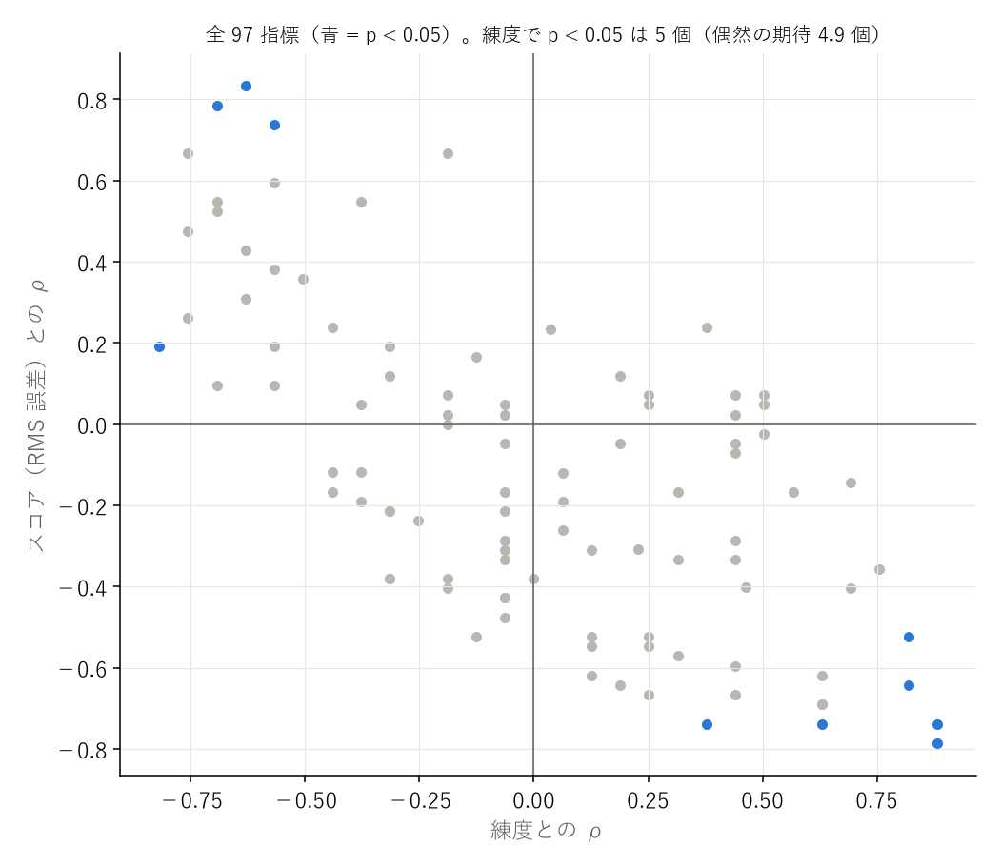
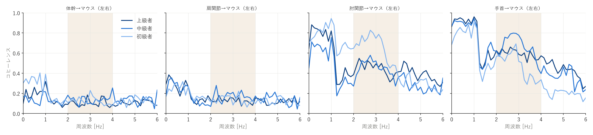
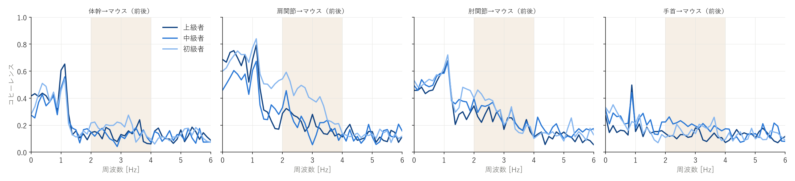
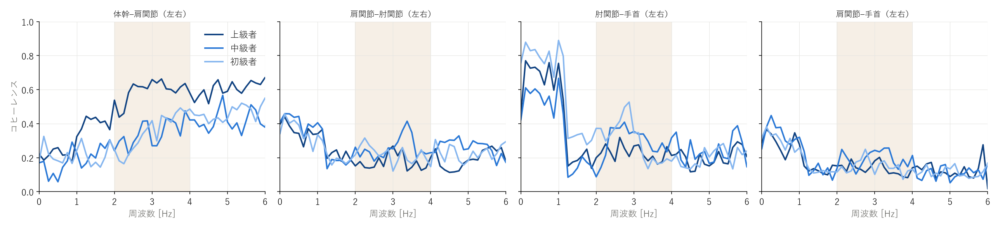
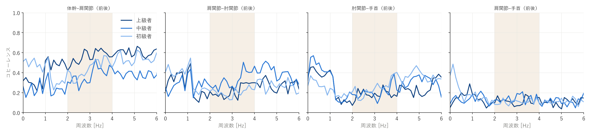
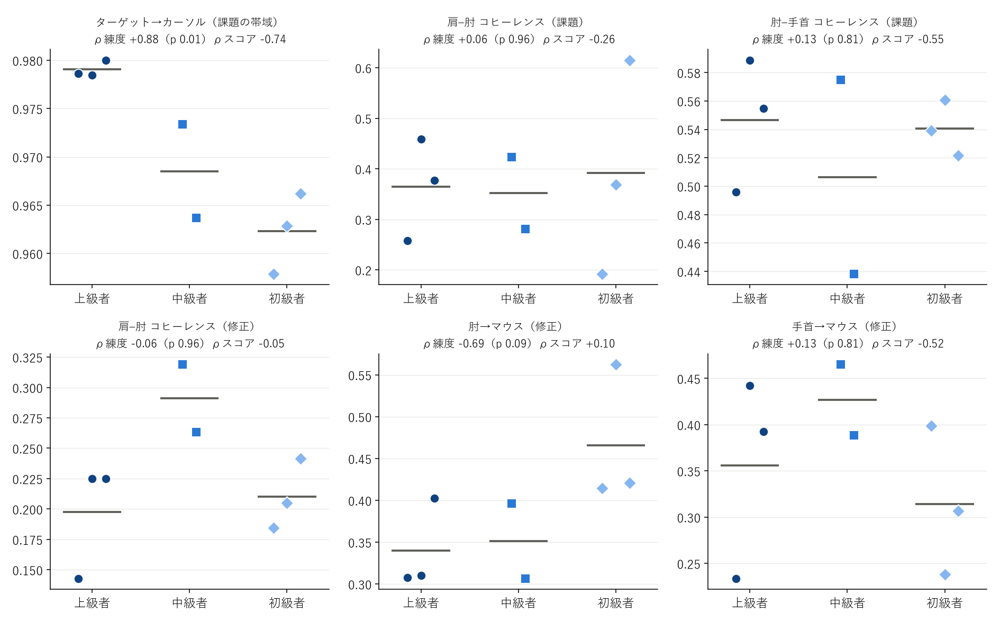
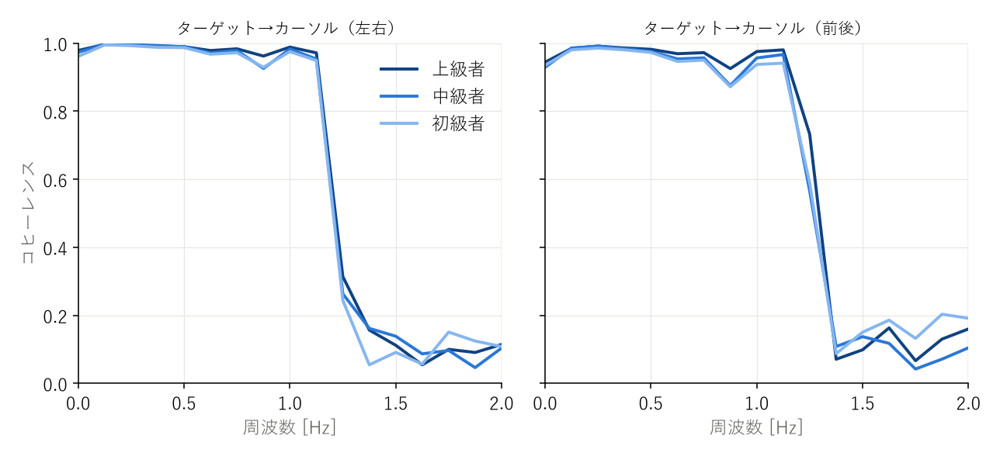
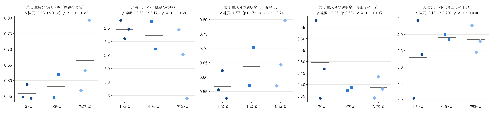
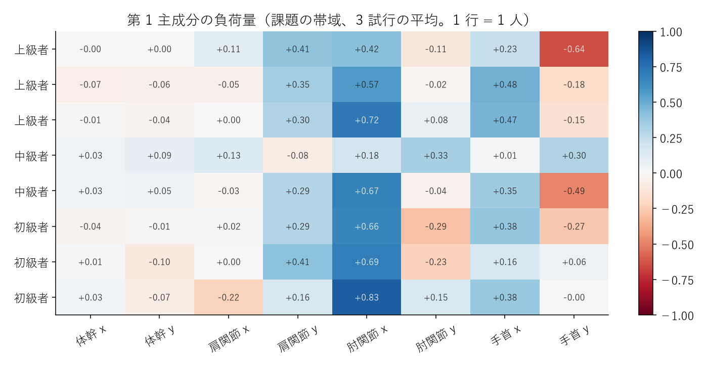

# 時系列 PCA・コヒーレンス解析 — dpi800_fast

参加者 8 人（上級 3 / 中級 2 / 初級 3）。各指標は 3 試行の平均。p は全並べ替えの正確な値、q は族ごとの BH 補正。

**探索的な解析。多数の指標を見ているので、p < 0.05 でも q が大きいものは偶然の可能性がある。差が無かった指標もすべて載せる。**

- 全 97 指標のうち、練度と p < 0.05: 5 個 / スコアと p < 0.05: 7 個 / 試行間でスコアと p < 0.05: 17 個（偶然の期待はそれぞれ約 4.9 個）

## 時系列 PCA（課題の帯域）

| 指標 | 上級 | 中級 | 初級 | ρ練度（p / q） | 外れ値除外 ρ | ρスコア（p） | 試行間 r（p） | D | 判定 |
|---|---|---|---|---|---|---|---|---|---|
| pca_task_vaf1 | 0.559 | 0.581 | 0.664 | -0.63（0.12 / 0.32） | -0.60 | +0.83（0.02） | +0.05（0.82） | 1.4 | スコアと関係あり |
| pca_task_vaf2 | 0.238 | 0.228 | 0.186 | +0.38（0.38 / 0.50） | +0.68 | -0.74（0.05） | -0.06（0.78） | 0.9 | スコアと関係あり |
| pca_task_pr | 2.579 | 2.490 | 2.112 | +0.63（0.12 / 0.32） | +0.53 | -0.69（0.07） | -0.05（0.83） | 1.3 | 差なし |
| pca_task_n90 | 3.333 | 3.167 | 3.000 | +0.23（0.62 / 0.62） | +0.14 | -0.31（0.46） | +0.22（0.29） | 2.7 | 差なし |
| pca_task_nohand_vaf1 | 0.568 | 0.637 | 0.670 | -0.57（0.17 / 0.35） | -0.42 | +0.74（0.05） | -0.36（0.09） | 1.1 | スコアと関係あり |
| pca_task_nohand_vaf2 | 0.252 | 0.227 | 0.217 | +0.25（0.58 / 0.62） | +0.25 | -0.67（0.08） | +0.10（0.65） | 1.0 | 差なし |
| pca_task_nohand_pr | 2.461 | 2.139 | 2.001 | +0.63（0.12 / 0.32） | +0.51 | -0.74（0.05） | +0.42（0.04） | 1.1 | スコアと関係あり、試行間でスコアと連動 |
| pca_task_nohand_n90 | 3.000 | 2.833 | 2.556 | +0.46（0.31 / 0.50） | +0.29 | -0.40（0.34） | -0.21（0.33） | 1.4 | 差なし |

## 時系列 PCA（修正の帯域）

| 指標 | 上級 | 中級 | 初級 | ρ練度（p / q） | 外れ値除外 ρ | ρスコア（p） | 試行間 r（p） | D | 判定 |
|---|---|---|---|---|---|---|---|---|---|
| pca_corr_vaf1 | 0.496 | 0.380 | 0.385 | +0.25（0.58 / 0.93） | +0.00 | +0.05（0.93） | -0.54（0.01） | 3.0 | 試行間でスコアと連動 |
| pca_corr_vaf2 | 0.203 | 0.277 | 0.269 | -0.69（0.09 / 0.32） | -0.57 | +0.52（0.20） | +0.32（0.13） | 1.7 | 差なし |
| pca_corr_pr | 3.284 | 3.910 | 3.839 | -0.19（0.70 / 0.94） | +0.09 | +0.00（1.00） | +0.55（0.01） | 3.1 | 試行間でスコアと連動 |
| pca_corr_n90 | 4.222 | 4.500 | 4.444 | +0.06（0.96 / 0.96） | +0.43 | -0.12（0.78） | +0.15（0.49） | 2.3 | 差なし |
| pca_corr_nohand_vaf1 | 0.584 | 0.509 | 0.436 | +0.69（0.09 / 0.32） | +0.62 | -0.40（0.33） | -0.57（0.00） | 2.5 | 試行間でスコアと連動 |
| pca_corr_nohand_vaf2 | 0.239 | 0.248 | 0.296 | -0.31（0.49 / 0.93） | -0.13 | +0.12（0.79） | +0.40（0.05） | 1.6 | 差なし |
| pca_corr_nohand_pr | 2.450 | 2.849 | 3.111 | -0.63（0.12 / 0.32） | -0.53 | +0.43（0.30） | +0.58（0.00） | 2.6 | 試行間でスコアと連動 |
| pca_corr_nohand_n90 | 3.000 | 3.333 | 3.000 | +0.04（0.89 / 0.96） | +0.50 | +0.23（0.57） | +0.25（0.24） | 2.0 | 差なし |

## ターゲット→カーソルのコヒーレンス

| 指標 | 上級 | 中級 | 初級 | ρ練度（p / q） | 外れ値除外 ρ | ρスコア（p） | 試行間 r（p） | D | 判定 |
|---|---|---|---|---|---|---|---|---|---|
| tc_x_task | 0.984 | 0.976 | 0.973 | +0.82（0.03 / 0.03） | +0.76 | -0.64（0.10） | -0.54（0.01） | 1.2 | 練度と関係あり、試行間でスコアと連動 |
| tc_y_task | 0.974 | 0.961 | 0.952 | +0.88（0.01 / 0.02） | +0.85 | -0.79（0.03） | -0.47（0.02） | 1.4 | 練度と関係あり、スコアと関係あり、試行間でスコアと連動 |
| tc_xy_task | 0.979 | 0.969 | 0.962 | +0.88（0.01 / 0.02） | +0.85 | -0.74（0.05） | -0.60（0.00） | 1.5 | 練度と関係あり、スコアと関係あり、試行間でスコアと連動 |

## 成分どうしのコヒーレンス

| 指標 | 上級 | 中級 | 初級 | ρ練度（p / q） | 外れ値除外 ρ | ρスコア（p） | 試行間 r（p） | D | 判定 |
|---|---|---|---|---|---|---|---|---|---|
| jj_trunk_upperarm_x_task | 0.245 | 0.154 | 0.227 | -0.06（0.96 / 1.00） | -0.45 | +0.05（0.93） | +0.12（0.57） | 0.7 | 差なし |
| jj_trunk_upperarm_x_corr | 0.592 | 0.345 | 0.352 | +0.69（0.09 / 1.00） | +0.57 | -0.14（0.75） | -0.59（0.00） | 2.3 | 試行間でスコアと連動 |
| jj_upperarm_forearm_x_task | 0.355 | 0.407 | 0.355 | -0.06（0.96 / 1.00） | +0.26 | -0.29（0.50） | -0.02（0.94） | 1.1 | 差なし |
| jj_upperarm_forearm_x_corr | 0.176 | 0.256 | 0.217 | +0.00（1.00 / 1.00） | +0.36 | -0.38（0.36） | -0.12（0.59） | 1.7 | 差なし |
| jj_forearm_hand_x_task | 0.690 | 0.555 | 0.808 | -0.44（0.30 / 1.00） | -0.38 | -0.17（0.70） | +0.34（0.10） | 2.5 | 差なし |
| jj_forearm_hand_x_corr | 0.227 | 0.291 | 0.301 | -0.38（0.38 / 1.00） | -0.17 | -0.19（0.66） | -0.06（0.77） | 0.8 | 差なし |
| jj_upperarm_hand_x_task | 0.273 | 0.336 | 0.288 | -0.06（0.96 / 1.00） | +0.26 | -0.33（0.43） | +0.13（0.55） | 1.2 | 差なし |
| jj_upperarm_hand_x_corr | 0.135 | 0.193 | 0.146 | -0.31（0.49 / 1.00） | -0.08 | -0.38（0.36） | -0.18（0.39） | 1.4 | 差なし |
| jj_trunk_upperarm_y_task | 0.343 | 0.255 | 0.493 | -0.57（0.17 / 1.00） | -0.55 | +0.60（0.13） | -0.45（0.03） | 1.3 | 試行間でスコアと連動 |
| jj_trunk_upperarm_y_corr | 0.558 | 0.371 | 0.441 | +0.19（0.70 / 1.00） | -0.11 | +0.12（0.79） | -0.43（0.04） | 2.3 | 試行間でスコアと連動 |
| jj_upperarm_forearm_y_task | 0.375 | 0.297 | 0.429 | -0.06（0.96 / 1.00） | -0.11 | +0.02（0.98） | -0.16（0.46） | 0.9 | 差なし |
| jj_upperarm_forearm_y_corr | 0.219 | 0.326 | 0.203 | +0.19（0.70 / 1.00） | +0.47 | -0.05（0.93） | -0.11（0.59） | 1.2 | 差なし |
| jj_forearm_hand_y_task | 0.402 | 0.458 | 0.273 | +0.50（0.22 / 1.00） | +0.45 | +0.07（0.88） | +0.26（0.21） | 0.7 | 差なし |
| jj_forearm_hand_y_corr | 0.180 | 0.206 | 0.247 | -0.19（0.70 / 1.00） | -0.09 | +0.07（0.88） | -0.26（0.22） | 1.7 | 差なし |
| jj_upperarm_hand_y_task | 0.178 | 0.134 | 0.235 | -0.19（0.70 / 1.00） | -0.28 | +0.02（0.98） | +0.30（0.15） | 1.0 | 差なし |
| jj_upperarm_hand_y_corr | 0.116 | 0.138 | 0.106 | +0.25（0.58 / 1.00） | +0.13 | +0.07（0.88） | -0.11（0.61） | 0.6 | 差なし |
| jj_trunk_upperarm_xy_task | 0.294 | 0.205 | 0.360 | -0.57（0.17 / 1.00） | -0.64 | +0.38（0.36） | -0.21（0.33） | 1.0 | 差なし |
| jj_trunk_upperarm_xy_corr | 0.575 | 0.358 | 0.397 | +0.44（0.30 / 1.00） | +0.23 | +0.02（0.98） | -0.61（0.00） | 2.8 | 試行間でスコアと連動 |
| jj_upperarm_forearm_xy_task | 0.365 | 0.352 | 0.392 | +0.06（0.96 / 1.00） | +0.25 | -0.26（0.54） | -0.09（0.67） | 0.9 | 差なし |
| jj_upperarm_forearm_xy_corr | 0.198 | 0.291 | 0.210 | -0.06（0.96 / 1.00） | +0.30 | -0.05（0.93） | -0.13（0.53） | 1.1 | 差なし |
| jj_forearm_hand_xy_task | 0.546 | 0.506 | 0.540 | +0.13（0.81 / 1.00） | +0.42 | -0.55（0.17） | +0.40（0.05） | 0.5 | 差なし |
| jj_forearm_hand_xy_corr | 0.204 | 0.249 | 0.274 | -0.57（0.17 / 1.00） | -0.42 | +0.10（0.84） | -0.18（0.40） | 1.1 | 差なし |
| jj_upperarm_hand_xy_task | 0.225 | 0.235 | 0.262 | -0.19（0.70 / 1.00） | +0.08 | -0.38（0.36） | +0.23（0.28） | 0.8 | 差なし |
| jj_upperarm_hand_xy_corr | 0.126 | 0.165 | 0.126 | +0.06（0.96 / 1.00） | +0.13 | -0.19（0.66） | -0.19（0.37） | 1.0 | 差なし |

## 成分どうしの位相

| 指標 | 上級 | 中級 | 初級 | ρ練度（p / q） | 外れ値除外 ρ | ρスコア（p） | 試行間 r（p） | D | 判定 |
|---|---|---|---|---|---|---|---|---|---|
| jjph_trunk_upperarm_x_task | 94.107 | 105.398 | 138.832 | -0.76（0.05 / 0.40） | -0.77 | +0.67（0.08） | +0.30（0.15） | 1.1 | 差なし |
| jjph_trunk_upperarm_x_corr | 174.950 | 171.212 | 169.672 | +0.50（0.22 / 0.55） | +0.34 | +0.05（0.93） | -0.11（0.62） | 0.8 | 差なし |
| jjph_upperarm_forearm_x_task | 112.467 | 115.834 | 123.004 | -0.13（0.81 / 0.93） | +0.17 | -0.52（0.20） | +0.06（0.79） | 1.7 | 差なし |
| jjph_upperarm_forearm_x_corr | 149.060 | 149.334 | 142.392 | +0.25（0.58 / 0.77） | +0.25 | -0.52（0.20） | -0.25（0.24） | 0.8 | 差なし |
| jjph_forearm_hand_x_task | 19.650 | 22.783 | 12.318 | +0.44（0.30 / 0.55） | +0.94 | -0.60（0.13） | -0.38（0.07） | 2.3 | 差なし |
| jjph_forearm_hand_x_corr | 75.811 | 48.918 | 24.960 | +0.63（0.12 / 0.55） | +0.53 | -0.69（0.07） | -0.31（0.14） | 2.5 | 差なし |
| jjph_upperarm_hand_x_task | 145.660 | 143.793 | 120.703 | +0.31（0.49 / 0.69） | +0.26 | -0.17（0.70） | -0.26（0.22） | 0.9 | 差なし |
| jjph_upperarm_hand_x_corr | 130.459 | 102.437 | 131.692 | -0.06（0.96 / 0.96） | -0.02 | -0.43（0.30） | -0.25（0.24） | 0.9 | 差なし |
| jjph_trunk_upperarm_y_task | 102.916 | 46.355 | 136.224 | -0.38（0.38 / 0.61） | -0.38 | +0.05（0.93） | -0.39（0.06） | 2.7 | 差なし |
| jjph_trunk_upperarm_y_corr | 171.426 | 168.810 | 166.964 | +0.44（0.30 / 0.55） | +0.26 | -0.29（0.50） | -0.16（0.46） | 1.0 | 差なし |
| jjph_upperarm_forearm_y_task | 61.908 | 82.689 | 43.711 | +0.38（0.38 / 0.61） | +0.28 | +0.24（0.58） | +0.12（0.59） | 0.8 | 差なし |
| jjph_upperarm_forearm_y_corr | 158.881 | 161.045 | 117.119 | +0.76（0.05 / 0.40） | +0.87 | -0.36（0.39） | -0.06（0.77） | 1.2 | 差なし |
| jjph_forearm_hand_y_task | 58.573 | 31.349 | 57.217 | -0.06（0.96 / 0.96） | -0.09 | -0.17（0.70） | -0.11（0.62） | 1.2 | 差なし |
| jjph_forearm_hand_y_corr | 145.845 | 145.032 | 150.493 | -0.13（0.81 / 0.93） | +0.15 | +0.17（0.70） | -0.07（0.74） | 0.7 | 差なし |
| jjph_upperarm_hand_y_task | 125.008 | 124.249 | 65.064 | +0.44（0.30 / 0.55） | +0.28 | -0.07（0.88） | +0.21（0.32） | 1.6 | 差なし |
| jjph_upperarm_hand_y_corr | 83.864 | 128.277 | 53.666 | +0.44（0.30 / 0.55） | +0.47 | -0.33（0.43） | -0.01（0.98） | 0.9 | 差なし |
| jjph_trunk_upperarm_xy_task | 98.511 | 75.876 | 137.528 | -0.57（0.17 / 0.55） | -0.64 | +0.19（0.66） | +0.06（0.76） | 2.1 | 差なし |
| jjph_trunk_upperarm_xy_corr | 173.188 | 170.011 | 168.318 | +0.44（0.30 / 0.55） | +0.26 | -0.05（0.93） | -0.17（0.42） | 1.0 | 差なし |
| jjph_upperarm_forearm_xy_task | 87.188 | 99.262 | 83.357 | +0.19（0.70 / 0.89） | +0.43 | -0.64（0.10） | +0.18（0.40） | 1.6 | 差なし |
| jjph_upperarm_forearm_xy_corr | 153.971 | 155.190 | 129.756 | +0.82（0.03 / 0.40） | +0.94 | -0.52（0.20） | -0.26（0.21） | 1.3 | 練度と関係あり（補正後は残らない） |
| jjph_forearm_hand_xy_task | 39.111 | 27.066 | 34.768 | -0.06（0.96 / 0.96） | +0.08 | -0.21（0.62） | -0.14（0.50） | 1.3 | 差なし |
| jjph_forearm_hand_xy_corr | 110.828 | 96.975 | 87.727 | +0.63（0.12 / 0.55） | +0.53 | -0.62（0.11） | -0.24（0.25） | 1.2 | 差なし |
| jjph_upperarm_hand_xy_task | 135.334 | 134.021 | 92.884 | +0.57（0.17 / 0.55） | +0.45 | -0.17（0.70） | +0.01（0.98） | 1.4 | 差なし |
| jjph_upperarm_hand_xy_corr | 107.161 | 115.357 | 92.679 | +0.31（0.49 / 0.69） | +0.36 | -0.57（0.15） | -0.15（0.49） | 0.6 | 差なし |

## 成分→マウスのコヒーレンス（修正の帯域）

| 指標 | 上級 | 中級 | 初級 | ρ練度（p / q） | 外れ値除外 ρ | ρスコア（p） | 試行間 r（p） | D | 判定 |
|---|---|---|---|---|---|---|---|---|---|
| jm_trunk_x_corr | 0.104 | 0.140 | 0.124 | -0.31（0.49 / 0.58） | -0.23 | +0.19（0.66） | -0.10（0.63） | 1.0 | 差なし |
| jm_upperarm_x_corr | 0.128 | 0.167 | 0.133 | -0.06（0.96 / 0.96） | +0.26 | -0.43（0.30） | -0.05（0.81） | 1.5 | 差なし |
| jm_forearm_x_corr | 0.444 | 0.439 | 0.650 | -0.76（0.05 / 0.20） | -0.72 | +0.48（0.24） | -0.04（0.84） | 1.5 | 差なし |
| jm_hand_x_corr | 0.593 | 0.655 | 0.475 | +0.44（0.30 / 0.45） | +0.77 | -0.67（0.08） | +0.04（0.84） | 1.7 | 差なし |
| jm_trunk_y_corr | 0.131 | 0.125 | 0.178 | -0.50（0.22 / 0.44） | -0.38 | +0.36（0.39） | +0.15（0.50） | 1.1 | 差なし |
| jm_upperarm_y_corr | 0.204 | 0.207 | 0.380 | -0.76（0.05 / 0.20） | -0.72 | +0.26（0.54） | +0.53（0.01） | 1.9 | 試行間でスコアと連動 |
| jm_forearm_y_corr | 0.236 | 0.264 | 0.281 | -0.31（0.49 / 0.58） | -0.17 | -0.38（0.36） | -0.10（0.65） | 1.2 | 差なし |
| jm_hand_y_corr | 0.119 | 0.199 | 0.154 | -0.44（0.30 / 0.45） | -0.40 | +0.24（0.58） | +0.00（1.00） | 1.7 | 差なし |
| jm_trunk_xy_corr | 0.117 | 0.132 | 0.151 | -0.63（0.12 / 0.29） | -0.53 | +0.31（0.46） | +0.04（0.85） | 0.9 | 差なし |
| jm_upperarm_xy_corr | 0.166 | 0.187 | 0.256 | -0.82（0.03 / 0.20） | -0.79 | +0.19（0.66） | +0.39（0.06） | 1.7 | 練度と関係あり（補正後は残らない） |
| jm_forearm_xy_corr | 0.340 | 0.352 | 0.466 | -0.69（0.09 / 0.26） | -0.72 | +0.10（0.84） | -0.09（0.68） | 1.5 | 差なし |
| jm_hand_xy_corr | 0.356 | 0.427 | 0.314 | +0.13（0.81 / 0.88） | +0.53 | -0.52（0.20） | +0.04（0.84） | 1.8 | 差なし |

## 成分→マウスの位相

| 指標 | 上級 | 中級 | 初級 | ρ練度（p / q） | 外れ値除外 ρ | ρスコア（p） | 試行間 r（p） | D | 判定 |
|---|---|---|---|---|---|---|---|---|---|
| jmph_trunk_x_corr | 71.018 | 112.297 | 113.152 | -0.69（0.09 / 0.51） | -0.59 | +0.79（0.03） | +0.35（0.10） | 1.0 | スコアと関係あり（補正後は残らない） |
| jmph_upperarm_x_corr | 113.485 | 108.487 | 128.169 | -0.38（0.38 / 0.76） | -0.19 | -0.12（0.79） | -0.52（0.01） | 0.9 | 試行間でスコアと連動 |
| jmph_forearm_x_corr | 40.144 | 55.310 | 35.655 | +0.13（0.81 / 0.96） | +0.53 | -0.62（0.11） | -0.03（0.89） | 2.3 | 差なし |
| jmph_hand_x_corr | 28.242 | 22.233 | 17.193 | +0.44（0.30 / 0.76） | +0.26 | +0.07（0.88） | +0.08（0.72） | 1.4 | 差なし |
| jmph_trunk_y_corr | 150.864 | 86.477 | 154.458 | -0.06（0.96 / 0.96） | +0.04 | -0.31（0.46） | +0.32（0.12） | 1.3 | 差なし |
| jmph_upperarm_y_corr | 45.565 | 74.373 | 38.954 | +0.25（0.58 / 0.87） | +0.09 | -0.55（0.17） | -0.25（0.24） | 1.4 | 差なし |
| jmph_forearm_y_corr | 19.652 | 34.113 | 8.468 | +0.50（0.22 / 0.76） | +0.55 | -0.02（0.98） | +0.18（0.40） | 1.0 | 差なし |
| jmph_hand_y_corr | 25.423 | 38.566 | 46.128 | -0.38（0.38 / 0.76） | -0.43 | +0.55（0.17） | -0.00（0.99） | 1.6 | 差なし |
| jmph_trunk_xy_corr | 110.941 | 99.387 | 133.805 | -0.69（0.09 / 0.51） | -0.72 | +0.55（0.17） | +0.57（0.00） | 0.9 | 試行間でスコアと連動 |
| jmph_upperarm_xy_corr | 79.525 | 91.430 | 83.561 | -0.06（0.96 / 0.96） | +0.00 | -0.48（0.24） | -0.54（0.01） | 0.9 | 試行間でスコアと連動 |
| jmph_forearm_xy_corr | 29.898 | 44.712 | 22.061 | +0.31（0.49 / 0.83） | +0.64 | -0.33（0.43） | +0.17（0.44） | 1.5 | 差なし |
| jmph_hand_xy_corr | 26.833 | 30.400 | 31.660 | -0.19（0.70 / 0.94） | -0.34 | +0.67（0.08） | +0.04（0.86） | 1.7 | 差なし |

## 計測の確認（手先→マウス）

| 指標 | 上級 | 中級 | 初級 | ρ練度（p / q） | 外れ値除外 ρ | ρスコア（p） | 試行間 r（p） | D | 判定 |
|---|---|---|---|---|---|---|---|---|---|
| em_x_corr | 0.800 | 0.782 | 0.784 | +0.13（0.81 / 0.81） | +0.49 | -0.31（0.46） | -0.15（0.50） | 0.6 | 差なし |
| em_x_task | 0.844 | 0.816 | 0.897 | -0.44（0.30 / 0.81） | -0.28 | -0.12（0.79） | +0.10（0.65） | 1.3 | 差なし |
| em_y_corr | 0.593 | 0.606 | 0.715 | -0.31（0.49 / 0.81） | -0.11 | -0.21（0.62） | -0.42（0.04） | 1.5 | 試行間でスコアと連動 |
| em_y_task | 0.778 | 0.753 | 0.860 | -0.25（0.58 / 0.81） | -0.02 | -0.24（0.58） | -0.30（0.16） | 0.7 | 差なし |
| em_xy_corr | 0.697 | 0.694 | 0.750 | -0.19（0.70 / 0.81） | +0.06 | -0.40（0.33） | -0.31（0.14） | 1.0 | 差なし |
| em_xy_task | 0.811 | 0.784 | 0.878 | -0.31（0.49 / 0.81） | -0.11 | -0.21（0.62） | -0.16（0.45） | 0.9 | 差なし |

## 図

