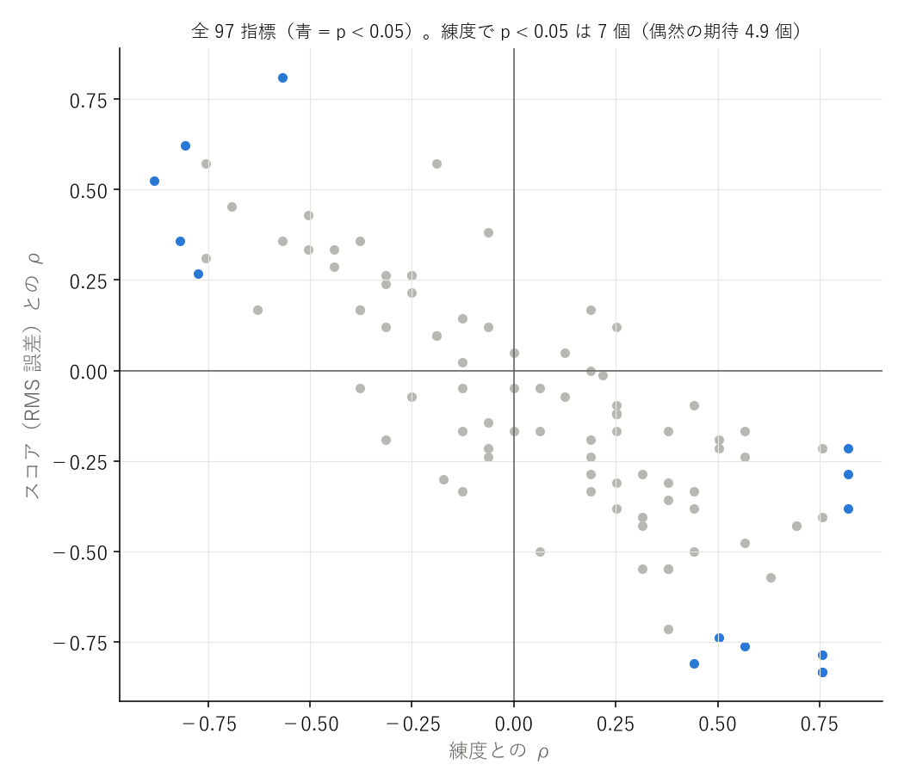
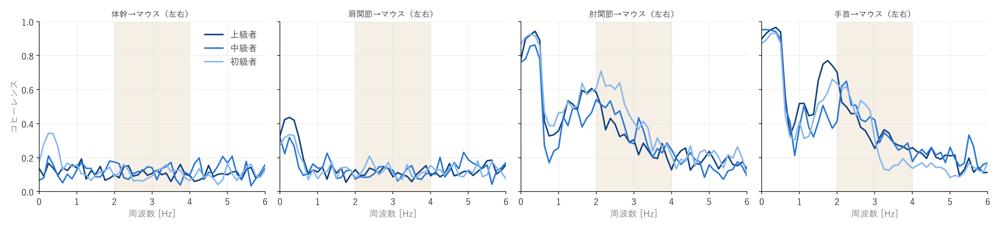
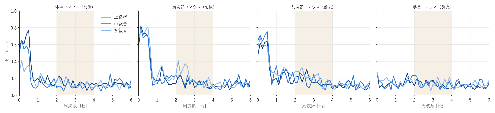
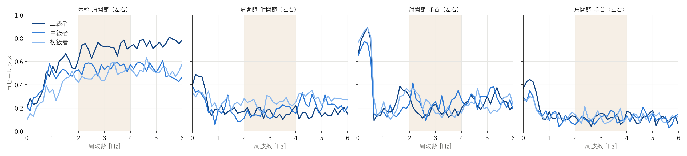
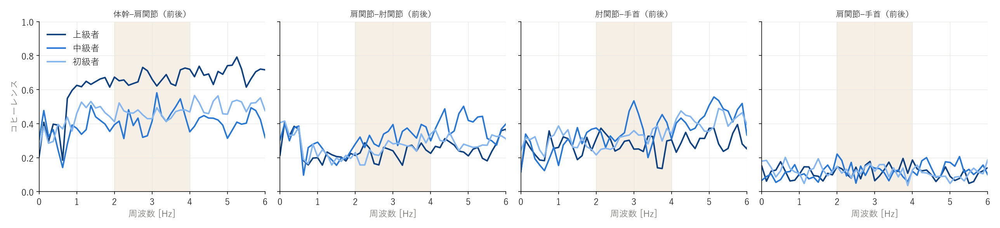
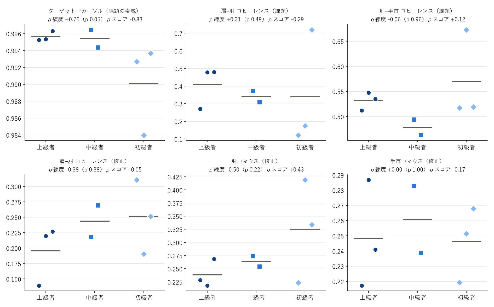
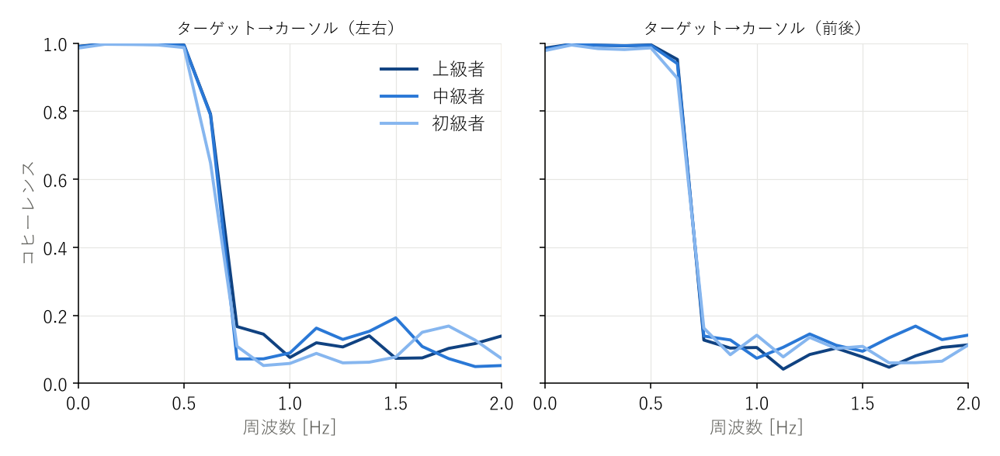
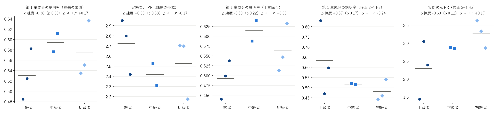
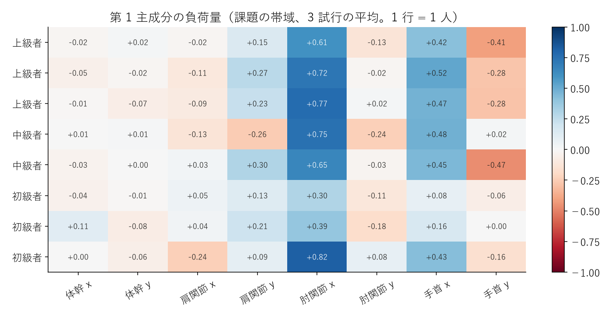

# 時系列 PCA・コヒーレンス解析 — dpi800_slow

参加者 8 人（上級 3 / 中級 2 / 初級 3）。各指標は 3 試行の平均。p は全並べ替えの正確な値、q は族ごとの BH 補正。

**探索的な解析。多数の指標を見ているので、p < 0.05 でも q が大きいものは偶然の可能性がある。差が無かった指標もすべて載せる。**

- 全 97 指標のうち、練度と p < 0.05: 7 個 / スコアと p < 0.05: 7 個 / 試行間でスコアと p < 0.05: 13 個（偶然の期待はそれぞれ約 4.9 個）

## 時系列 PCA（課題の帯域）

| 指標 | 上級 | 中級 | 初級 | ρ練度（p / q） | 外れ値除外 ρ | ρスコア（p） | 試行間 r（p） | D | 判定 |
|---|---|---|---|---|---|---|---|---|---|
| pca_task_vaf1 | 0.530 | 0.594 | 0.574 | -0.38（0.38 / 0.61） | -0.15 | +0.17（0.70） | +0.06（0.78） | 1.1 | 差なし |
| pca_task_vaf2 | 0.253 | 0.225 | 0.236 | +0.44（0.30 / 0.61） | +0.23 | -0.38（0.36） | -0.04（0.85） | 0.7 | 差なし |
| pca_task_pr | 2.722 | 2.418 | 2.526 | +0.38（0.38 / 0.61） | +0.15 | -0.17（0.70） | -0.11（0.59） | 1.0 | 差なし |
| pca_task_n90 | 3.222 | 3.333 | 3.333 | -0.17（0.74 / 0.75） | +0.00 | -0.30（0.46） | -0.28（0.18） | 1.1 | 差なし |
| pca_task_nohand_vaf1 | 0.492 | 0.614 | 0.564 | -0.50（0.22 / 0.61） | -0.30 | +0.33（0.43） | +0.02（0.91） | 1.2 | 差なし |
| pca_task_nohand_vaf2 | 0.298 | 0.238 | 0.278 | +0.31（0.49 / 0.65） | +0.23 | -0.55（0.17） | -0.01（0.96） | 0.9 | 差なし |
| pca_task_nohand_pr | 2.777 | 2.265 | 2.467 | +0.44（0.30 / 0.61） | +0.23 | -0.10（0.84） | -0.08（0.70） | 1.1 | 差なし |
| pca_task_nohand_n90 | 3.111 | 3.000 | 3.000 | +0.22（0.75 / 0.75） | +0.27 | -0.01（0.99） | -0.02（0.93） | 1.0 | 差なし |

## 時系列 PCA（修正の帯域）

| 指標 | 上級 | 中級 | 初級 | ρ練度（p / q） | 外れ値除外 ρ | ρスコア（p） | 試行間 r（p） | D | 判定 |
|---|---|---|---|---|---|---|---|---|---|
| pca_corr_vaf1 | 0.632 | 0.517 | 0.481 | +0.57（0.17 / 0.23） | +0.43 | -0.24（0.58） | +0.20（0.35） | 2.9 | 差なし |
| pca_corr_vaf2 | 0.207 | 0.255 | 0.221 | +0.13（0.81 / 0.81） | +0.53 | -0.07（0.88） | -0.17（0.43） | 2.0 | 差なし |
| pca_corr_pr | 2.291 | 2.861 | 3.276 | -0.63（0.12 / 0.19） | -0.53 | +0.17（0.70） | -0.28（0.18） | 3.0 | 差なし |
| pca_corr_n90 | 3.222 | 3.833 | 4.333 | -0.77（0.04 / 0.09） | -0.73 | +0.27（0.53） | -0.05（0.80） | 2.0 | 練度と関係あり |
| pca_corr_nohand_vaf1 | 0.702 | 0.605 | 0.530 | +0.82（0.03 / 0.09） | +0.79 | -0.38（0.36） | +0.21（0.32） | 2.7 | 練度と関係あり |
| pca_corr_nohand_vaf2 | 0.214 | 0.251 | 0.252 | -0.19（0.70 / 0.80） | +0.09 | +0.10（0.84） | -0.13（0.54） | 1.8 | 差なし |
| pca_corr_nohand_pr | 1.884 | 2.288 | 2.738 | -0.82（0.03 / 0.09） | -0.79 | +0.36（0.39） | -0.30（0.16） | 2.9 | 練度と関係あり |
| pca_corr_nohand_n90 | 2.333 | 3.000 | 3.444 | -0.81（0.04 / 0.09） | -0.76 | +0.62（0.10） | -0.10（0.63） | 3.2 | 練度と関係あり |

## ターゲット→カーソルのコヒーレンス

| 指標 | 上級 | 中級 | 初級 | ρ練度（p / q） | 外れ値除外 ρ | ρスコア（p） | 試行間 r（p） | D | 判定 |
|---|---|---|---|---|---|---|---|---|---|
| tc_x_task | 0.997 | 0.996 | 0.994 | +0.76（0.05 / 0.05） | +0.79 | -0.83（0.02） | -0.55（0.01） | 1.5 | スコアと関係あり、試行間でスコアと連動 |
| tc_y_task | 0.995 | 0.994 | 0.987 | +0.76（0.05 / 0.05） | +0.79 | -0.79（0.03） | -0.71（0.00） | 2.9 | スコアと関係あり、試行間でスコアと連動 |
| tc_xy_task | 0.996 | 0.995 | 0.990 | +0.76（0.05 / 0.05） | +0.79 | -0.83（0.02） | -0.71（0.00） | 2.8 | スコアと関係あり、試行間でスコアと連動 |

## 成分どうしのコヒーレンス

| 指標 | 上級 | 中級 | 初級 | ρ練度（p / q） | 外れ値除外 ρ | ρスコア（p） | 試行間 r（p） | D | 判定 |
|---|---|---|---|---|---|---|---|---|---|
| jj_trunk_upperarm_x_task | 0.260 | 0.273 | 0.181 | +0.38（0.38 / 0.83） | +0.87 | -0.55（0.17） | +0.44（0.03） | 0.9 | 試行間でスコアと連動 |
| jj_trunk_upperarm_x_corr | 0.714 | 0.550 | 0.490 | +0.82（0.03 / 0.34） | +0.76 | -0.21（0.62） | -0.02（0.91） | 1.0 | 練度と関係あり（補正後は残らない） |
| jj_upperarm_forearm_x_task | 0.446 | 0.315 | 0.312 | +0.38（0.38 / 0.83） | +0.42 | -0.36（0.39） | +0.05（0.81） | 2.1 | 差なし |
| jj_upperarm_forearm_x_corr | 0.158 | 0.160 | 0.245 | -0.44（0.30 / 0.83） | -0.53 | +0.29（0.50） | +0.12（0.58） | 1.7 | 差なし |
| jj_forearm_hand_x_task | 0.822 | 0.711 | 0.842 | -0.25（0.58 / 0.87） | -0.28 | +0.21（0.62） | +0.06（0.78） | 2.4 | 差なし |
| jj_forearm_hand_x_corr | 0.172 | 0.243 | 0.215 | -0.38（0.38 / 0.83） | -0.32 | +0.17（0.70） | -0.26（0.22） | 1.2 | 差なし |
| jj_upperarm_hand_x_task | 0.407 | 0.272 | 0.259 | +0.38（0.38 / 0.83） | +0.42 | -0.31（0.46） | +0.02（0.93） | 2.2 | 差なし |
| jj_upperarm_hand_x_corr | 0.113 | 0.106 | 0.118 | -0.06（0.96 / 1.00） | -0.02 | +0.38（0.36） | -0.12（0.59） | 0.6 | 差なし |
| jj_trunk_upperarm_y_task | 0.373 | 0.353 | 0.340 | +0.19（0.70 / 0.94） | +0.34 | -0.24（0.58） | +0.06（0.77） | 0.7 | 差なし |
| jj_trunk_upperarm_y_corr | 0.669 | 0.425 | 0.460 | +0.57（0.17 / 0.83） | +0.40 | -0.17（0.70） | +0.06（0.79） | 1.8 | 差なし |
| jj_upperarm_forearm_y_task | 0.373 | 0.365 | 0.365 | +0.25（0.58 / 0.87） | +0.34 | -0.12（0.79） | +0.27（0.20） | 1.5 | 差なし |
| jj_upperarm_forearm_y_corr | 0.232 | 0.327 | 0.256 | -0.13（0.81 / 0.97） | +0.21 | -0.33（0.43） | -0.15（0.48） | 1.4 | 差なし |
| jj_forearm_hand_y_task | 0.240 | 0.245 | 0.298 | -0.25（0.58 / 0.87） | -0.26 | +0.26（0.54） | +0.05（0.80） | 1.2 | 差なし |
| jj_forearm_hand_y_corr | 0.276 | 0.363 | 0.311 | +0.00（1.00 / 1.00） | +0.19 | -0.05（0.93） | -0.05（0.82） | 1.9 | 差なし |
| jj_upperarm_hand_y_task | 0.121 | 0.080 | 0.134 | -0.13（0.81 / 0.97） | -0.55 | +0.14（0.75） | -0.06（0.79） | 0.5 | 差なし |
| jj_upperarm_hand_y_corr | 0.130 | 0.122 | 0.122 | +0.06（0.96 / 1.00） | +0.15 | -0.17（0.70） | +0.13（0.56） | 0.3 | 差なし |
| jj_trunk_upperarm_xy_task | 0.317 | 0.313 | 0.261 | +0.57（0.17 / 0.83） | +0.94 | -0.76（0.04） | +0.32（0.13） | 0.6 | スコアと関係あり（補正後は残らない） |
| jj_trunk_upperarm_xy_corr | 0.692 | 0.488 | 0.475 | +0.82（0.03 / 0.34） | +0.76 | -0.29（0.50） | +0.01（0.95） | 1.3 | 練度と関係あり（補正後は残らない） |
| jj_upperarm_forearm_xy_task | 0.409 | 0.340 | 0.339 | +0.31（0.49 / 0.87） | +0.42 | -0.29（0.50） | +0.19（0.37） | 2.2 | 差なし |
| jj_upperarm_forearm_xy_corr | 0.195 | 0.244 | 0.251 | -0.38（0.38 / 0.83） | -0.17 | -0.05（0.93） | -0.05（0.81） | 1.3 | 差なし |
| jj_forearm_hand_xy_task | 0.531 | 0.478 | 0.570 | -0.06（0.96 / 1.00） | +0.04 | +0.12（0.79） | +0.07（0.74） | 1.1 | 差なし |
| jj_forearm_hand_xy_corr | 0.224 | 0.303 | 0.263 | -0.19（0.70 / 0.94） | -0.06 | +0.10（0.84） | -0.20（0.36） | 1.8 | 差なし |
| jj_upperarm_hand_xy_task | 0.264 | 0.176 | 0.196 | +0.44（0.30 / 0.83） | +0.42 | -0.33（0.43） | -0.02（0.92） | 2.1 | 差なし |
| jj_upperarm_hand_xy_corr | 0.121 | 0.114 | 0.120 | +0.25（0.58 / 0.87） | +0.23 | +0.12（0.79） | +0.01（0.97） | 0.3 | 差なし |

## 成分どうしの位相

| 指標 | 上級 | 中級 | 初級 | ρ練度（p / q） | 外れ値除外 ρ | ρスコア（p） | 試行間 r（p） | D | 判定 |
|---|---|---|---|---|---|---|---|---|---|
| jjph_trunk_upperarm_x_task | 121.419 | 136.314 | 103.307 | +0.19（0.70 / 0.84） | +0.45 | -0.29（0.50） | +0.10（0.66） | 0.8 | 差なし |
| jjph_trunk_upperarm_x_corr | 177.069 | 175.490 | 173.796 | +0.69（0.09 / 0.65） | +0.62 | -0.43（0.30） | -0.43（0.03） | 0.9 | 試行間でスコアと連動 |
| jjph_upperarm_forearm_x_task | 157.439 | 128.405 | 121.456 | +0.25（0.58 / 0.82） | +0.26 | -0.38（0.36） | +0.11（0.62） | 1.4 | 差なし |
| jjph_upperarm_forearm_x_corr | 158.565 | 160.359 | 154.446 | +0.06（0.96 / 1.00） | +0.17 | -0.50（0.22） | -0.37（0.07） | 1.0 | 差なし |
| jjph_forearm_hand_x_task | 14.280 | 15.582 | 6.278 | +0.44（0.30 / 0.80） | +0.79 | -0.81（0.02） | -0.51（0.01） | 3.0 | スコアと関係あり（補正後は残らない）、試行間でスコアと連動 |
| jjph_forearm_hand_x_corr | 118.983 | 114.361 | 57.181 | +0.31（0.49 / 0.82） | +0.11 | -0.40（0.33） | -0.17（0.43） | 1.1 | 差なし |
| jjph_upperarm_hand_x_task | 148.702 | 154.682 | 106.548 | +0.19（0.70 / 0.84） | +0.26 | +0.00（1.00） | +0.24（0.26） | 1.9 | 差なし |
| jjph_upperarm_hand_x_corr | 127.517 | 103.438 | 105.409 | +0.25（0.58 / 0.82） | +0.00 | -0.10（0.84） | -0.19（0.38） | 0.6 | 差なし |
| jjph_trunk_upperarm_y_task | 30.186 | 9.639 | 122.021 | -0.57（0.17 / 0.65） | -0.64 | +0.36（0.39） | +0.07（0.73） | 4.0 | 差なし |
| jjph_trunk_upperarm_y_corr | 175.493 | 173.736 | 173.604 | +0.19（0.70 / 0.84） | -0.08 | +0.17（0.70） | -0.52（0.01） | 0.7 | 試行間でスコアと連動 |
| jjph_upperarm_forearm_y_task | 35.939 | 36.545 | 16.826 | +0.76（0.05 / 0.65） | +0.79 | -0.21（0.62） | +0.08（0.71） | 0.8 | 差なし |
| jjph_upperarm_forearm_y_corr | 171.816 | 174.375 | 157.059 | +0.69（0.09 / 0.65） | +0.79 | -0.43（0.30） | -0.33（0.11） | 1.3 | 差なし |
| jjph_forearm_hand_y_task | 42.816 | 32.272 | 37.828 | +0.25（0.58 / 0.82） | +0.26 | -0.31（0.46） | -0.14（0.52） | 1.4 | 差なし |
| jjph_forearm_hand_y_corr | 170.769 | 169.839 | 167.654 | +0.00（1.00 / 1.00） | +0.08 | +0.05（0.93） | -0.36（0.09） | 1.2 | 差なし |
| jjph_upperarm_hand_y_task | 97.970 | 109.831 | 75.757 | +0.25（0.58 / 0.82） | +0.11 | -0.12（0.79） | +0.40（0.06） | 1.7 | 差なし |
| jjph_upperarm_hand_y_corr | 83.834 | 86.849 | 102.620 | -0.13（0.81 / 0.88） | -0.02 | -0.05（0.93） | +0.07（0.74） | 1.1 | 差なし |
| jjph_trunk_upperarm_xy_task | 75.803 | 72.977 | 112.664 | -0.31（0.49 / 0.82） | -0.26 | -0.19（0.66） | +0.11（0.61） | 1.3 | 差なし |
| jjph_trunk_upperarm_xy_corr | 176.281 | 174.613 | 173.700 | +0.50（0.22 / 0.65） | +0.36 | -0.19（0.66） | -0.57（0.00） | 0.9 | 試行間でスコアと連動 |
| jjph_upperarm_forearm_xy_task | 96.689 | 82.475 | 69.141 | +0.63（0.12 / 0.65） | +0.76 | -0.57（0.15） | +0.20（0.34） | 2.1 | 差なし |
| jjph_upperarm_forearm_xy_corr | 165.191 | 167.367 | 155.753 | +0.38（0.38 / 0.82） | +0.53 | -0.55（0.17） | -0.41（0.04） | 1.0 | 試行間でスコアと連動 |
| jjph_forearm_hand_xy_task | 28.548 | 23.927 | 22.053 | +0.31（0.49 / 0.82） | +0.43 | -0.43（0.30） | -0.18（0.40） | 1.5 | 差なし |
| jjph_forearm_hand_xy_corr | 144.876 | 142.100 | 112.418 | +0.57（0.17 / 0.65） | +0.47 | -0.48（0.24） | -0.20（0.35） | 1.0 | 差なし |
| jjph_upperarm_hand_xy_task | 123.336 | 132.256 | 91.152 | +0.50（0.22 / 0.65） | +0.45 | -0.21（0.62） | +0.49（0.02） | 1.7 | 試行間でスコアと連動 |
| jjph_upperarm_hand_xy_corr | 105.675 | 95.143 | 104.015 | -0.13（0.81 / 0.88） | -0.11 | +0.02（0.98） | -0.08（0.72） | 0.7 | 差なし |

## 成分→マウスのコヒーレンス（修正の帯域）

| 指標 | 上級 | 中級 | 初級 | ρ練度（p / q） | 外れ値除外 ρ | ρスコア（p） | 試行間 r（p） | D | 判定 |
|---|---|---|---|---|---|---|---|---|---|
| jm_trunk_x_corr | 0.110 | 0.116 | 0.105 | +0.19（0.70 / 1.00） | +0.26 | -0.19（0.66） | -0.16（0.45） | 0.5 | 差なし |
| jm_upperarm_x_corr | 0.112 | 0.106 | 0.121 | -0.06（0.96 / 1.00） | -0.19 | -0.24（0.58） | +0.14（0.53） | 0.7 | 差なし |
| jm_forearm_x_corr | 0.311 | 0.367 | 0.450 | -0.38（0.38 / 0.91） | -0.34 | +0.36（0.39） | +0.17（0.42） | 1.6 | 差なし |
| jm_hand_x_corr | 0.371 | 0.389 | 0.350 | +0.06（0.96 / 1.00） | +0.43 | -0.05（0.93） | +0.22（0.31） | 0.6 | 差なし |
| jm_trunk_y_corr | 0.136 | 0.102 | 0.132 | +0.13（0.81 / 1.00） | -0.21 | +0.05（0.93） | +0.16（0.47） | 0.8 | 差なし |
| jm_upperarm_y_corr | 0.140 | 0.155 | 0.208 | -0.76（0.05 / 0.51） | -0.77 | +0.57（0.15） | +0.32（0.13） | 1.3 | 差なし |
| jm_forearm_y_corr | 0.165 | 0.161 | 0.201 | -0.44（0.30 / 0.90） | -0.62 | +0.33（0.43） | -0.04（0.84） | 0.6 | 差なし |
| jm_hand_y_corr | 0.126 | 0.133 | 0.143 | -0.31（0.49 / 0.97） | -0.51 | +0.12（0.79） | -0.02（0.93） | 0.8 | 差なし |
| jm_trunk_xy_corr | 0.123 | 0.109 | 0.119 | +0.25（0.58 / 0.99） | +0.15 | -0.17（0.70） | +0.03（0.90） | 0.7 | 差なし |
| jm_upperarm_xy_corr | 0.126 | 0.131 | 0.164 | -0.69（0.09 / 0.51） | -0.70 | +0.45（0.27） | +0.28（0.19） | 1.1 | 差なし |
| jm_forearm_xy_corr | 0.238 | 0.264 | 0.325 | -0.50（0.22 / 0.87） | -0.51 | +0.43（0.30） | +0.13（0.55） | 1.4 | 差なし |
| jm_hand_xy_corr | 0.248 | 0.261 | 0.246 | +0.00（1.00 / 1.00） | +0.34 | -0.17（0.70） | +0.21（0.33） | 0.5 | 差なし |

## 成分→マウスの位相

| 指標 | 上級 | 中級 | 初級 | ρ練度（p / q） | 外れ値除外 ρ | ρスコア（p） | 試行間 r（p） | D | 判定 |
|---|---|---|---|---|---|---|---|---|---|
| jmph_trunk_x_corr | 103.047 | 84.240 | 106.281 | -0.13（0.81 / 0.96） | -0.11 | -0.17（0.70） | -0.24（0.25） | 0.6 | 差なし |
| jmph_upperarm_x_corr | 116.740 | 91.080 | 98.567 | +0.25（0.58 / 0.94） | +0.17 | -0.12（0.79） | +0.21（0.33） | 0.9 | 差なし |
| jmph_forearm_x_corr | 40.737 | 53.015 | 24.842 | +0.38（0.38 / 0.94） | +0.72 | -0.71（0.06） | +0.04（0.85） | 2.0 | 差なし |
| jmph_hand_x_corr | 18.472 | 11.207 | 19.121 | -0.19（0.70 / 0.94） | -0.45 | +0.57（0.15） | -0.07（0.76） | 1.4 | 差なし |
| jmph_trunk_y_corr | 127.955 | 105.835 | 128.495 | -0.25（0.58 / 0.94） | -0.11 | -0.07（0.88） | +0.02（0.92） | 0.5 | 差なし |
| jmph_upperarm_y_corr | 47.043 | 71.986 | 43.180 | +0.19（0.70 / 0.94） | +0.30 | -0.33（0.43） | -0.08（0.71） | 0.7 | 差なし |
| jmph_forearm_y_corr | 12.783 | 18.467 | 13.093 | -0.06（0.96 / 0.96） | +0.00 | -0.14（0.75） | -0.01（0.95） | 1.1 | 差なし |
| jmph_hand_y_corr | 69.724 | 76.146 | 30.798 | +0.44（0.30 / 0.94） | +0.79 | -0.50（0.22） | -0.05（0.81） | 0.8 | 差なし |
| jmph_trunk_xy_corr | 115.501 | 95.037 | 117.388 | -0.06（0.96 / 0.96） | -0.04 | -0.21（0.62） | -0.17（0.44） | 0.6 | 差なし |
| jmph_upperarm_xy_corr | 81.891 | 81.533 | 70.873 | +0.25（0.58 / 0.94） | +0.17 | -0.12（0.79） | +0.12（0.57） | 0.8 | 差なし |
| jmph_forearm_xy_corr | 26.760 | 35.741 | 18.968 | +0.50（0.22 / 0.94） | +0.70 | -0.74（0.05） | +0.02（0.92） | 1.7 | スコアと関係あり（補正後は残らない） |
| jmph_hand_xy_corr | 44.098 | 43.677 | 24.959 | +0.76（0.05 / 0.60） | +0.79 | -0.40（0.33） | -0.06（0.77） | 0.8 | 差なし |

## 計測の確認（手先→マウス）

| 指標 | 上級 | 中級 | 初級 | ρ練度（p / q） | 外れ値除外 ρ | ρスコア（p） | 試行間 r（p） | D | 判定 |
|---|---|---|---|---|---|---|---|---|---|
| em_x_corr | 0.677 | 0.692 | 0.734 | -0.57（0.17 / 0.35） | -0.53 | +0.81（0.02） | +0.49（0.02） | 0.9 | スコアと関係あり（補正後は残らない）、試行間でスコアと連動 |
| em_x_task | 0.959 | 0.926 | 0.975 | -0.31（0.49 / 0.58） | -0.21 | +0.24（0.58） | -0.10（0.64） | 1.4 | 差なし |
| em_y_corr | 0.327 | 0.360 | 0.537 | -0.76（0.05 / 0.15） | -0.79 | +0.31（0.46） | +0.44（0.03） | 1.6 | 試行間でスコアと連動 |
| em_y_task | 0.898 | 0.875 | 0.901 | -0.25（0.58 / 0.58） | -0.26 | +0.26（0.54） | -0.01（0.97） | 1.1 | 差なし |
| em_xy_corr | 0.502 | 0.526 | 0.635 | -0.88（0.01 / 0.06） | -0.87 | +0.52（0.20） | +0.52（0.01） | 1.2 | 練度と関係あり、試行間でスコアと連動 |
| em_xy_task | 0.928 | 0.900 | 0.938 | -0.31（0.49 / 0.58） | -0.36 | +0.26（0.54） | -0.04（0.87） | 1.3 | 差なし |

## 図

